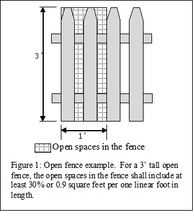

# 6-1 ZONING TITLE, PURPOSE, DEFINITIONS

### 6-1-1: SHORT TITLE

This Title shall be known, cited and referred to as the "City of Naperville Zoning Ordinance".

### 6-1-2: PURPOSE AND INTENT

This Zoning Title is adopted for the purpose of improving and protecting the public health, safety, comfort, convenience and general welfare of the people. The fulfillment of this purpose is to be accomplished by seeking the following objectives:

1\. To lessen congestion on the public streets.

2\. To avoid undue concentration of population.

3\. To prevent the overcrowding of land, thereby insuring proper living and working conditions and preventing the development of blight and slums.

4\. To establish adequate standards for the provision of light, air and open spaces.

5\. To facilitate the provision of adequate public services such as transportation, water, sewerage, open space and parks.

6\. To zone all properties with a view to conserving the value of buildings and encouraging the most appropriate use of land throughout the City.

7\. To protect all areas alike from harmful encroachment by incompatible uses and to insure that land allocated to a class of uses shall not be usurped by inappropriate uses within the parameters of the standards and requirements of this Title.

8\. To avoid the inappropriate development of lands and provide for adequate drainage, curbing or erosion, and reduction of flood damage.

9\. To fix reasonable standards to which buildings and structures shall conform.

10\. To prevent such additions to, and alterations or remodeling of, existing buildings or structures as would not comply with the restrictions and limitations imposed herein.

11\. To foster a more rational pattern of relationship between residential, business and industrial uses for the mutual benefit of all.

12\. To isolate or control the location of unavoidable nuisance-producing uses.

13\. To define the powers and duties of the administrative and enforcement officers and bodies.

14\. To prescribe penalties for any violation of the provisions of this Title, or of any subsequent amendments hereto.

The standards and requirements contained in this Title and the district mapping reflected on the City Zoning District Map are intended to implement all elements of the Comprehensive Plan, including the land use component, and the planning policies of the City.

### 6-1-3: INTERPRETATION

In their interpretation and application, the provisions of this Title shall be held to be the minimum requirements for the promotion of the public health, safety, comfort, convenience and general welfare. Where the conditions imposed by any provision of this Title, upon the use of buildings, structures or land, or upon the bulk of buildings or structures, are either more restrictive or less restrictive than comparable conditions imposed by any other provision of this Title or of any other law, ordinance, resolution, rule or regulation of any kind, the regulations which are more restrictive or which impose higher standards or requirements shall govern.

This Title is not intended to abrogate any easement, covenant or any other private agreement; provided, that where the regulations of this Title are more restrictive or impose higher standards or requirements than such easements, covenants or other private agreements, the requirements of this Title shall govern.

### 6-1-4: SEPARABILITY

The several provisions of this Title are separable, as follows:

1\. If any court of competent jurisdiction shall adjudge any provision of this Title, or any amendment hereto, to be invalid, such judgment shall not affect any other provisions of this Title not specifically included in said judgment.

2\. If any court of competent jurisdiction shall adjudge invalid the application of any provision of this Title, or any amendments hereto, to a particular building, structure or parcel of land, such judgment shall not affect the application of said provision to any other building, structure or parcel of land not specifically included in said judgment.

### 6-1-5: SCOPE OF REGULATIONS

All buildings or structures erected hereafter, all uses of buildings, structures or land established hereafter, and all structural alteration or relocation of existing buildings or structures occurring hereafter shall be subject to all regulations of this Title, or any amendment hereto, which are applicable to the zoning districts in which such buildings, structures or parcels of land shall be located.

(Ord. 80-5, 1-21-1980)

However, where a building permit for a building or structure has been issued in accordance with law prior to the effective date hereof, or any amendment hereto, and provided that construction was begun before the effective date hereof, or any amendment hereto, and completion is accomplished within eighteen (18) months of the adoption of these regulations, or any amendment hereto, said building or structure may be completed in accordance with the approved plans on the basis of which the building permit has been issued, and further, may, upon completion, be occupied for the use for which originally designated, subject thereafter to the provisions of Section 6-2-19 and Chapter 10 of this Title.

(Ord. 80-5, 1-21-1980; amd. 1984 Code)

### 6-1-6: DEFINITIONS

In the construction of this Title the definitions contained in this Section shall be observed and applied, except when the context clearly indicates otherwise. The following definitions of word use shall apply:

1\. Words used in the present tense shall include the future.

2\. Words used in the singular number shall include the plural number and the plural the singular.

3\. The word "shall" is mandatory and not discretionary.

4\. The word "may" is permissive.

5\. The word "lot" shall include the words "piece", "parcel" and "plot".

6\. The phrase "used for" shall include the phrases "maintained for" and "occupied for".

7\. The phrase "designed for" shall include the phrases "arranged for" and "intended for".

8\. All "measured distances" shall be to the nearest foot. If a fraction is one-half foot or less, the full number next below shall be taken.

<table>
<colgroup>
<col style="width: 33%" />
<col style="width: 66%" />
</colgroup>
<thead>
<tr class="header">
<th>ACCESSORY BUILDING OR STRUCTURE:</th>
<th>A subordinate building, structure or portion of the principal building or structure, the use of which is incidental to that of the principal use of the principal building, structure or use of the land.</th>
</tr>
</thead>
<tbody>
<tr class="odd">
<td>ACCESSORY BUILDING OR STRUCTURE, ATTACHED:</td>
<td>An accessory building or structure which is physically connected to the principal building or structure.</td>
</tr>
<tr class="even">
<td>ACCESSORY BUILDING OR STRUCTURE, DETACHED:</td>
<td>An accessory building or structure which is entirely surrounded by open space and separated from the principal building or structure.</td>
</tr>
<tr class="odd">
<td>ACCESSORY USE:</td>
<td>A use incidental to the principal building, structure or use of land.</td>
</tr>
<tr class="even">
<td>AMUSEMENT 
ESTABLISHMENT:</td>
<td>Establishments whose principal use is providing amusement or entertainment for a fee or admission charge. Such establishments include dance halls; theaters and studios; bowling alleys; billiard and pool establishments; and other similar or related uses.</td>
</tr>
<tr class="odd">
<td>APARTMENT HOTEL:</td>
<td>A hotel in which at least ninety percent (90%) of the accommodations are occupied or intended for occupancy by permanent guests.</td>
</tr>
<tr class="even">
<td>APPEAL:</td>
<td>An appeal taken by a person from a decision or interpretation made by the Zoning Administrator.</td>
</tr>
<tr class="odd">
<td>AREA:</td>
<td>The measure of a horizontal plane bounded by the front, side and rear lot lines of a lot or parcel of land, but not including any area occupied by the waters of a duly recorded lake or river.</td>
</tr>
<tr class="even">
<td>AUTOMOBILE REPAIR 
FACILITY:</td>
<td>A building, structure or portion thereof designed or used for the general repair, engine rebuilding, reconditioning, collision service or painting of motor vehicles.</td>
</tr>
<tr class="odd">
<td>AUTOMOBILE SERVICE 
STATION:</td>
<td>A building, structure or parcel of land used for: 1) dispensing, sale or offering for sale at retail to the public gasoline stored only in underground tanks, kerosene, lubricating oil, or grease for the operation of motor vehicles; and 2) the sale and installation of tires, batteries and other minor accessories and services for motor vehicles, but not including major motor vehicle repairs; and 3) washing of motor vehicles by hand.</td>
</tr>
<tr class="even">
<td>BANK:</td>
<td>An organization, chartered by a state or federal government, which conducts retail banking operations on-site, including the receipt of deposits, payment of interest, certification of depositor's checks, issuance of drafts and loans, and withdrawal of cash through tellers or ATMs.</td>
</tr>
<tr class="odd">
<td>BASEMENT:</td>
<td>That portion of a building or structure having more than one-half (½) of its height below lot grade.</td>
</tr>
<tr class="even">
<td>BEAUTY SHOP/SALON:</td>
<td>An establishment (except those known as barbershops or men's hair stylist shops) where people go to receive beauty treatments, and/or purchase beauty products. These treatments primarily include one or more of the following: 1) cutting, trimming, shampooing, weaving, coloring, waving, or styling hair; 2) providing facials; 3) applying makeup (except permanent makeup); and 4) providing nail care services, such as manicures, pedicures, and nail extensions. Spa services may be provided as additional and secondary services, including body art subject to the condition that said body art services shall be accessory to the primary use of the facility as a beauty shop/salon and that the area in which the body art services are provided shall not exceed twenty-five percent (25%) of the gross floor area of the beauty shop/salon.</td>
</tr>
<tr class="odd">
<td>BED AND BREAKFAST 
ESTABLISHMENT:</td>
<td>An operator occupied residence providing accommodations for a charge to the public with no more than five (5) guestrooms for rent, in operation for more than ten (10) nights in a 12-month period. Breakfast may be provided to the guests only. Bed and breakfast establishments shall not include motels, hotels, boarding houses, rooming houses, lodging houses or food service establishments.</td>
</tr>
<tr class="even">
<td> Guestroom:</td>
<td>A sleeping room intended to serve no more than two (2) transient guests per night.</td>
</tr>
<tr class="odd">
<td> Operator:</td>
<td>The owner of the bed and breakfast establishment, or the owner's agent, who is required by the Illinois Bed and Breakfast Act, 50 Illinois Compiled Statutes 820/1 et seq., to reside in the bed and breakfast establishment or on contiguous property.</td>
</tr>
<tr class="even">
<td> Transient Guest:</td>
<td>A person who pays for the right to occupy a bed and breakfast guestroom and for whom the guestroom is not a place of permanent residence.</td>
</tr>
<tr class="odd">
<td>BOARD:</td>
<td>As referred to in this Title as the Board of Zoning Appeals, or the Zoning Board of Appeals.</td>
</tr>
<tr class="even">
<td>BOARDING HOUSE:</td>
<td>A building, structure or portion thereof which contains boarding rooms for rent in which occupants reside in separate living spaces under individual rental arrangements and for varying periods of time. Some services, such as laundry and cleaning, may be supplied. The presence of certain structural features to the dwelling unit shall constitute prima facie evidence that the structure is operating as a boarding house, including, but not limited to:</td>
</tr>
<tr class="odd">
<td></td>
<td>(1) separate double key or other locking mechanisms on internal individual occupant spaces which have the purpose of preventing access while the room is not occupied; or</td>
</tr>
<tr class="even">
<td></td>
<td>(2) multiple mailboxes on the house or property; or</td>
</tr>
<tr class="odd">
<td></td>
<td>(3) locked or partitioned inside stairwells or doors physically separating parts of the house; or</td>
</tr>
<tr class="even">
<td></td>
<td>(4) separate electrical meters; or</td>
</tr>
<tr class="odd">
<td></td>
<td>(5) separate kitchens or food preparation appliances in individual occupant spaces; or</td>
</tr>
<tr class="even">
<td></td>
<td>(6) multiple exterior entrances to individual occupant spaces in addition to the common entrance; or</td>
</tr>
<tr class="odd">
<td></td>
<td>(7) lack of access to common living spaces which accommodate residents for a household purpose (i.e., living room, kitchen).</td>
</tr>
<tr class="even">
<td></td>
<td>Except as provided above, a boarding house does not encompass a situation where a property owner rents a residential structure through provision of a single lease to tenants who intend to occupy it as a shared home for an extended duration.</td>
</tr>
<tr class="odd">
<td>BOARDING ROOM:</td>
<td>This term refers to a room within a principal residential structure that is rented as sleeping and living quarters, but without cooking facilities in the room and with or without an individual bathroom, which provides access to common areas of the home including the entry, living, kitchen and bathroom areas and does not possess characteristics of a boarding house.</td>
</tr>
<tr class="even">
<td>BODY ART ESTABLISHMENT:</td>
<td>A facility licensed by the Illinois Department of Public Health to administer body art, including body piercing, artistic and cosmetic tattooing, and permanent makeup, as defined in Chapter 7 (Body Art, Tattooing, and Body Piercing) of Title 4 (Health and Sanitation) of the Naperville Municipal Code.</td>
</tr>
<tr class="odd">
<td>BUILDING:</td>
<td>Any structure built, used, designed or intended for the support, shelter, protection or enclosure of persons, animals, chattels or property of any kind, and which is permanently affixed to the land.</td>
</tr>
<tr class="even">
<td>BUILDING, NONCONFORMING:</td>
<td>A building which exists upon the effective date of adoption or amendment of this Title and which does not comply with the conditions, area requirements, lot width requirements, yard requirements, height limitations, bulk regulations or off street parking and loading requirements of the zoning district in which said building is located by reason of the adoption or amendment of this Title.</td>
</tr>
<tr class="odd">
<td>BUILDING, PRINCIPAL:</td>
<td>A building or structure in which a principal use is conducted.</td>
</tr>
<tr class="even">
<td>BUILDING, TEMPORARY:</td>
<td>A building not designed or intended for permanent human occupancy nor for the permanent protection of animals, chattels or property of any kind.</td>
</tr>
<tr class="odd">
<td>BULK:</td>
<td>The term used to describe the size of buildings or structures, and their relationships to each other and to open areas and lot lines, and therefore includes:</td>
</tr>
<tr class="even">
<td></td>
<td>1. The size of a building or structure; and</td>
</tr>
<tr class="odd">
<td></td>
<td>2. The area of the lot upon which a building or structure is located, and the number of dwelling units within such building or structure in relation to the area of the lot; and</td>
</tr>
<tr class="even">
<td></td>
<td>3. The shape of a building or structure; and</td>
</tr>
<tr class="odd">
<td></td>
<td>4. The location of exterior walls of a building or structure in relation to lot lines, to other walls of the same building or structure, to legally required windows, or to other buildings or structures; and</td>
</tr>
<tr class="even">
<td></td>
<td>5. All open areas relating to a building or structure and their relationship thereto.</td>
</tr>
<tr class="odd">
<td>BYPASS LANE:</td>
<td>A lane that facilitates the movement of traffic by allowing motorists to avoid or bypass the stacking lane.</td>
</tr>
<tr class="even">
<td>CANNABIS FACILITIES:</td>
<td>Those facilities defined in Section 6-2-32 (Cannabis Facilities) of this Title.</td>
</tr>
<tr class="odd">
<td>CAR WASH:</td>
<td>A building, structure or portion thereof containing facilities for washing motor vehicles.</td>
</tr>
<tr class="even">
<td>CARRYOUT 
ESTABLISHMENTS:</td>
<td>A building, structure or portion thereof which is maintained, operated, advertised or held out to the public as a place where food, beverages, or desserts are served in disposable containers or wrappers from a serving counter for consumption off the premises. These establishments often provide drive-through facilities.</td>
</tr>
<tr class="odd">
<td>CENTRAL BUSINESS 
DISTRICT:</td>
<td>Whenever the term "central business district" is used, it shall mean the downtown core.</td>
</tr>
<tr class="even">
<td>CLUB:</td>
<td>A nonprofit corporation or association of persons for the promotion of some common purpose, including, but not limited to, literature, science, politics, and good fellowship.</td>
</tr>
<tr class="odd">
<td>COLLEGE OR UNIVERSITY:</td>
<td>An institution of higher education accredited by a regional organization or authorized by the State to issue baccalaureate, graduate, and professional level degrees.</td>
</tr>
<tr class="even">
<td>COMMERCIAL ART STUDIO:</td>
<td>An establishment engaged in the sale or exhibit of artworks such as paintings, sculpture, macrame, knitted goods, stitchery, or pottery. The studios are also engaged in the creations of such artworks and often offer instruction in their creation.</td>
</tr>
<tr class="odd">
<td>COMMISSION:</td>
<td>As referred to in this Title is the Plan Commission.</td>
</tr>
<tr class="even">
<td>CONDITIONS AND 
RESTRICTIONS:</td>
<td>Provisions and limitations which may be imposed upon a building, structure or parcel of land at the time the City Council grants a variance, amendment or conditional use.</td>
</tr>
<tr class="odd">
<td>CONVALESCENT HOME:</td>
<td>A building or structure which is used, designed or intended for the care of the aged or infirm, or for those suffering bodily disorders and which does not contain the facilities nor render the services normally associated with a hospital.</td>
</tr>
<tr class="even">
<td>CROSS DOCKS:</td>
<td>The practice of unloading goods from inbound delivery vehicles and loading them directly onto outbound vehicles.</td>
</tr>
<tr class="odd">
<td>CULTURAL INSTITUTIONS:</td>
<td>Establishments such as museums, botanical, and zoological gardens of a historic, educational or cultural interest, or art galleries which are operated primarily for the display, rather than the sale, of works of art.</td>
</tr>
<tr class="even">
<td>DATA CENTER:</td>
<td>A large group of networked computer servers typically used by organizations for the remote storage, processing, or distribution of large amounts of data.</td>
</tr>
<tr class="odd">
<td>DAY:</td>
<td>Day, unless otherwise specified, shall mean business day. A business day shall mean any day other than a Saturday, Sunday, or a Federal holiday. If the date for taking any action in this Title falls on a Saturday, Sunday, or Federal holiday, then the notice or obligation may be given or performed on the next business day after that Saturday, Sunday, or Federal holiday.</td>
</tr>
<tr class="even">
<td>DAYCARE CENTER:</td>
<td>A facility as described in Section 2.09 of the Childcare Act of 19691, as amended.</td>
</tr>
</tbody>
</table>
<aside id="footnotes" class="footnotes footnotes-end-of-document" role="doc-endnotes">

<ol>
<li id="fn1">
 225 ILCS 10/2.09.<a href="#fnref1" class="footnote-back" role="doc-backlink">↩︎</a>
</li>
</ol>
</aside>

| DAYCARE HOME: | A facility as described in Section 2.18 of the Childcare Act of 1969[^1], as amended. |
|---------------|---------------------------------------------------------------------------------------|

<table>
<colgroup>
<col style="width: 36%" />
<col style="width: 63%" />
</colgroup>
<thead>
<tr class="header">
<th>DECIBEL:</th>
<th>A logarithmic unit of measurement which defines the range of sound pressure levels (Lp) between the minimum audible value at one thousand (1,000) cps and the maximum audible value of Lp, at which effects, other than hearing, begin to appear.</th>
</tr>
</thead>
<tbody>
<tr class="odd">
<td>DISTRICT BOUNDARY LINE:</td>
<td>A line which marks the separation between two (2) zoning districts.</td>
</tr>
<tr class="even">
<td>DISTRICT, BUSINESS:</td>
<td>Any one of the following zoning districts: B1, B2, B3, B4, B5, OCI.</td>
</tr>
<tr class="odd">
<td>DISTRICT, INDUSTRIAL:</td>
<td>Any one of the following zoning districts: RD, ORI, I.</td>
</tr>
<tr class="even">
<td>DISTRICT, RESIDENCE:</td>
<td>Any one of the following zoning districts: R1A, R1B, R2, R3, R4, R5, E1, E2, AG.</td>
</tr>
<tr class="odd">
<td>DISTRICT, ZONING:</td>
<td>A portion of the corporate area of the City within which certain regulations and requirements, or various combinations thereof, apply under the provisions of this Title.</td>
</tr>
<tr class="even">
<td>DONATION BOX:</td>
<td>An unattended container, receptacle, or similar device that is used for soliciting and collecting donations of clothing or other salvageable personal property. This term does not include any unattended donation box located within a building, which is permitted by right.</td>
</tr>
<tr class="odd">
<td>DORMITORY:</td>
<td>A building or structure which provides lodging for students attending a school, college, university, educational facility or boarding school and which is operated by the school, college, university, educational facility or boarding school.</td>
</tr>
<tr class="even">
<td>DRINKING ESTABLISHMENT:</td>
<td>A building, structure or portion thereof where liquors are sold to be consumed on the premises, but not including eating establishments where the principal use is serving food.</td>
</tr>
<tr class="odd">
<td>DRIVE-IN ESTABLISHMENT:</td>
<td>A business which is operated for the sale and purchase at retail of food and other goods, services or entertainment and which is designed and equipped so as to allow patrons to be served or accommodated while remaining in their automobiles.</td>
</tr>
<tr class="even">
<td>DRIVE-THROUGH FACILITIES:</td>
<td>A place of business which through design, physical facilities, service, or packaging procedures, encourages or permits customers to receive services, obtain goods, or be entertained while remaining in their motor vehicles.</td>
</tr>
<tr class="odd">
<td>DRY CLEANING 
ESTABLISHMENT:</td>
<td>A business which handles on the premises the washing, drying, dry cleaning and ironing of clothes, including pick up and delivery services.</td>
</tr>
<tr class="even">
<td>DUPLEX:</td>
<td>A detached or semidetached building or structure containing two (2) dwelling units designed for and occupied by two (2) families.</td>
</tr>
<tr class="odd">
<td>DWELLING:</td>
<td>A building, structure or portion thereof designed or used exclusively for residential occupancy, including single-family detached dwellings, two-family dwellings, duplexes, single-family attached dwellings, multiple-family dwellings, boarding, lodging and rooming houses, dormitories, and apartment hotels, but excluding cabins, tents, hotels, motels, trailers and recreational vehicles.</td>
</tr>
<tr class="even">
<td>DWELLING, MULTIPLE-FAMILY:</td>
<td>A building, structure or portion thereof containing three (3) or more dwelling units where the units are primarily connected vertically.</td>
</tr>
<tr class="odd">
<td>DWELLING, SINGLE-FAMILY ATTACHED (TOWNHOUSE):</td>
<td>A building, structure or portion thereof containing three (3) or more attached single-family dwellings where the units are primarily connected horizontally and are not more than two (2) dwelling units deep.</td>
</tr>
<tr class="even">
<td>DWELLING, SINGLE-FAMILY DETACHED:</td>
<td>A building or structure containing one dwelling unit which is entirely surrounded by open space, but not including mobile homes.</td>
</tr>
<tr class="odd">
<td>DWELLING, TEAR DOWN 
OR INFILL SINGLE-FAMILY 
DETACHED:</td>
<td>A single-family detached dwelling unit or duplex which meets the criteria of Section 6-2-26 of this Title.</td>
</tr>
<tr class="even">
<td>DWELLING UNIT:</td>
<td>A room or group of rooms forming a single habitable unit with facilities that are used or intended to be used for living, sleeping, cooking and/or eating.</td>
</tr>
<tr class="odd">
<td>EATING ESTABLISHMENT:</td>
<td>A building, structure or portion thereof within which food is offered for sale and which permits consumption within the building or structure.</td>
</tr>
<tr class="even">
<td>FAMILY:</td>
<td>An individual or two (2) or more persons related by blood, marriage or legal adoption living together as a single housekeeping unit within a dwelling unit including foster children and domestic servants. Family shall also include two (2) unrelated persons, and shall include senior citizens' group homes as defined in this Title.</td>
</tr>
<tr class="odd">
<td>FARMING:</td>
<td>The use of land for agricultural purposes, including agriculture, floriculture, forestry, grazing of dairy animals, greenhouses, hatcheries, horticulture, nurseries, orchards, paddocks, truck farming, viticulture, and raising of furbearing animals and poultry.</td>
</tr>
<tr class="even">
<td>FAST FOOD 
ESTABLISHMENTS:</td>
<td>Eating establishments whose principal business is the preparation of food for immediate sale and consumption, generally served in disposable containers and wrappers, where orders are placed and picked up by patrons at the sales window(s), counter(s) or service area(s) for consumption on or off the premises, where seating is normally without full time waiter service. These establishments often provide drive-through facilities.</td>
</tr>
<tr class="odd">
<td>FENCE:</td>
<td>A structure which is used as a boundary or means of protection or confinement and which is made of manufactured material or natural growth.</td>
</tr>
<tr class="even">
<td>FINANCIAL INSTITUTIONS:</td>
<td>Private or public organizations that act as a channel between investors and borrowers of funds with primary services such as financial advising, brokerage, and investment. Customer activities are typically by appointment as compared to convenience-based retail bank operations.</td>
</tr>
<tr class="odd">
<td>FITNESS FACILITY:</td>
<td>A place of business with equipment, amenities, services, or classes intended for active, passive, or recreational fitness activities. Fitness facilities may, but are not required to, provide specialized instruction, training, or assistance to those utilizing the facility.</td>
</tr>
<tr class="even">
<td>FLOOR AREA:</td>
<td>The sum of the gross horizontal areas of the several floors of a building or structure measured from the exterior faces of the exterior walls or from the centerline of walls separating two (2) buildings or structures. The "floor area" of a building or structure shall include: basement floor area, elevator shafts, stairwells, floor space used for mechanical equipment (except equipment open or enclosed located on the roof), penthouses, attic space having headroom of seven (7) feet or more, interior balconies and mezzanines, enclosed porches, floor area devoted to accessory uses, accessory storage areas located within selling or working space such as counters, racks or closets, and space devoted to retaining activities, to the production or processing of goods, or to business or professional offices.</td>
</tr>
<tr class="odd">
<td></td>
<td>The term "floor area" shall not include any space devoted to off street parking or loading.</td>
</tr>
<tr class="even">
<td></td>
<td>The "floor area" of structures devoted to bulk storage of materials, including, but not limited to, grain elevators and petroleum storage tanks, shall be determined on the basis of height in feet, i.e., ten (10) feet in height shall equal one foot. For determining the floor area ratio in the B4, B5 and OCI districts, the term "floor area" shall not include the basement floor area used for the principal purpose of storage of goods or materials.</td>
</tr>
<tr class="odd">
<td>FLOOR AREA RATIO (FAR):</td>
<td>The numerical value obtained by dividing the floor area within a building or structure on a lot by the area of such lot. The floor area ratio, as specified for each zoning district, when multiplied by the area of the lot in square feet, shall determine the maximum permissible floor area for the building or structure on the lot.</td>
</tr>
<tr class="even">
<td>FOOTPRINT OF PRINCIPAL STRUCTURE:</td>
<td>The area within the perimeter of a principal building measured at the foundation, including attached roofed accessory structures and cantilevered portions of a building. Building footprint excludes ordinary roof projections, single-story porches, uncovered structures and detached accessory structures.</td>
</tr>
<tr class="odd">
<td>FRATERNITY:</td>
<td>A building or structure which is used and occupied by a group of students attending a college or university and which provides domestic and social facilities and services thereto.</td>
</tr>
<tr class="even">
<td>FREIGHT TERMINAL:</td>
<td>A building, structure, parcel of land or portion thereof in which: 1) freight is shipped by airplane, motor truck or railroad; or 2) freight is received, assembled, sorted and/or rerouted for local, intrastate or interstate shipment.</td>
</tr>
<tr class="odd">
<td>FREQUENCY:</td>
<td>Signifies the number of oscillations per second in a sound wave and is an index of the pitch of the resulting sound.</td>
</tr>
<tr class="even">
<td>FRONTAGE:</td>
<td>The line of demarcation between private property and that which opens to the general use of the public, such as a street, alley, stream or park. When two (2) or more sides of a parcel of property face or abut upon streets, alleys, streams or parks, it shall be deemed to have frontage on all sides.</td>
</tr>
<tr class="odd">
<td>FULFILLMENT CENTER:</td>
<td>A facility that receives shipments of stock, stores and tracks warehouse inventory, and picks and packs orders to ship to customers. Facilities may provide such services for multiple companies and may also be referred to as a third-party logistics facility, fulfillment company, or fulfillment warehouse.</td>
</tr>
<tr class="even">
<td>GAME COURT:</td>
<td>An accessory structure intended for private recreational use having a permanent or removable playing surface which is not part of a driveway.</td>
</tr>
<tr class="odd">
<td>GRADE:</td>
<td>The average level of the finished surface of the ground adjacent to the exterior walls of the building or structure.</td>
</tr>
<tr class="even">
<td>GUEST, PERMANENT:</td>
<td>A person who occupies or has the right to occupy an apartment hotel accommodation as their domicile and place of permanent residence.</td>
</tr>
<tr class="odd">
<td>HEALTH SPA WITHOUT 
LODGING ACCOMMODATION/ 
MASSAGE ESTABLISHMENT:</td>
<td>A nurturing, safe, clean commercial establishment, which employs professional licensed therapists or utilizes mechanical equipment whose services include massage and body or facial treatments. Private treatment rooms are provided for each client receiving a personal service. Massage treatments may include body packs and wraps, exfoliation, cellulite and heat treatments, electrolysis, body toning, waxing, aromatherapy, cleansing facials, medical facials, nonsurgical facelifts, electrical toning, and electrolysis. Hydrotherapy and steam and sauna facilities, nutrition and weight management, spa cuisine, and exercise facilities and instruction may be provided in addition to the massage and therapeutic treatment services. Full service hair salons, makeup consultation and application and manicure and pedicure services may be provided as additional services. Body art services may be provided as an additional service subject to the condition that said body art services shall be accessory to the primary use of the facility as a health spa/massage establishment and that the area in which the body art services are provided shall not exceed twenty-five percent (25%) of the gross floor area of the health spa/massage establishment.</td>
</tr>
<tr class="even">
<td>HEIGHT, BUILDING OR 
STRUCTURE:</td>
<td>Height of a building or structure is the vertical distance measured from a datum point established by the average of the two (2) grades along each side lot line where the front yard line meets the side lot lines to the highest point of the roof surface or parapet, in case of a flat roof; to the deck roofline of a mansard roof; and to the mean level of the underside of the rafters between the eaves and the ridge of a gable, hip or gambrel roof. When determining front yard line, variances shall not be considered.</td>
</tr>
<tr class="odd">
<td>HOME OCCUPATION:</td>
<td>An accessory use of a dwelling unit which is utilized for gainful employment involving the manufacture, provision or sale of commodities and/or services by a member of the family who is residing in the dwelling unit in which the home occupation is being conducted.</td>
</tr>
<tr class="even">
<td>HOSPITAL:</td>
<td>A building or structure which is maintained and operated for the diagnosis, treatment, medical care or surgical care of persons and which is operated overnight or permits overnight lodging for patients.</td>
</tr>
<tr class="odd">
<td>HOTEL:</td>
<td>A building, structure or portion thereof which is used as a temporary abiding place, for remuneration, with or without meals, containing five (5) or more guestrooms or suites where no provision for cooking is made in any individual guestroom or suite, and which provides maid, butler and linen service and which maintains a hotel register.</td>
</tr>
<tr class="even">
<td>HOTEL, FULL SERVICE:</td>
<td>A hotel providing dining, fitness, and meeting accommodations either within a single building or multiple buildings located within a campus setting (defined as a single lot or planned unit development), offering guest services (e.g. room service, laundry and concierge). Direct access to the lobby, common area and rooms is provided via internal corridors.</td>
</tr>
<tr class="odd">
<td>INDEPENDENT SERVICE 
COORDINATION AGENCY:</td>
<td>An agency that promotes service accessibility and continuity of care for developmentally disabled individuals, and seeks to maximize an individual's potential for independence, productivity and community integration. The agency works with developmentally disabled individuals of all ages and their families to identify needed supports and services through the completion of comprehensive assessments.</td>
</tr>
<tr class="even">
<td>INSTITUTION:</td>
<td>An established society or corporation whether created for profit or nonprofit.</td>
</tr>
<tr class="odd">
<td>INSTITUTION, RELIGIOUS:</td>
<td>A building or structure which is occupied by a religious nonprofit corporation or organization and which is operated for public or semipublic use including, but not limited to, churches, synagogues, rectories and convents.</td>
</tr>
<tr class="even">
<td>INTERNET CAFE:</td>
<td>A place where one can use a computer with internet access for a fee, usually per hour or minute; sometimes one can have unmetered access with a pass for a day or month, etc. While the primary activity in the internet cafe is the internet usage such as e-mail, newsgroup, website surfing, and online games, other services as accessory uses may provide office and business software, fax and printing services, scanning and digital photo services, food and drink services, etc.</td>
</tr>
<tr class="odd">
<td>JUNKYARD:</td>
<td>A parcel of land where waste, scrap, discarded or salvaged materials are bought, sold, exchanged, stored, baled, packed, disassembled or handled, including, but not limited to, scrap iron and other metals, vehicles and machinery in inoperable condition, paper, rags, rubber tires, and bottles. The term "junkyard" includes automobile graveyards, automobile wrecking yards, house wrecking yards and storage areas, and used lumberyards, but does not include uses established entirely within enclosed buildings and structures.</td>
</tr>
<tr class="even">
<td>KENNEL:</td>
<td>A dwelling unit or a nonresidential building, structure, parcel of land or portion thereof in which four (4) or more dogs, cats or other household domestic animals are maintained, boarded, bred, cared for or kept for the purposes of sale, and are housed without continuous observation by veterinary professionals, provided that the kennel service is operated in compliance with standards set forth in Section 6-2-25 of this Title.</td>
</tr>
<tr class="odd">
<td>LABORATORY:</td>
<td>A building, structure or portion thereof which is devoted to experimental study such as testing and analyzing but not including the manufacturing of products for sale either directly or indirectly.</td>
</tr>
<tr class="even">
<td>LANDSCAPE TREATMENTS:</td>
<td>Landscaping and landscape materials include vegetative treatments containing a variety of plant types with the possible inclusion of other ornamental treatments.</td>
</tr>
<tr class="odd">
<td>LEARNING CENTER:</td>
<td>Includes private tutoring services, test preparation centers, drivers' education services, instruction in arts, performing arts, and specialized crafts; and similar educational facilities. Learning centers do not include nursery schools, preschools or daycare centers.</td>
</tr>
<tr class="even">
<td>LIFE SCIENCES FACILITY:</td>
<td>A facility providing offices, research, and laboratory space related to the fields of pharmaceuticals, biotechnology, biomedical technologies, nutraceuticals, cosmeceuticals, and other related fields.</td>
</tr>
<tr class="odd">
<td>LODGE:</td>
<td>A nonprofit corporation or association of persons for the promotion of some common purpose, including, but not limited to, literature, science, politics, and good fellowship.</td>
</tr>
<tr class="even">
<td>LOT:</td>
<td>A parcel of land indicated as such upon a subdivision plat recorded in the office of the county recorder.</td>
</tr>
<tr class="odd">
<td>LOT, CORNER:</td>
<td>A lot of which at least two (2) adjacent sides abut for their full lengths upon street rights-of-way. The point of intersection of the right-of-way lines is the "corner".</td>
</tr>
<tr class="even">
<td>LOT DEPTH:</td>
<td>The average horizontal distance between the front lot line and the rear lot line measured along the side lot lines.</td>
</tr>
<tr class="odd">
<td>LOT LINE, CORNER SIDE:</td>
<td>That boundary of a corner lot which abuts a street right-of-way but is not the front line.</td>
</tr>
<tr class="even">
<td>LOT LINE, FRONT:</td>
<td>That boundary of a lot which is along a street right-of-way. For landlocked or partially landlocked parcels of land, the front lot line is that lot line that faces the access to the lot.</td>
</tr>
<tr class="odd">
<td>LOT LINE, INTERIOR SIDE:</td>
<td>A boundary of a lot which does not abut a street right-of-way and which is not a front or rear lot line.</td>
</tr>
<tr class="even">
<td>LOT LINE, REAR:</td>
<td>That boundary of a lot which is most distant from and is, or is most nearly, parallel to the front lot line.</td>
</tr>
<tr class="odd">
<td>LOT LINE, SIDE:</td>
<td>An interior lot line which is not a front lot line or a rear lot line. If it is located along a public street, it shall be deemed a corner side lot line.</td>
</tr>
<tr class="even">
<td>LOT LINES:</td>
<td>The lines bounding a lot.</td>
</tr>
<tr class="odd">
<td>LOT WIDTH:</td>
<td>The horizontal distance between the side lot lines measured at the front yard line as established by this Title.</td>
</tr>
<tr class="even">
<td>LOT, ZONING:</td>
<td>A parcel of land indicated as such upon a subdivision or assessment plat recorded in the office of the county recorder.</td>
</tr>
<tr class="odd">
<td>MOBILE HOME:</td>
<td>A dwelling unit designed to be transported on streets to the place where it is to be occupied as a dwelling unit complete and ready for year round and permanent occupancy attached to a permanent foundation except for minor and incidental unpacking and assembly operations.</td>
</tr>
<tr class="even">
<td>MOBILE HOME LOT:</td>
<td>A lot designed within a mobile home park for the location of one mobile home.</td>
</tr>
<tr class="odd">
<td>MOBILE HOME PARK:</td>
<td>A parcel or tract of land subdivided into mobile home lots and developed with facilities for locating mobile homes.</td>
</tr>
<tr class="even">
<td>MODEL HOME:</td>
<td>A building or structure which is used as an example of the type of dwelling unit which may be purchased or rented.</td>
</tr>
<tr class="odd">
<td>MOTEL:</td>
<td>A series of attached, semiattached or detached guestrooms or suites for the accommodation primarily of automobile transient guests which does not include individual cooking or kitchen facilities and which provides the unit with convenient access to off street parking spaces for the exclusive use of the guests or occupants of the premises.</td>
</tr>
<tr class="even">
<td>MOTOR VEHICLE:</td>
<td>Any self-propelled wheeled conveyance that does not run on rails and that carries passengers, goods and equipment.</td>
</tr>
<tr class="odd">
<td>NOTICE OF APPEAL:</td>
<td>The notice given by a person seeking an appeal from a decision or interpretation made by the Zoning Administrator.</td>
</tr>
<tr class="even">
<td>NURSERY SCHOOL:</td>
<td>An instructional facility for preschool children.</td>
</tr>
<tr class="odd">
<td>NURSING HOME:</td>
<td>A building or structure which is used, designed or intended for the care of the aged or infirm, or for those suffering bodily disorders and which does not contain the facilities nor render the services normally associated with a hospital, or facilities which are defined and regulated by the Nursing Home Care Reform Act of 1979, as amended.</td>
</tr>
<tr class="even">
<td>OCTAVE BAND:</td>
<td>A means of dividing the range of sound frequencies into octaves in order to classify sound according to pitch.</td>
</tr>
<tr class="odd">
<td>ODOR THRESHOLD:</td>
<td>The minimum concentration of odorous matter in the air that can be detected as an odor.</td>
</tr>
<tr class="even">
<td>OFF STREET LOADING DOCK:</td>
<td>An area of a building where goods are loaded and unloaded from a vehicle (road or rail); may also be referred to as an off street loading bay.</td>
</tr>
<tr class="odd">
<td>OFF STREET PARKING OR LOADING FACILITY:</td>
<td>A building, structure, parcel of land, or portion thereof which provides off street parking spaces or off street loading berths and including accessways, driveways and aisles and which is either a principal or accessory use.</td>
</tr>
<tr class="even">
<td>OFF STREET PARKING SPACE OR LOADING BERTH:</td>
<td>An open, hard surfaced area of land, other than a right-of-way, an access, a driveway or an aisle and the principal use of which is for the standing, loading and unloading of motor vehicles.</td>
</tr>
<tr class="odd">
<td>OFFICE/CLINIC, MEDICAL OR DENTAL:</td>
<td>A building, structure or portion thereof which is maintained or operated for the diagnosis, treatment, medical care or surgical care of persons. Medical or dental offices/clinics shall not include facilities operated overnight. Body art services may be provided at a medical office/clinic subject to the condition that said services shall be accessory to the primary use of the facility as a medical office/clinic and that the area in which the body art services are provided shall not exceed twenty-five percent (25%) of the gross floor area of the medical office/clinic.</td>
</tr>
<tr class="even">
<td>ON SITE MOBILE STORAGE CONTAINER:</td>
<td>A movable, fully enclosed container which is used for the temporary storage of household or business items not related to construction activity for a limited period of time not to exceed an aggregate of thirty (30) consecutive days.</td>
</tr>
<tr class="odd">
<td>OPACITY:</td>
<td>The quality or state of an object that renders it impervious to the rays of light; the degree of nontransparency.</td>
</tr>
<tr class="even">
<td>OPEN FENCE:</td>
<td>A fence, including gates, which has, for each one (1) foot wide segment extending over the entire length and height of the fence, at least thirty percent (30%) of the surface area in open spaces which afford direct views through the fence. (See Figure 1)</td>
</tr>
<tr class="odd">
<td></td>
<td></td>
</tr>
<tr class="even">
<td>OPEN SPACE:</td>
<td>That portion of a lot or parcel of land unoccupied by buildings, structures, rights-of-way and off street parking or loading facilities.</td>
</tr>
<tr class="odd">
<td>OPEN SPACE, COMMON:</td>
<td>Land within or related to a development, not in individually owned lots or dedicated for public use, but which is improved, designed, and intended for the common use or enjoyment of the residents or occupants of the development. Common open space does not include the following: areas reserved for the exclusive use or benefit of an individual occupant; dedicated streets, alleys, or other public rights-of-way; or vehicular drives, private streets, parking, loading and storage areas. However, areas of recreational activities including, but not limited to, playgrounds, swimming pools, tennis courts, and walking or jogging trails may be included as common open space.</td>
</tr>
<tr class="even">
<td>OSTEOPATH:</td>
<td>Includes any person licensed to practice osteopathic medicine.</td>
</tr>
<tr class="odd">
<td>PARKING GARAGE, 
ACCESSORY:</td>
<td>An accessory building or structure or an accessory portion of the principal building or structure which is intended and used for the storage of private motor vehicles owned by members of the family or families residing upon the premises or by the owners or patrons of the business or industrial uses. For residential land uses, an attached parking garage shall be considered as part of the footprint of a principal structure in calculation of lot coverage.</td>
</tr>
<tr class="even">
<td>PARKING GARAGE, 
PRINCIPAL:</td>
<td>A principal building or structure which is intended and used for the storage of motor vehicles pursuant to previous arrangements or to transients, and where no equipment, parts, fuel, grease or oil is sold and vehicles are not equipped, serviced, repaired, hired or sold.</td>
</tr>
<tr class="odd">
<td>PARKING LOT, ACCESSORY:</td>
<td>An open, hard surfaced area, other than a right-of-way, which is accessory to the principal use of the lot and which is intended and used for the storage of private motor vehicles owned by members of the family or families residing upon the premises or by the owners, employees or patrons of the business or industrial uses.</td>
</tr>
<tr class="even">
<td>PARKING LOT, BICYCLE:</td>
<td>An area, other than a public right-of-way, which is intended and used for the storage of bicycles.</td>
</tr>
<tr class="odd">
<td>PARKING LOT, PRINCIPAL:</td>
<td>An open, hard surfaced area, other than a right-of-way, which is the principal use of the parcel of land and which is intended and used for the storage of motor vehicles pursuant to previous arrangements or to transients, and where no equipment, parts, fuel, grease or oil is sold and vehicles are not equipped, serviced, repaired, hired or sold.</td>
</tr>
<tr class="even">
<td>PARKING, RESERVOIR:</td>
<td>Off street parking spaces allocated to motor vehicles awaiting entrance to a drive-in establishment.</td>
</tr>
<tr class="odd">
<td>PARTICULATE MATTER:</td>
<td>Material which is suspended in or discharged into the atmosphere in finely divided form as a liquid or solid such as dust.</td>
</tr>
<tr class="even">
<td>PERFORMANCE STANDARDS:</td>
<td>Criteria established to control noise, odor, glare, exterior lighting, vibration, smoke, particulate matter, gases, fire and explosion hazards, and wastes generated by or inherent in uses of buildings, structures or land.</td>
</tr>
<tr class="odd">
<td>PERSON:</td>
<td>Person shall mean individuals, partnerships, associations, corporations, limited liability companies, trusts, land trusts, governmental bodies, and any other form of business or not for profit organization, or one or more of them.</td>
</tr>
<tr class="even">
<td>PET CARE ESTABLISHMENT:</td>
<td>A building, structure or portion thereof designed or used for the boarding, daycare or kenneling of dogs, cats or other household domestic animals. Pet care establishments as an accessory use shall be defined as any pet care establishment which is subordinate and incidental to the principal permitted use of the building, structure or premises.</td>
</tr>
<tr class="odd">
<td>PET GROOMING AND 
TRAINING 
ESTABLISHMENT:</td>
<td>A building, structure or portion thereof designed or used for the grooming or training of dogs, cats or other household domestic animals. Outdoor areas are not permitted.</td>
</tr>
<tr class="even">
<td>PETITION:</td>
<td>A petition requesting action by the Planning and Zoning Commission and/or the City Council, including: rezoning, conditional uses, variances, planned unit development, and text amendments.</td>
</tr>
<tr class="odd">
<td>PETITIONER:</td>
<td>Any person who files a petition as provided herein.</td>
</tr>
<tr class="even">
<td>PHOTOGRAPHY STUDIO:</td>
<td>A workspace to take, develop, print and duplicate photographs. Photographic training and the display of finished photographs may also be accommodated in a photography studio.</td>
</tr>
<tr class="odd">
<td>PHYSICIAN:</td>
<td>Includes any person licensed to practice medicine.</td>
</tr>
<tr class="even">
<td>PILOT PLANT:</td>
<td>A building or structure used for the testing of commercial or industrial processes and products and for the manufacturing of products for testing purposes.</td>
</tr>
<tr class="odd">
<td>PLANNED UNIT:</td>
<td>A parcel of land which is of sufficient size to create its own environment and which is under single ownership or unified control and which may be granted waivers from specific land use regulations and design standards in order to accomplish the purposes of the planned unit development regulations as specified in Chapter 4 of this Title.</td>
</tr>
<tr class="even">
<td>PREMISES:</td>
<td>A parcel of land and all buildings and structures thereon.</td>
</tr>
<tr class="odd">
<td>PRESCHOOL:</td>
<td>An instructional facility for preschool children.</td>
</tr>
<tr class="even">
<td>PROPERTY LINES:</td>
<td>The lines bounding a lot.</td>
</tr>
<tr class="odd">
<td>PUBLIC OR PRIVATE UTILITY FACILITY:</td>
<td>A building, structure or use of land which provides, under public regulations, electricity, gas, steam, telephone, communications, transportation, sewer or water and which is operated by a person, firm or corporation authorized to furnish such services.</td>
</tr>
<tr class="even">
<td>RESIDENTIAL CARE:</td>
<td>Maintenance (room and board), oversight, general watchfulness, and other appropriate services to meet the needs of residents including, but not limited to, social, recreational, medical, employment, educational, rehabilitative and other therapeutic services enhanced by being provided to individuals with a common and related need for such services in a family like environment in a residential care home.</td>
</tr>
<tr class="odd">
<td>RESIDENTIAL CARE HOME:</td>
<td>Any dwelling unit or living quarters wherein individuals are provided residential care. Where a sponsoring agency of the residential care home is required to be licensed or certified by the State, that sponsoring agency must maintain at all times a current and valid Illinois State license or certification by the State to operate residential care homes. A residential care home does not include a nursing home, hospital, adult daycare center, child daycare center or a dwelling unit or living quarters which serves to house persons as an alternative to incarceration for a criminal offense.</td>
</tr>
<tr class="even">
<td>RESIDENTIAL CARE UNIT:</td>
<td>A second dwelling unit located on a residential lot in a single-family residence district to provide housing for a residential care unit qualifying individual, or to serve as a residential care home for residential care unit qualifying individuals.</td>
</tr>
<tr class="odd">
<td>RESIDENTIAL CARE UNIT QUALIFYING INDIVIDUAL:</td>
<td>An individual who has been screened and is determined eligible for services by an independent service coordination agency. This eligibility shall substantiate that joint occupancy of a residential lot is medically necessary and/or beneficial. Individuals suffering from drug addiction, alcoholism, or similar chemical dependency or substance abuse condition do not qualify.</td>
</tr>
<tr class="even">
<td>RETAIL, GENERAL:</td>
<td>Uses provide for the general sale of merchandise (e.g. apparel, pet supplies, books, home decor) directly to customers.</td>
</tr>
<tr class="odd">
<td>RIGHT-OF-WAY:</td>
<td>Any existing or dedicated sidewalk, street, alley, highway or other thoroughfare.</td>
</tr>
<tr class="even">
<td>RINGELMANN CHART:</td>
<td>A chart which is described in the U.S. Bureau of Mines information circular 8333, and on which are illustrated graduated shades of gray for use in estimating the light obscuring capacity of smoke and smoke density.</td>
</tr>
<tr class="odd">
<td>RINGELMANN NUMBER:</td>
<td>The number of the area on the Ringelmann chart that coincides most nearly with the visual density of emission or the light obscuring capacity of the smoke.</td>
</tr>
<tr class="even">
<td>SCHOOL, PRIMARY 
OR SECONDARY:</td>
<td>An elementary school, middle school, junior high school, or senior high school, either public or private, which offers systematic academic instruction in any branch or branches of knowledge. Primary and secondary schools do not include training studios, trade or vocational schools or student learning centers.</td>
</tr>
<tr class="odd">
<td>SCHOOL, TRADE 
OR VOCATIONAL:</td>
<td>A school which offers career based instruction in skilled subjects such as computer repair, network development, graphic design, multimedia, arts, shorthand, carpentry, drafting and automobile mechanics as part of a certificate or degree program.</td>
</tr>
<tr class="even">
<td>SCREENING:</td>
<td>Screening shall constitute any object that blocks the ground level view of the satellite installation year round.</td>
</tr>
<tr class="odd">
<td>SENIOR CITIZENS' GROUP HOME:</td>
<td>A residential dwelling unit or units maintained as a single housekeeping unit and occupied by persons sixty-two (62) years of age or older, spouses of such persons who may be under sixty-two (62) years of age, and resident employees who may be under sixty-two (62) years of age; but not including convalescent homes, nursing homes, hospitals, or facilities which are defined and regulated by the Nursing Home Care Reform Act of 1979, as amended1.</td>
</tr>
</tbody>
</table>
<aside id="footnotes" class="footnotes footnotes-end-of-document" role="doc-endnotes">

<ol>
<li id="fn1">
 210 ILCS 45/1-101 et seq.<a href="#fnref1" class="footnote-back" role="doc-backlink">↩︎</a>
</li>
</ol>
</aside>

<table>
<colgroup>
<col style="width: 36%" />
<col style="width: 63%" />
</colgroup>
<thead>
<tr class="header">
<th>SERVICES, COMMERCIAL:</th>
<th>The business or occupation of doing convenience work for others for a fee with the services performed on-site and goods available for purchase on-site. Commercial services depend on visibility to attract walk-in customers. Examples of commercial service uses include banks, barbershops, beauty shops/salons, dry cleaning, shoe repair, tailor shops, photography studios. Accessory retail is allowed, up to a maximum of twenty-five percent (25%) of the customer area, in conjunction with permitted commercial service uses.</th>
</tr>
</thead>
<tbody>
<tr class="odd">
<td>SERVICES, GENERAL:</td>
<td>The business or occupation of doing work for others for a fee with a primary business, office, showroom or training component. General services are typically scheduled by appointment. Uses include business, professional, medical or dental offices, workrooms or studios of artists, authors, interior designers, sculptors or other trades people, instruction in music, dance, fitness, home crafts and art, showroom and meeting/conference space, health spas without lodging facilities/massage establishments, and similar uses. Accessory retail is allowed, up to a maximum of ten percent (10%) of the customer area, in conjunction with permitted general service uses.</td>
</tr>
<tr class="even">
<td>SEXUALLY ORIENTED 
BUSINESS:</td>
<td>Any premises to which the public, patrons or members are invited or admitted and which is so physically arranged as to provide booths, cubicles, rooms, compartments, or stalls separate from the common areas of the premises for the purpose of viewing adult oriented motion pictures, or wherein an entertainer provides adult entertainment to a member of the public, a patron, or a member, when such adult entertainment is held, conducted, operated or maintained for a profit, direct or indirect. A sexually oriented business further includes, without being limited to, any adult store, adult motion picture theaters, adult mini-motion picture establishments, adult cabaret, adult entertainment studio, or any premises that is physically arranged and used as such, whether advertised or represented as an adult entertainment studio, rap studio, exotic dance studio, encounter studio, sensitivity studio, modeling studio or any other term of like import.</td>
</tr>
<tr class="odd">
<td>SHOPPING CENTER:</td>
<td>An integrated and harmonious design of a building or structure or buildings or structures in which is located a group of business enterprises and which has adequate and properly arranged facilities for internal traffic circulation, collective off street parking and loading facilities, landscaping, and other features and facilities common to shopping center developments. A shopping center is usually, but not necessarily, planned, developed, owned or managed as a unit.</td>
</tr>
<tr class="even">
<td>SLEEP CLINIC:</td>
<td>A building, structure or portion thereof which is maintained or operated for the diagnosis, treatment, and care of persons suffering from a sleep disorder or comparable medical condition as approved by the Zoning Administrator, rendering overnight operations medically necessary and/or beneficial.</td>
</tr>
<tr class="odd">
<td>SMOKE:</td>
<td>The visible discharge from a chimney, stack, vent, exhaust or combustion process which consists of particulate matter.</td>
</tr>
<tr class="even">
<td>SPECIALTY FOOD 
 
ESTABLISHMENT:</td>
<td>A limited service establishment (without wait staff) that offers specialty snack and food products and/or beverages. Examples include bakeries, butcher and produce markets, spice shops, tea shops, coffee shops, ice cream, candy, popcorn, and cookie shops, and carry out establishments. Specialty food establishments may have up to twenty-five percent (25%) of the interior customer space dedicated to patron seating.</td>
</tr>
<tr class="odd">
<td>STACKING LANE:</td>
<td>A queuing area for motorists who remain in their vehicles awaiting service at a drive-through facility or discharging or picking up passengers at other facilities.</td>
</tr>
<tr class="even">
<td>STORY:</td>
<td>That part of a building or structure between any floor and the floor next above, and if there be no floor above, then the ceiling above. A basement is a story if its ceiling is four (4) feet or more above the level from which the height of the building or structure is measured.</td>
</tr>
<tr class="odd">
<td>STORY, HALF:</td>
<td>That portion of a building or structure under a gable or hip roof, the wall plates of which on at least two (2) opposite exterior walls are not more than four and one-half (4½) feet above the finished floor of each story. A half story shall include finished or unfinished space under a roof that meets one of the following criteria: it is accessible by a stairway; it is designed to support habitable spaces as well as bathrooms, toilet rooms, closets, storage, or hallways; it is improved with floor sheathing or decking.</td>
</tr>
<tr class="even">
<td></td>
<td>The floor area of the half story shall not exceed fifty percent (50%) of the gross building area of the story immediately below it. If a dormer(s) provided on a sloping roof facing a front, corner side or interior side yard of a structure exceeds thirty percent (30%) of the maximum width of the roof surface on which the dormer(s) is built, then the roofed area shall be considered a full story.</td>
</tr>
<tr class="odd">
<td>STRUCTURAL ALTERATION:</td>
<td>Any change, other than incidental repairs, which prolongs the life of the supporting members of a building or structure, such as the addition, removal or modification of bearing walls, columns, beams, girders or foundations.</td>
</tr>
<tr class="even">
<td>STRUCTURE:</td>
<td>An object which is constructed or erected and which requires permanent location on the land or attachment to an object having permanent location on the land. The term "structure" is intended to include, but not be limited to, such objects as buildings, fences, parking lots, concrete or asphalt slabs, decks and patios.</td>
</tr>
<tr class="odd">
<td>STRUCTURE, 
NONCOMPLYING:</td>
<td>A structure which exists upon the effective date of the adoption or amendment of this Title and which does not comply with the conditions, area requirements, lot width requirements, yard requirements, height limitations, bulk regulations or off street parking and loading requirements of the zoning district in which said structure is located by reason of the adoption or amendment of this Title.</td>
</tr>
<tr class="even">
<td>STRUCTURE, PRINCIPAL:</td>
<td>A building or structure in which a principal use is conducted.</td>
</tr>
<tr class="odd">
<td>STRUCTURE, TEMPORARY:</td>
<td>A structure not designed or intended for permanent human occupancy nor for the permanent protection of animals, chattels or property of any kind.</td>
</tr>
<tr class="even">
<td>SUBJECT PROPERTY:</td>
<td>The real property which is the subject of an appeal or petition.</td>
</tr>
<tr class="odd">
<td>USE:</td>
<td>The purpose or activity for which the land or building or structure thereon is designed, arranged or intended, or for which it is occupied or maintained.</td>
</tr>
<tr class="even">
<td>USE, CONDITIONAL:</td>
<td>A use which, because of its unique characteristics, may be allowed in a specified zoning district permitting it as a conditional use, only after special consideration of its impact upon neighboring land and of public need for the use at the particular location.</td>
</tr>
<tr class="odd">
<td>USE, NONCONFORMING:</td>
<td>The use of any building, structure or parcel of land which lawfully is occupied and maintained upon the effective date of the adoption or amendment of this Title and which does not conform to the use regulations of the zoning district in which the use is located by reason of the adoption or amendment of this Title.</td>
</tr>
<tr class="even">
<td>USE, PERMITTED:</td>
<td>A use which may be lawfully established in a particular zoning district or districts, provided it conforms with all requirements, regulations and standards of such zoning district.</td>
</tr>
<tr class="odd">
<td>USE, PRINCIPAL:</td>
<td>The primary purpose or function of a building, structure or parcel of land. A principal use may be either a permitted use or a conditional use.</td>
</tr>
<tr class="even">
<td>USE, TEMPORARY:</td>
<td>A use of a building, structure or parcel of land which is impermanent and in existence for a limited amount of time.</td>
</tr>
<tr class="odd">
<td>VARIANCE:</td>
<td>A waiver of the terms of the zoning regulations where, due to conditions peculiar to the property, a literal enforcement of the regulations would result in unnecessary and undue hardship.</td>
</tr>
<tr class="even">
<td>VETERINARY OFFICE:</td>
<td>A building, structure, premises, or portion thereof where domestic animals are primarily given veterinary medical or surgical treatment and are cared for during the time of such treatment. A veterinary office may include the boarding of domestic animals when housed under the continuous observation of veterinary professionals, provided that the boarding service is in compliance with standards set forth in Section 6-2-25 of this Title.</td>
</tr>
<tr class="odd">
<td>VIBRATION:</td>
<td>A periodic motion of the particles of an elastic body or medium in alternately opposite directions from the position of equilibrium when that equilibrium has been disturbed.</td>
</tr>
<tr class="even">
<td>VIOLATION:</td>
<td>The act of disregarding, disobeying, neglecting, omitting or refusing to comply with the regulations or enforcement of this Title.</td>
</tr>
<tr class="odd">
<td>WAREHOUSE AND STORAGE FACILITY:</td>
<td>A building or structure used for the storage and distribution of goods and materials, including but not limited to distribution and fulfillment centers.</td>
</tr>
<tr class="even">
<td>WAREHOUSE, 
SELF-STORAGE:</td>
<td>A building or structure which is used for the purpose of renting or leasing individual storage spaces to occupants and is designed for the storage and removal of vehicles and/or personal property.</td>
</tr>
<tr class="odd">
<td>WATER STREET STUDY AREA:</td>
<td>The area and all properties included therein bounded by the west branch of the DuPage River to the north, Aurora Avenue to the south, Main Street to the east and Webster Street to the west.</td>
</tr>
<tr class="even">
<td>YARD:</td>
<td>An open space required by the provisions of this Title which is located at grade between a building or structure and the adjoining lot lines and which is unobstructed or unoccupied by any portion of a building or structure from the ground upward, except as provided in Section 6-2-3 of this Title.</td>
</tr>
<tr class="odd">
<td>YARD, CORNER SIDE:</td>
<td>A yard which is bounded by the front yard line, corner side yard line, rear yard line and corner side lot line.</td>
</tr>
<tr class="even">
<td>YARD, FRONT:</td>
<td>A yard which extends across the lot and which is bounded by the side lot lines, the front lot line and the front yard line.</td>
</tr>
<tr class="odd">
<td>YARD, INTERIOR SIDE:</td>
<td>A yard which is bounded by the front yard line, interior side yard line, rear yard line and side lot line.</td>
</tr>
<tr class="even">
<td>YARD LINE, CORNER SIDE:</td>
<td>A line which is parallel to the corner side lot line and which is not nearer to the corner side lot line at any point than the required corner side yard depth.</td>
</tr>
<tr class="odd">
<td>YARD LINE, FRONT:</td>
<td>A line which extends across the lot and is parallel to the front lot line and which is not nearer to the front lot line at any point than the required front yard depth.</td>
</tr>
<tr class="even">
<td>YARD LINE, INTERIOR SIDE:</td>
<td>A line which is parallel to the interior side lot line and which is not nearer to the interior side lot line at any point than the required interior side yard depth.</td>
</tr>
<tr class="odd">
<td>YARD LINE, REAR:</td>
<td>A line which extends across the lot and is parallel to the rear lot line and which is not nearer to the rear lot line at any point than the required rear yard depth.</td>
</tr>
<tr class="even">
<td>YARD, REAR:</td>
<td>A yard which extends across the lot and which is bounded by the side lot line, the rear lot line, and the rear yard line.</td>
</tr>
<tr class="odd">
<td>YARD, TRANSITIONAL:</td>
<td>A yard which is provided on a lot in an industrial district which abuts a lot in a residence district.</td>
</tr>
<tr class="even">
<td>ZONING ADMINISTRATOR:</td>
<td>The person designated by Section 6-3-1 of this Title as the officer responsible for enforcing and administering all requirements of this Title.</td>
</tr>
<tr class="odd">
<td>ZONING DISTRICT MAP:</td>
<td>The map incorporated herein by reference which designates zoning districts. (Ord. 80-5, 1-21-1980; amd. Ord. 87-90, 6-15-1987; Ord. 87-152, 10-5-1987; Ord. 89-09, 1-16-1989; Ord. 89-100, 6-5-1989; Ord. 90-217, 10-16-1990; Ord. 91-102, 6-18-1991; Ord. 91-209, 11-5-1991; Ord. 93-73, 4-19-1993; Ord. 99-27, 2-16-1999; Ord. 99-124, 8-3-1999; Ord. 99-180, 10-19-1999; Ord. 99-227, 12-21-1999; Ord. 00-02, 1-18-2000; Ord. 00-91, 5-16-2000; Ord. 01-110, 6-5-2001; Ord. 01-140, 7-17-2001; Ord. 01-141, 7-17-2001; Ord. 02-132, 5-21-2002; Ord. 03-18, 1-21-2003; Ord. 03-64, 2-18-2003; Ord. 04-039, 3-16-2004; Ord. 04-117, 7-6-2004; Ord. 05-027, 2-15-2005; Ord. 05-125, 7-5-2005; Ord. 06-143, 6-20-2006; Ord. 06-191, 8-15-2006; Ord. 06-225, 9-19-2006; Ord. 06-243, 11-6-2006; Ord. 06-264, 11-21-2006; Ord. 06-300, 12-19-2006; Ord. 07-19, 2-6-2007; Ord. 07-182, 8-6-2007; Ord. 08-018, 1-15-2008; Ord. 08-035, 2-19-2008; Ord. 08-078, 4-15-2008; Ord. 08-114, 6-17-2008; Ord. No. 10-073, § 1, 6-15-2010; Ord. No. 10-087, § 2, 7-20-2010; Ord. No. 11-034, § 4, 3-1-2011; Ord. No. 11-043, § 2, 3-15-2011; Ord. No. 11-090, § 2, 6-21-2011; Ord. No. 11-179, § 2, 12-19-2011; Ord. No. 11-189, § 1, 12-19-2011; Ord. No. 13-082, § 2, 8-20-2013; Ord. No. 13-129, § 3, 11-5-2013; Ord. No. 13-162, § 2, 12-17-2013; Ord. No. 15-169, § 2, 10-6-2015; Ord. No. 15-190, § 2, 12-1-2015; Ord. No. 16-081, § 2, 6-21-2016; Ord. No. 16-108, § 2, 8-16-2016; Ord. No. 19-099, § 3, 8-20-2019; Ord. No. 20-088, § 3, 8-18-2020; Ord. No. 20-124, § 3, 11-17-2020; Ord. No. 22-015, § 2, 2-15-2022; Ord. No. 22-044, § 2, 5-3-2022; Ord. No. 23-091, § 2, 6-20-2023)</td>
</tr>
</tbody>
</table>

### 6-1-7: ORDINANCE A-139; SAVING PROVISION

1\. The provisions of ordinance A-139, as amended, shall be applicable only to the territory shown on the "City of Naperville zoning district map" dated January 21, 1980, as subject to the provisions of ordinance A-139, and such provisions shall remain applicable only until the date of expiration of the respective annexation agreements as shown on said map, or until changed in accordance with law.

2\. Upon expiration of an annexation agreement for territory shown on the "City of Naperville zoning district map" dated January 21, 1980, to be subject to ordinance A-139, such territory shall be subject to the regulation and district classification imposed by this Title as of the date shown on such map.

3\. No additional territory shall be made subject to the provisions of ordinance A-139 after January 21, 1980, and the City Council shall, without notice or further public hearing, repeal the provisions of this Section and ordinance A-139 at such time as no territory remains subject to the regulations of ordinance A-139.

(1984 Code)

[^1]: 225 ILCS 10/2.18.
