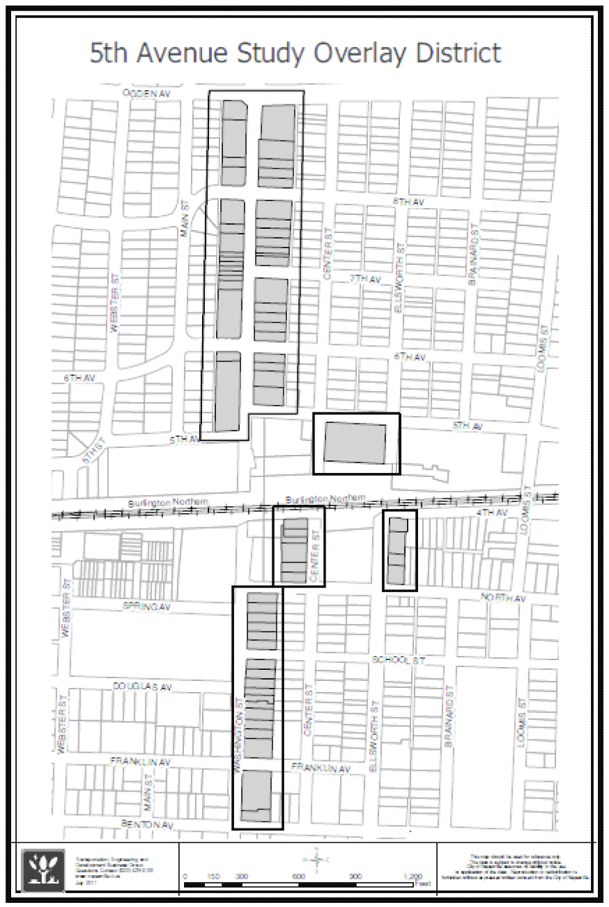
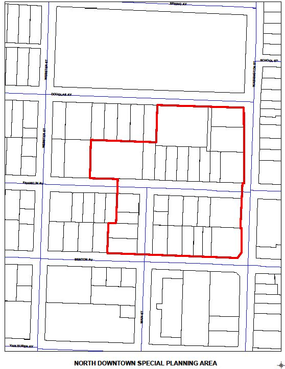

# 6-2 GENERAL ZONING PROVISIONS

### 6-2-1: USES

1\. Permitted: Permitted uses of buildings, structures or parcels of land shall be allowed in the zoning districts indicated under the conditions specified. No buildings, structures or parcels of land shall be devoted to any use other than a use permitted hereinafter in the zoning district in which such building, structure or parcel of land shall be located, with the exception of the following:

1.1. Uses lawfully established on the effective date hereof in accordance with the provisions of Chapter 10 of this Title.

1.2. Conditional uses allowed in accordance with the provisions of Section 6-3-8 of this Title and Subsection 6-2-1.2 of this Section.

2\. Conditional: Conditional uses of buildings, structures or parcels of land, as hereinafter listed, shall be allowed in the zoning districts indicated under the conditions specified in accordance with the provisions of Section 6-3-8 and Chapter 4 of this Title.

Where a use is classified as a conditional use under the provisions of this Title and exists as a permitted use or special use under the provisions of ordinance A-139 at the date of the adoption of this Title, it shall be classified as a conditional use in the zoning district indicated under the conditions specified in accordance with the provisions of Section 6-3-8 and Chapter 4 of this Title. The authorization of the conditional use shall be only for the use existing at the time of the adoption of this Title and for no other use.

(Ord. 80-5, 1-21-1980)

### 6-2-2: AREA AND LOT WIDTH

1\. Minimum Area: Every lot created subsequent to the effective date hereof, or any amendment hereto, shall meet the minimum area requirements of the zoning district within which it is located. In any district, a building, structure or use of land may be established on any lot which is of record on the effective date hereof, or any amendment hereto, regardless of the area or width of the lot, provided all other requirements of this Title are complied with.

2\. Minimum Lot Width: Every lot created subsequent to the effective date hereof, or any amendment hereto, shall meet the minimum lot width requirements of the zoning district within which it is located. In any district, a building, structure or use of land may be established on any lot which is of record on the effective date hereof, or any amendment hereto, regardless of the area or width of the lot, provided all other requirements of this Title are complied with.

(Ord. 80-5, 1-21-1980)

### 6-2-3: YARD REQUIREMENTS

1\. Location Of Required Yards: Yard requirements shall be as set forth under each zoning district for all buildings, structures and uses of land. All required yards shall be located on the same lot as the building, structure or use of land for which such yard is required. The right-of-way of any public roadway, public alley or public accessway which exists by dedication, recorded easement or prescription and which is located on the lot shall not be included as part of the required yard.

2\. Required Yards For Existing Buildings: No yards, now or hereafter provided, for a building, structure or use existing on the effective date hereof, or any amendment hereto, shall subsequently be reduced below, or further reduced if already less than, the minimum yard requirements of this Title for equivalent new construction.

3\. Permitted Obstructions In Required Yards: All required yards shall be unobstructed from the ground level to the sky except the following:

3.1. In all required yards, except interior side yards, the ordinary projection of sills, belt courses, cornices, cantilevered bay windows, buttresses, chimneys, ornamental features, and eaves may extend three (3) feet into the required yard except as provided in Subsection 6-2-3.3.1.1 of this Section. In all required interior side yards, the ordinary projection of sills, belt courses, cornices, chimneys, and eaves may extend three (3) feet into the required side yard and cantilevered bay windows may extend one foot into the required side yard. Steps or sidewalks which provide access to a building or structure or access to a lot from a street or alley may be located in any required yard.

3.1.1. No obstruction permitted by this Subsection 6-2-3.3 shall be installed so that any portion is above, across, under or over a five-foot interior side yard drainage or utility easement from ground level to the sky.

3.1.2. Cantilevered bay windows as permitted in this Section shall include projecting windows with any number of sides, provided that (a) for each story of each building elevation, the total combined width of all cantilevered bay windows shall not exceed thirty percent (30%) of that elevation's facade length; and (b) the predominant material of the cantilevered bay window is window glass.

3.2. Patios, decks and porches may extend five (5) feet into the required front yard or corner side yard and ten (10) feet into the required rear yard. Air conditioning equipment and generators or other heating and ventilation equipment may extend five (5) feet into the required rear yard.

3.3. Accessory buildings, structures or uses of land shall comply with the provisions of Section 6-2-10 of this Chapter.

3.4. Fences shall comply with the provisions of Section 6-2-12 of this Chapter.

3.5. Off street parking and loading facilities shall comply with the provisions of Subsections 6-9-2.4 and 6-9-4.4 of this Title.

3.6. Antennas, towers and satellite dishes shall comply with Chapter 13 of this Title.

4\. Corner Lot Yard Requirements: On corner lots the owner of the parcel of land may determine which street side of the lot shall be considered the front yard and which street side of the lot shall be considered the corner side yard.

5\. Encroachment Into Required Yards: It shall not be deemed a violation of the yard requirements of this Title if a residential building or structure encroaches upon a required yard under the following conditions:

5.1. The building or structure does not encroach upon more than one (1) required yard;

5.2. The encroachment does not exceed six (6) inches; and

5.3. No portion of the encroachment is above, across, under or over a five-foot interior side yard drainage or utility easement from ground level to the sky.

The Zoning Administrator shall review each case of such encroachment to determine compliance with this Subsection. If the encroachment does not comply with this Subsection, the variance procedure must be followed. If the encroachment does comply with this Subsection, the Zoning Administrator shall administratively approve said encroachment.

(Ord. No. 80-5, 1-21-1980; Ord. No. 95-14, 1-17-1995; Ord. No. 01-33, 2-20-2001; Ord. No. 04-225, 12-21-2004; Ord. No. 08-078, 4-15-2008; Ord. No. 15-187, § 1, 11-17-2015)

### 6-2-4: BUILDING HEIGHT AND BULK

1\. Height Limitations: Height limitations shall be as set forth under each zoning district for all buildings, structures and uses of land. All height limitations shall be measured from a datum point established by the average of the two (2) grades along each side lot line where the front yard line meets the side lot lines to the highest point of the roof surface or parapet, in case of a flat roof; to the deck roofline of a mansard roof; and to the mean level of the underside of the rafters between the eaves and the ridge of a gable, hip or gambrel roof. For peak roof height measurement, the height shall be measured from a datum point established by the average of the two (2) grades along each side lot line where the front yard line meets the side lot lines to the peak of the roof. For those developments considered tear downs, infill single-family detached dwellings and tear down/infill duplexes pursuant to Section 6-2-26 of this Chapter, the height regulations set forth therein shall supersede any height regulations provided in the underlying zoning district.

1.1. Chimneys, ornamental towers, scenery lofts, monuments, cupolas, domes, spires, steeples, false mansards, parapet walls, and similar structures and necessary mechanical appurtenances may be erected to their customary height, regardless of the height limitations of the zoning district in which they are located.

2\. Bulk Regulations: Bulk regulations shall be as set forth under each zoning district for all buildings, structures and uses of land.

The maintenance of yards and other open space and minimum lot area legally required for a building, structure or use of land shall be a continuing obligation of the owner of such building, structure or use of land as long as the building, structure or use of land is in existence. Furthermore, no legally required yards, other open space, or minimum lot area allocated to any building, structure or use of land shall by virtue of change of ownership or for any other reason, be used to satisfy yard, other open space, or minimum lot area requirements for any other building, structure or use of land.

(Ord. No. 80-5, 1-21-1980; Ord. No. 05-125, 7-5-2005)

### 6-2-5: UTILITY FACILITY REGULATIONS

All public and private utility facilities shall conform to the performance standards of Chapter 14 of this Title. They shall be screened with fences or landscaping of at least seventy-five percent (75%) opacity. Lighting of the facilities shall be directed away from surrounding properties.

(Ord. 01-68, 4-4-2001)

### 6-2-6: AGRICULTURE AS A PERMITTED USE

Farming shall be permitted in any zoning district. Dwelling units which are accessory to the farming uses shall also be permitted; provided, that the occupants of the dwelling units are engaged in agricultural activities on the premises as their principal means of livelihood.

(Ord. 80-5, 1-21-1980)

### 6-2-7: TRAILERS AND RECREATIONAL VEHICLES

1\. Applicability: These regulations shall apply to all trailers and recreational vehicles as defined below, in all zoning districts, except the R5 district. They shall apply to all trailers and recreational vehicles other than the mobile homes permanently affixed to the ground and used as a principal residence.

RECREATIONAL VEHICLE: Any camping trailer, motor home, mini-motor home, travel trailer, truck camper or van camper used primarily for recreational purposes, as defined in the Illinois Motor Vehicle Code; as well as vehicles including, but not limited to, all-terrain vehicles, boats, snowmobiles, watercraft, and other similar vehicles.

TRAILER: Every vehicle without motive power in operation designed for carrying persons or property and so constructed that no part of its weight rests upon the towing vehicle.

2\. Location Of Trailers And Recreational Vehicles: Storage and parking of trailers and recreational vehicles shall be regulated as follows, except as otherwise provided in Subsections 6-2-7.3 and 6-2-7.4 of this Section:

2.1. Only one trailer or recreational vehicle shall be located outside of a fully enclosed building or structure on any lot or parcel of land, provided however, that when such trailer or recreational vehicle is provided in conjunction with a use located in the business or industrial districts, said restriction shall not be applicable.

2.2. The storage and parking of said trailer or recreational vehicle is subject to the following location requirements:

2.2.1. Trailers and recreational vehicles shall only be located in the rear or interior side yard;

2.2.2. Trailers and recreational vehicles shall not be located in the required front or corner side yard, except as provided in Subsections 6-2-7.3 and 6-2-7.4 of this Section; and

2.2.3. Trailers and recreational vehicles shall not be located closer than five (5) feet to any lot line.

2.3. Trailers or recreational vehicles, which are located outside of a fully enclosed building or structure, shall be screened from the property line with fences or walls six (6) feet in height, or landscaping of at least seventy-five percent (75%) opacity, such as nondeciduous plantings, six (6) feet in height at time of planting. Said screening shall be located either along the perimeter of the lot where the trailer or recreational vehicle is stored, or along the perimeter of said trailer or recreational vehicle.

2.4. In any zoning district, the wheels or any similar transporting devices of trailers or recreational vehicles shall not be removed except for repairs; nor shall said trailer or recreational vehicle be otherwise immobilized or affixed to the ground, unless it is stored in a fully enclosed building or structure.

2.5. The use of any trailer or recreational vehicle shall be in accordance with the provisions of Titles 5, "Building Regulations", and 8, "Public Utilities", of this Code.

3\. Parking Of Recreational Vehicles: Recreational vehicles may be parked on the driveway within the required front yard or corner side yard setback, provided:

3.1. The recreational vehicle shall be used daily and shall be its owner's principal means of transportation; and

3.2. The length of the recreational vehicle shall not exceed twenty-five (25) feet in length; and

3.3. The recreational vehicle does not exceed the maximum curb weight for motor vehicles in residential districts as set forth in Subsection 6-2-20.2.1 of this Chapter.

4\. Temporary Storage And Parking Of Trailers And/Or Recreational Vehicles: A trailer or recreational vehicle may be temporarily placed, kept or maintained upon any lot or parcel of land for a period not to exceed the following:

4.1. Time Period: Three (3) times per month for no more than forty-eight (48) hours per occurrence for loading and unloading purposes.

4.2. Recreational Vehicles: An aggregate of fourteen (14) days (which may or may not be consecutive) within a period of thirty (30) days for storage if such recreational vehicle is owned by a guest of the occupants of the residence.

4.3. Trailers: Trailers associated with an approved permit from the City of Naperville which are located on property during the allowable construction hours as defined in Subsection 6-14-4.1 of this Title and Subsection 5-2B-8.5 of this Code.

(Ord. 07-011, 1-16-2007)

### 6-2-8: HOME OCCUPATION REGULATIONS

1\. Purposes: It is the intent of this Section to allow as home occupations only those uses that conform to the standards of this Section. A home occupation is an accessory use so located and conducted that the average neighbor would not be aware of its existence except for a sign as provided for in Title 5 of this Code. The standards for home occupations are intended to ensure compatibility with other permitted uses and the residential character of the neighborhood and to maintain the subordinate and incidental status of the home occupation.

2\. Location: A home occupation shall be conducted completely within any dwelling unit or within any building or structure accessory to the dwelling unit in any zoning district in which dwelling units are permitted, except as otherwise stated in Subsection 6-2-8.5.3 of this Section.

3\. Permitted Uses: Home occupations shall include, but shall not be limited to, the following uses:

(Ord. 07-014, 1-16-2007)

3.1. Beauty shops and barbershops; limited to two (2) operators of whom one shall be a resident of the dwelling unit in which this home occupation is permitted.

(Ord. 87-84, 6-2-1987)

3.2. Baby sitting services and home based daycare facilities.

(Ord. 07-014, 1-16-2007)

3.3. Instruction in music, dance, home crafts and art; provided, that the total class size does not exceed four (4) students at any time.

3.4. Offices of architects, brokers, engineers, insurance agents, lawyers, real estate agents, and urban planners.

3.5. Offices of medical or dental practitioners.

3.6. Offices of ministers, priests and rabbis.

(Ord. 80-5, 1-21-1980)

3.7. Offices of salesmen, sales representatives or manufacturers' representatives; provided, that no retail transactions shall be made on the premises except through telephone, telegraph or mail communication, or electronic or wireless communication.

(Ord. 07-014, 1-16-2007)

3.8. Repair services, but not including retail sales.

3.9. Studios of artists, authors, composers, photographers and sculptors.

3.10. Workrooms of dressmakers, seamstresses and tailors.

(Ord. 80-5, 1-21-1980)

3.11. Workrooms for home crafts, crafts people and tradespeople including, but not limited to, model making, rug weaving, lapidary work and cabinetmaking.

(Ord. 07-014, 1-16-2007)

4\. Prohibited Uses: Permitted home occupations shall not be deemed to include the following uses:

4.1. Eating and drinking establishments.

4.2. General retail.

4.3. Hospitals.

(Ord. 80-5, 1-21-1980; amd. Ord. 87-84, 6-2-1987; Ord. 08-114, 6-17-2008; Ord. No. 10-073, § 1, 6-15-2010)

4.4. Pet care establishments.

(Ord. 08-035, 2-19-2008; amd. Ord. 08-114, 6-17-2008)

4.5. Rental of mobile homes, trailers and camper trailers.

4.6. Stables.

4.7. Undertaking establishments and funeral parlors.

(Ord. 80-5, 1-21-1980; amd. Ord. 87-84, 6-2-1987; Ord. 08-114, 6-17-2008)

4.8. Veterinary office.

(Ord. 08-114, 6-17-2008)

5\. Standards: The following standards shall govern the operation of a home occupation:

5.1. The dwelling unit in which the home occupation is located shall be subject to the regulations of the zoning district in which located.

5.2. At least one employee of the home occupation shall reside at the residence where the home occupation is located.

5.3. Activities related to the home occupation shall be conducted entirely within the dwelling unit or within an accessory building or structure. Outdoor activities in furtherance of the home occupation including, but not limited to, the following, are specifically prohibited on the premises where the home occupation is located:

5.3.1. Outdoor placement or storage of trucks in excess of eight thousand (8,000) pounds of curb weight and outdoor placement, storage, delivery, or distribution of goods, or other equipment, not including deliveries customarily associated with residential households, such as parcel or letter carriers;

5.3.2. Conducting business activities outdoors;

5.3.3. Outdoor assembly of persons on or adjacent to the subject property;

5.3.4. Preparation of materials, equipment, goods, etc., for off site work;

5.3.5. Parking in violation of Section 6-2-20 of this Chapter;

5.3.6. The restrictions set forth in this Subsection shall not apply to baby sitting services and home based daycare facilities.

5.4. The home occupation shall be subordinate and incidental to the principal use of the building or structure for residential purposes and shall not exceed twenty-five percent (25%) of the gross floor area of the dwelling unit and accessory buildings or structures on the premises on which the home is located. Baby sitting services and home based daycare facilities shall be exempt from this provision.

5.5. The home occupation shall be in compliance with the performance standards for residential uses provided in Chapter 14 of this Title.

5.6. Adherence to the parking rules as defined and amended from time to time in Title 11, Chapter 2, Article A of this Code is required.

5.7. The maximum number of daily business trips generated from a home occupation shall not exceed one hundred twenty-five percent (125%) of the average number of daily trips generated from a similar residential use in the City of Naperville.

5.7.1. For the purposes of this Section, a "residence" includes "single-family detached dwelling", "two-family dwelling", "single-family attached dwelling", and "multiple-family dwelling", as categorized by the Institute of Transportation Engineers (ITE) and defined in this Title.

5.7.2. For the purposes of this Section, a "business trip" shall be defined as either the arrival or the departure of a nonresident employee, customer, or supplier at or from a home occupation.

5.7.3. For the purposes of this Section, the average number of daily trips for a residence is sixteen (16), as may be adjusted from time to time pursuant to engineering traffic studies conducted by the City of Naperville.

5.7.4. This Subsection shall not apply to baby sitting services or home based daycare facilities.

(Ord. 07-014, 1-16-2007)

### 6-2-9: TEMPORARY MODEL HOME REGULATIONS

Temporary model homes shall be used primarily to offer for sale or rental dwelling units located within the same subdivision or planned unit development in which the model home is located. The following regulations shall govern the operation of a model home:

1\. Upon request by the City, the owners of the property shall provide information relating to the use of the model home, including, but not limited to, a record of sales or rentals made from the model home.

2\. Building materials may be stored within the model home but not upon the lot on which a model home is situated.

3\. Sales offices, rental offices and construction offices may be contained in a model home; provided, that the appearance of the model home is not substantially different from that of the other dwelling units in the subdivision or planned unit development.

(Ord. 80-5, 1-21-1980)

4\. Temporary off street parking facilities shall be provided containing not less than five (5) parking spaces. The off street parking and loading regulations of Chapter 9 of this Title shall apply to such facilities.

(Ord. 86-35, 3-3-1986)

5\. Exterior floodlights may be used to illuminate the model home; provided, that lights are sufficiently screened so that private dwelling units and traffic are not adversely affected by the floodlights.

(Ord. 80-5, 1-21-1980)

### 6-2-10: ACCESSORY BUILDINGS, STRUCTURES AND USES OF LAND

1\. Location: Accessory buildings, structures or uses may be attached to, established within, or detached from the principal building, structure or use of land. Detached accessory buildings, structures or uses may be located in the required rear yard or interior side yard of any zoning district; provided, that detached accessory buildings or structures shall not be located within five (5) feet of any rear or interior side lot line nor nearer to a lot line adjoining a street than the longest distance between such lot line and the nearest wall of the principal building or structure. Detached accessory buildings, structures or uses may be located in the corner side yard of any zoning district; provided that detached accessory buildings structures or uses are not located within the required corner side yard.

2\. Yard Requirements: All accessory buildings, structures or uses shall comply with the front and corner side yard requirements of the zoning district in which it is located. Accessory buildings, structures or uses attached to or established within the principal building or structure shall comply with the rear yard and interior side yard requirements of the zoning district in which located. Detached accessory buildings, structures or uses may be located in the required rear yard or interior side yard in accordance with the provisions of Subsection 6-2-10.1 of this Section.

3\. Height Limitations: All accessory buildings, structures or uses shall comply with the height limitations of the zoning district in which it is located; provided, that the height of the principal building or structure to which it is accessory is not exceeded except as provided in Subsection 6-2-4.1 of this Chapter. In residential districts, the height of accessory buildings and structures shall be limited to a maximum height of eighteen (18) feet to be measured from the grade at the base of the structure to the highest point of the roof.

4\. Bulk Regulations: All accessory buildings, structures or uses shall comply with the bulk regulations of the zoning district in which located. The area of the accessory building or structure shall be included in the computation of the floor area ratio. In residential districts, no single detached accessory structure shall exceed the footprint of the principal structure.

5\. Percentage Of Required Yard Occupied: Detached accessory buildings or structures shall not occupy more than twenty-five percent (25%) of the area of a required rear yard or interior side yard. In residential districts, detached accessory buildings or structures shall not occupy more than twenty-five percent (25%) of a required rear or interior side yard or a total of four hundred eighty (480) square feet, whichever is greater, provided that any unroofed brick paver or concrete patio which is less than five hundred (500) square feet in size shall be exempt from inclusion in this calculation.

6\. Time Of Construction: No accessory building, structure or use shall be constructed or established prior to the time of construction or establishment of the principal building, structure or use to which it is accessory.

7\. Game Court Screening: Screening of game courts shall comply with the provisions of Subsection 5-10-3.8 of this Code.

(Ord. No. 80-5, 1-21-1980; Ord. No. 90-61, 4-3-1990; Ord. 00-02, 1-18-2000; Ord. 08-069, 4-1-2008; Ord. No. 15-187, § 1, 11-17-2015)

### 6-2-11: TEMPORARY BUILDINGS, STRUCTURES AND USES OF LAND

1\. The Zoning Administrator, with the written concurrence of the fire, public works, and public utilities departments, may authorize the temporary use of a building, structure or parcel of land in any zoning or underlying PUD district for a building, structure or use of land that does not conform to the regulations prescribed elsewhere in this Title for the zoning district in which it is located, provided, however, that such use will not have a potential adverse impact on surrounding properties or public health, safety and general welfare, and shall not exceed a period of more than six (6) months.

2\. Upon conclusion of the six-month approval period, the Zoning Administrator may extend the temporary use approval for an additional six-month period provided that said temporary use had no adverse impact on surrounding properties during the initial approval period.

3\. Requests for temporary uses for periods in excess of that which can be approved by the Zoning Administrator, or those having a potential adverse impact on surrounding properties, shall require the City Council's approval.

4\. The City Council shall only grant such temporary uses for specified periods of time and subject to such conditions as the City Council determines to be appropriate to protect against any potential adverse impact on surrounding properties and for safeguarding the public health, safety and general welfare.

(Ord. 96-47, 4-2-1996; Ord. No. 15-188, § 2, 11-17-2015)

### 6-2-12: FENCES

1\. Residence Districts: Except as provided in Subsection 6-2-12.4 of this Section, Section 6-2-13 of this Chapter, and Section 7-4-3 of this Code, the establishment of all fences in residence districts shall be regulated as follows:

1.1. Fences not exceeding three (3) feet in height may be constructed and maintained at any point behind the front or corner side yard lot lines.

1.2. Open fences, as defined in Section 6-1-6 (Definitions), not exceeding four (4) feet in height may be constructed and maintained at the front or corner side yard lot line.

1.3. Fences not exceeding six (6) feet in height may be constructed and maintained at any point behind the corner side yard line, provided they do not extend forward of the wall of the principal building facing the front yard.

1.4. Fences up to six (6) feet in height shall be permitted in the required interior side yard or rear yard provided that the fence does not extend nearer to a front lot line than the longest distance between such lot line and the nearest wall of the principal building or structure.

1.5. Fences up to six (6) feet in height shall be permitted in the required corner side yard when said yard aligns with the rear yard or corner side yard of a residential property provided that the fence does not extend nearer to a front lot line than the longest distance between such lot line and the nearest wall of the principal building or structure.

1.6. Fences up to nine (9) feet in height shall be permitted along any residential property line which abuts a non-residential use or abuts a major arterial right-of-way.

1.7. Subdivision perimeter fencing shall be permitted; provided, that the fence not exceed six (6) feet in height along non-major arterial rights-of-way, except as otherwise provided in Section 6-2-12:1.10, or nine (9) feet in height along major arterial rights-of-way. Said fencing shall remain uniform in design and color.

1.8. Fences must be positioned so that the finished side faces away from the lot on which it is constructed.

1.9. Every fence fronting onto an existing or proposed road right-of-way, except for corner lots, must include a gate giving access to the right-of-way. Fences constructed along major arterial rights-of-way, where a mandatory homeowners' association is responsible for maintaining both the fence and the parkway between the fence and the street are exempt from this provision, except that the Department of Public Utilities may require gates on the section of fence fronting specific lots to allow access to utility facilities.

1.10. In order to maintain the rural character of Hobson Road, no board-on-board or chainlink fences shall be permitted along Hobson Road. Permitted fence types and materials shall be limited to aluminum, wrought iron, PVC, split rail, and three-board fences (horse fences). Said fences shall be constructed and maintained as open fences, as defined in Section 6-1-6 (Definitions) and shall comply with all regulations provided in Section 6-2-12:1. In no event shall any fence constructed along Hobson Road exceed six (6) feet in height.

1.11. A fence permit fee in accordance with Subsection 1-9H-1.3.7 of this Code shall be paid for all fences exceeding three (3) feet in height before a fence is erected on any property within the City.

1.12. All fences shall be constructed and maintained in accordance with the following Department of Public Utilities' minimum standards construction to allow for safe access to equipment:

1.12.1. Five (5) feet of clearance shall be maintained between any fence and all sides of an electrical transformer, except the side of the transformer which is padlocked, which shall have a ten-foot clearance.

1.12.1.1. If it is impossible to maintain ten (10) feet of clearance between the padlocked side of an electrical transformer and the fence, a removable section of fence or a gate with a padlock shall be installed.

1.12.1.2. All padlocks shall be issued by the City.

1.12.2. Five (5) feet of clearance shall be maintained between any fence and all sides of an electrical pedestal.

1.12.2.1. If it is impossible to maintain five (5) feet of clearance between an electrical pedestal and the fence, a removable section of fence or a gate with a padlock shall be installed.

1.12.2.2. All padlocks shall be issued by the City.

2\. Business Districts: The establishment of fences in business districts shall be regulated as follows, except as provided in Subsection 6-2-12.4 of this Section, Section 6-2-13 of this Chapter, and Section 7-4-3 of this Code:

2.1. Fences may be constructed and maintained in the front yard and corner side yard setbacks to a maximum height of three (3) feet.

2.2. Fences shall be permitted in the required interior side yard or rear yard; provided, that the fence does not extend nearer to a lot line adjoining a street than the longest distance between such lot line and the nearest wall of the principal building or structure; in the case of corner lots, not beyond the front or street side line of the building or structure; and does not exceed a height of fifteen (15) feet.

2.3. Fences must be positioned so that the finished side faces away from the lot on which constructed.

2.4. Walls which enclose outside storage shall be a minimum of six (6) feet and a maximum of fifteen (15) feet in height.

3\. Industrial Districts: The establishment of fences in industrial districts shall be regulated as follows, except as provided in Subsection 6-2-12.4 of this Section, Section 6-2-13 of this Chapter, and Section 7-4-3 of this Code:

3.1. Fences may be located in any required yard.

3.2. All fences other than those intended for decorative or screening purposes shall be buffered with berming and/or landscaping.

3.3. All fences shall not exceed a height of fifteen (15) feet.

3.4. Fences must be positioned so that the finished side faces away from the lot on which constructed.

Walls which enclose outside storage shall be a minimum of six (6) feet and a maximum of fifteen (15) feet in height.

4\. Miscellaneous Uses Of Land: Screening which is required for swim and/or tennis clubs and private and public utility facilities shall be regulated as follows, except as provided in Section 6-2-13 of this Chapter and Section 7-4-3 of this Code:

4.1. Fences may be located in any required yard.

4.2. All fences other than those intended for decorative or screening purposes shall be buffered with berming and/or landscaping.

4.3. All fences shall not exceed a height of six (6) feet except those for tennis courts shall not exceed a height of twelve (12) feet.

4.4. Fences must be positioned so that the finished side faces away from the lot on which constructed.

(Ord. 80-5, 1-21-1980; Ord. 95-230, 10-17-1995; Ord. 99-104, 6-15-1999; Ord. No. 11-034, § 4, 3-1-2011; Ord. No. 15-187, § 1, 11-17-2015)

### 6-2-13: VISIBILITY ON CORNER LOTS

The location of buildings, structures and landscaping on corner lots shall be regulated as follows so as not to obstruct the vision of drivers of motor vehicles. No buildings or structures shall be erected or maintained, nor any landscaping planted, grown or maintained within a triangular area determined by a diagonal line connecting two (2) points measured along the property lines of the abutting streets thirty (30) feet equidistant from the intersection of those property lines, so as to obstruct or obscure the vision of drivers of motor vehicles on either or both street(s).

(Ord. No. 95-15, 1-17-1995)

### 6-2-14: MAJOR ARTERIAL SETBACK REQUIREMENTS

Except as provided by this Section, a minimum setback of seventy (70) feet from the centerline or twenty (20) feet from the edge of the right-of-way, whichever is greater, shall be maintained.

1\. The minimum setback from any major arterial and Hobson Road in or adjacent to an E1, E2, or E3 zoning district shall be fifty (50) feet from the edge of the right-of-way. The minimum major arterial setback for any structure constructed on a property zoned TU shall be fifteen (15) feet from the edge of the right-of-way, except that properties zoned TU along Ogden Avenue between Mill Street and Loomis Street shall have a ten-foot major arterial setback.

1.1. No building, structure, off street parking facility or off street loading facility shall be located within the required setback.

1.2. Where the condition imposed by this Subsection 6-2-14.1 is either more restrictive or less restrictive than the yard requirements of individual zoning districts, the more restrictive requirement shall be applicable.

2\. Parcels less than one hundred fifty (150) feet in depth on Ogden Avenue between Washington Street and Sherman Avenue, shall be permitted to provide off street parking, as required by Section 6-9-2 of this Title, in the rear ten (10) feet of the required 20-foot arterial setback.

2.1. This exemption shall be applicable to parcels platted prior to the effective date hereof (January 1, 2008), and parcels for which a preliminary/final plat of subdivision is processed in accordance with the administrative resubdivision process described in Section 7-2-8 of this Code subsequent to the effective date hereof.

3\. Fences as regulated by Section 6-2-12 of this Chapter may be constructed and maintained within a required setback from a major arterial roadway where such fence complies with all other requirements of Sections 6-2-12 and 6-2-13 of this Chapter.

3.1. This Subsection shall not abrogate any easement, covenant, or other private agreement.

3.2. Any new fence constructed along a major arterial roadway next to an existing fence shall be set back at a distance even to the existing fence.

(Ord. No. 99-104, 6-15-1999; Ord. No. 07-090, 5-1-2007; Ord. No. 07-266, 12-18-2007; Ord. No. 15-011, § 3, 1-20-2015)

### 6-2-15: BOARDING FACILITIES

1\. Boarding Houses: Boarding houses established after July 20, 2010 shall be required to obtain approval of a conditional use in the B3 (General Commercial) Business District or C/U (College/University) District only, subject to provisions contained in Section 6-7C-3 (B3 District, Conditional Uses) and 6-7G-3 (C/U District, Conditional Uses) of the Naperville Municipal Code.  
Nothing herein shall be construed as a prohibition on the property owner's ability to rent a residential structure through the provision of a single lease to an individual or group of individuals who intend to occupy the structure as a shared home, and which is not a boarding house as defined in Section 6-1-6 of this Code.

2\. Boarding Rooms in Residential Districts: The rental of boarding rooms in single-family detached dwellings, two-family dwellings, duplexes, single-family attached dwellings, and multiple-family dwelling units shall be permitted as accessory to the principal residential use of the dwelling unit; provided, that there shall be not more than two (2) boarding rooms per owner-occupied single-family dwelling unit and not more than one (1) boarding room per owner-occupied duplex, single-family attached dwelling, or multiple-family dwelling. Boarding rooms as permitted in herein shall provide access to common areas of the home including the entry, living, kitchen and bathroom areas, and shall not possess characteristics of a boarding house as defined in Section 6-1-6 of this Code. Boarding rooms shall not impose overflow parking impacts onto the public right-of-way or an unapproved surface.

3\. Amortization of Boarding Facilities:

3.1. Boarding Houses: Boarding houses and boarding rooms as defined herein and lawfully established prior to July 20, 2010 shall be permitted to continue operating in accordance with provisions of law and the Municipal Code related to nonconforming uses for a two-year period expiring July 20, 2012. Upon completion of the amortization period, all boarding facilities shall operate in compliance with the underlying zoning and the provisions of Section 6-2-15.

4\. Enforcement:

4.1. Enforcement of this Section 6-2-15 shall be achieved by all remedies available by law including but not limited to daily fines of no less than one hundred dollars (\$100.00) and declaratory and injunctive relief.

(Ord. No. 80-5, 1-21-1980; Ord. No. 10-087, § 3, 7-20-2010; Ord. No. 16-126, § 2, 8-16-2016; Ord. No. 18-126, § 2, 11-7-2018)

### 6-2-16: SWIM AND/OR TENNIS CLUB REGULATIONS

Swim and/or tennis clubs shall be screened with fences or landscaping of at least seventy-five percent (75%) opacity. Lighting of the facilities and sound systems shall be directed away from surrounding properties.

(Ord. No. 80-5, 1-21-1980)

### 6-2-17: DEVELOPMENT OF AIR RIGHTS

The development of air rights above any parcel of land located in any zoning district and utilized for public or private purposes shall be permitted subject to all the requirements of the zoning district in which such development is located. Development of air rights shall be considered as a conditional use and subject to the provisions of Section 6-3-9 of this Title or, if a planned unit development, to the provisions of Chapter 4 of this Title.

(Ord. No. 80-5, 1-21-1980)

### 6-2-18: INTERPRETATION BY ZONING ADMINISTRATOR

Where there is any ambiguity or dispute concerning the interpretation of this Title, the decision of the Zoning Administrator shall prevail, subject to appeal as provided in Section 6-3-6 of this Title.

The Zoning Administrator may allow as a permitted use or conditional use those uses which, though not contained by name in a zoning district list of permitted or conditional uses, they determine to be of the same general character as the listed permitted or conditional uses, subject to approval by the City Council.

(Ord. No. 80-5, 1-21-1980; Ord. No. 22-044, § 2, 5-3-2022)

### 6-2-19: EXISTING BUILDINGS AND STRUCTURES

1\. Continuance Of Existing Buildings And Structures: Any building or structure which existed at the time of the adoption of this Title, or any amendment hereto, and which does not comply with the conditions, area requirements, lot width requirements, yard requirements, height limitations or bulk regulations of the zoning district in which said building or structure is located upon the adoption of this Title, or any amendments hereto, may be continued during the remainder of the normal life of the building or structure or until the building or structure has deteriorated to the extent that it is no longer safe. The continuance of such building or structure shall be subject to the regulations herein set forth.

2\. Repairs And Alterations:

2.1. Repairs and alterations which increase the bulk of the building or structure may be made to a building or structure which does not comply with the conditions of the zoning district in which said building or structure is located, provided said repairs or alterations comply with all regulations, including conditions, of the zoning district in which said building or structure is located.

2.2. Repairs and alterations which increase the bulk of the building or structure may be made to a building or structure which does not comply with the area requirements of the zoning district in which said building or structure is located, provided said repairs or alterations comply with the conditions, yard requirements, height limitations, and bulk regulations of the zoning district in which said building or structure is located.

2.3. Repairs and alterations which increase the bulk of the building or structure may be made to a building or structure which does not comply with the lot width requirements of the zoning district in which said building or structure is located, provided said repairs or alterations comply with the conditions, yard requirements, height limitations, and bulk regulations of the zoning district in which said building or structure is located.

2.4. Repairs and alterations which increase the bulk of the building or structure and which increase the lot coverage may be made to a building or structure which does not comply with the yard requirements of the zoning district in which said building or structure is located, provided said repairs or alterations comply with the conditions, yard requirements, height limitations, and bulk regulations of the zoning district in which said building or structure is located.

2.5. Repairs and alterations which increase the bulk of the building or structure and which do not increase the lot coverage may be made to a building or structure which does not comply with the yard requirements of the zoning district in which said building or structure is located, provided said repairs or alterations comply with the conditions, height limitations, and bulk regulations of the zoning district in which said building or structure is located.

2.6. If a building or structure exceeds the height limitations of the zoning district in which said building or structure is located, repairs and alterations which increase the bulk of the building or structure and which increase the lot coverage may be made, provided said repairs or alterations comply with the conditions of the zoning district in which said building or structure is located.

2.7. If a building or structure exceeds the height limitations of the zoning district in which said building or structure is located, repairs and alterations which increase the bulk of the building or structure and which do not increase the lot coverage may be made; provided: 1) said repairs or alterations comply with the conditions and bulk regulations of the zoning district in which said building or structure is located; and 2) the height limitations are not further exceeded.

2.8. If a building or structure exceeds the bulk regulations of the zoning district in which said building or structure is located, repairs and alterations which increase the bulk of the building or structure and/or which increase the lot coverage may not be made.

2.9. Nothing in this Title shall prevent the reconstruction, repairing or rebuilding of a building, structure or part thereof which does not comply with the conditions, area requirements, lot width requirements, yard requirements, height limitations, or bulk regulations of the zoning district in which said building or structure is located and which exists at the effective date hereof, rendered necessary by wear and tear, or deterioration of which is required by the provisions of the building regulations of the City relative to the maintenance of said buildings or structures, provided the cost of such work, within a two-year time period, shall not exceed fifty percent (50%) of the replacement cost of such building or structure at the time such work is done.

3\. Restoration: If a building or structure which does not comply with the conditions, area requirements, lot width requirements, yard requirements, height limitations, or bulk regulations of the zoning district in which said building or structure is located is damaged by fire, collapse, explosion, or other casualty or act of God to the extent that the cost of restoration to the condition in which it was before the occurrence shall exceed fifty percent (50%) of the replacement cost of the building or structure at the time of destruction or damage, then any new construction or reconstruction must comply with all regulations of the zoning district in which the building or structure is located.

4\. Relocation Of Buildings Or Structures: No building or structure which does comply with the conditions, area requirements, lot width requirements, yard requirements, height limitations or bulk regulations of the zoning district in which said building or structure is located shall be moved in whole or in part to any other location on the same or any other lot unless every portion of such building or structure complies with the regulations of the zoning district in which it is to be located.

(Ord. No. 80-5, 1-21-1980)

### 6-2-20: MOTOR VEHICLE REGULATIONS IN RESIDENTIAL DISTRICTS

1\. Off Street Parking Facilities: Off street parking facilities accessory to residential uses shall be used for the parking of properly licensed motor vehicles only.

2\. Overnight Parking: Overnight off street parking between the hours of two o'clock (2:00) a.m. and five o'clock (5:00) a.m. from Monday to Sunday is prohibited for the following motor vehicles:

2.1. Any motor vehicle having a curb weight of eight thousand (8,000) pounds or greater. For the purposes of this Section, "curb weight" is defined as the weight of a motor vehicle with standard equipment, fuel, oil, and coolant;

2.2. Any mobile commercial machinery on wheels designed to be towed over the public right-of-way, including, but not limited to, air compressors, asphalt basins, chipper machines, etc.; and

2.3. Any commercial or industrial equipment on a vehicle or in the bed of a vehicle not safely secured or covered.

3\. Exempt Vehicles: The following motor vehicles shall be exempt from the provisions of this Section:

3.1. Any motor vehicle which is stored within a fully enclosed building or structure, except as otherwise provided in Section 6-2-7 of this Chapter.

3.2. Any motor vehicle which has snow removal equipment temporarily attached, subject to the following:

3.2.1. The vehicle shall not be located on the subject property prior to November 15 of each year, or beginning with the first two-inch snow event, whichever comes first, and not after April 15 of the subsequent year;

3.2.2. There shall be not more than one such vehicle per residence; and

3.2.3. The vehicle must be owned or operated by a resident of the property where the vehicle is parked overnight.

(Ord. No. 07-017, 1-16-2007)

### 6-2-21: STORM SHELTERS

1\. Storm Shelters Permitted: Storm shelters intended to provide protection to human life during periods of danger from storms, nuclear fallout, air raids or other emergencies, may be constructed, erected, and maintained in any district as principal or accessory uses, subject to all yard and area requirements applicable in the district where located, and to the following:

1.1. Location And Yard Encroachments: Such shelters may be contained in other structures or may be constructed separately. If entirely underground, storm shelters may be constructed within any yard, including front yards, which otherwise are required by this Title to be kept and maintained free from buildings and structures; provided, that no part of said underground shelter shall project above the average grade of such yard, including ventilating devices, and provided that no entrance or exit shall open into such yard.

1.2. Joint Shelters: The Plan Commission may recommend to the City Council, authorizing of joint shelters by one or more property owners, as a conditional use, in accordance with the provisions of Sections 6-3-8 and 6-3-9 of this Title. In recommending such joint shelters, the Commission may recommend the modification or waiving of said and rear yard requirements on the lot or lots directly involved in the construction of the joint shelter; provided, that all applicable yard requirements shall be met where the lot or lots involved in the joint shelter abut property not included in the project.

(Ord. No. 80-5, 1-21-1980)

### 6-2-22: DONATION BOXES

1\. Permits Required: It shall be unlawful for any person or business to place or allow to be placed on their own property a receptacle for the purpose of collecting donations within the City of Naperville without first making application and securing a permit from the Department of Transportation, Engineering and Development.

1.1. Applicants shall submit written authorization from the property owner consenting to the placement of a donation box on the subject property.

2\. Standards: A permit shall not be issued for a donation box unless it demonstrates compliance with the following standards:

2.1. Donation boxes may only be placed on properties zoned to allow commercial, assembly, institutional or industrial use, except, however, that donation boxes shall not be permitted in the B4, B5 and TU Districts;

2.2. Donation boxes shall not be placed within a required parking space;

2.3. Donation boxes shall not be placed within a required front or corner side yard, or major arterial setback. To the extent feasible, donation boxes shall be placed so as to be inconspicuous as viewed from public rights-of-way;

2.4. Donation boxes shall not be placed in such a manner as to cause a sight obstruction for pedestrians or motorists;

2.5. Only one donation box shall be permitted per lot or per shopping center, whichever is more restrictive;

2.6. Donation boxes shall not exceed six and one-half feet (6.5') in height; and

2.7. Donation boxes shall indicate whether the operator is a not-for-profit organization; and

2.8. Signage on donation boxes shall not exceed five-inch (5") letter height. All donation boxes shall contain the following contact information in two-inch (2") type visible from the front of the box: the name, address, email, and phone number of both the permittee and operator.

3\. Maintenance: Donation boxes shall be maintained in good condition and appearance with no structural damage, holes, or visible rust, and shall be free of graffiti. All boxes shall be free of debris and shall be serviced regularly so as to prevent overflow of donations or the accumulation of junk, debris or other material.

4\. Revocation of Permit: Any permit granted pursuant to the provisions of this Section may be subject to revocation for cause by the Director of Transportation, Engineering and Development (or their designee), including but not limited to the failure to comply with this Section or any other applicable provisions of the Naperville Municipal Code.

5\. Exclusions:

5.1. The provisions of this Section shall not be applied to attended donation facilities (including trailers), which shall be authorized under the provisions of Section 6-2-11.

5.2. The provisions of this Section shall not be applied to recycling receptacles for the principal use of the owner(s) or occupant(s) of the property. Screening of recycling facilities shall be in accordance with Section 5-10-3.

(Ord. No. 11-090, § 3, 6-21-2011; Ord. No. 22-044, § 2, 5-3-2022)

### 6-2-23: OUTDOOR SALES AND STORAGE

The outside sale and storage of seasonal merchandise at retail shall be permitted only under the following terms, conditions, restrictions and regulations in the B1, B2, B3, B4, B5 and OCI business districts:

1\. As used in this Section the following terms shall have the following meanings:

| PEDESTRIAN WALKWAY:   | The paved area located solely on private property adjacent to the building used by patrons to walk to the entrance of the commercial establishment, but shall not include areas within parking lots designed for vehicular travel or parking. |
|-----------------------|-----------------------------------------------------------------------------------------------------------------------------------------------------------------------------------------------------------------------------------------------|
| SEASONAL MERCHANDISE: | Items which are not normally sold throughout the year and are displayed and sold only during the time of year for which they are appropriate or for which they are intended to be used.                                                       |

2\. Outdoor sales and storage items at retail shall be restricted to sales of seasonal merchandise during the time of the year when such items are normally used, and to the sales of salt blocks throughout the year.

3\. When merchandise is stored or displayed on pedestrian walkways, a minimum width of five (5) feet must be maintained free and clear of any storage, display or sales.

4\. All outdoor sales and storage shall be restricted to private property, and no sales and storage shall be permitted on publicly owned property.

5\. Outdoor sales and storage of merchandise in parking areas shall not be permitted in the area bounded by the front lot line, the lines formed by extending the line of the side walls of the structure in which the business storing and/or selling the merchandise is located to the front lot line, and the line formed by the front wall of said structure.

6\. All merchandise must be kept in a neat, safe, sanitary and orderly fashion, free from garbage, rubbish and other debris.

7\. Outside sales and storage of merchandise not in compliance with the above regulations must be approved by the City Council.

(Ord. 88-115, 6-6-1988)

### 6-2-24: BED AND BREAKFAST ESTABLISHMENTS PROHIBITED

It shall be illegal to operate a bed and breakfast establishment in any residential zoning district or on any property zoned for a residential use except as allowed for within the provisions of the transitional use district.

(Ord. No. 97-186, 11-4-1997; Ord. No. 03-64, 2-18-2003; Ord. No. 21-007, § 2, 1-19-2021)

### 6-2-25: VETERINARY OFFICE AND PET CARE ESTABLISHMENT[^2]

1\. Purpose: It is the intent of this Section to distinguish the operational differences between a "veterinary office" and a "pet care establishment". The following standards are to be applied in categorizing a business in either the veterinary office or pet care establishment classification.

2\. Applicability: These regulations shall apply to all veterinary offices and pet care establishments operating within the corporate limits of the City including those in operation prior to the effective date of this Section.

3\. Standards For Veterinary Offices: The following standards shall govern the operation of a veterinary office:

3.1. Noise generated by animals within the building shall not exceed the noise performance standards of the City at the property lines.

3.2. When outside, each animal shall be leashed and under the control of a person. A ratio of one person per one animal shall be maintained for all animals outdoors at all times.

3.3. Animals may be taken outside between the hours of seven o'clock (7:00) a.m. and ten o'clock (10:00) p.m.

3.4. Outside areas shall be cleared of excrement daily to eliminate offensive odors.

3.5. Animals causing a nuisance outside shall be controlled or taken inside if the animal cannot be controlled immediately.

3.6. Animals not receiving medical treatment may be boarded for extended stays.

3.7. Veterinary offices shall be authorized to provide boarding services, but such services shall comply with State of Illinois inspection requirements and the operator shall obtain and/or display appropriate certificates or documentation of compliance. The operator of the veterinary office shall not be required to obtain a conditional use permit to provide on premises boarding services.

4\. Standards For Pet Care Establishments: The following standards shall govern the operation of a pet care establishment:

4.1. Where permitted, as defined by this Title, animals may be allowed outside without leashes.

4.2. Where permitted, outdoor areas for use by animals not on leashes shall be fenced.

4.3. Where outdoor areas are permitted, animals may remain outside without direct supervision by an employee.

4.4. Where permitted, outside areas shall be cleared of excrement daily.

4.5. Medical treatments or procedures shall not be regularly administered nor scheduled at a pet care establishment. Emergency medical treatment and nonprofessional care associated with existing medical conditions shall be permitted.

4.6. Other conditions and restrictions as imposed by the City Council necessary to protect public health and safety and to protect the use and value of nearby property.

(Ord. No. 01-140, 7-17-2001; Ord. No. 08-035, 2-19-2008; Ord. No. 08-114, 6-17-2008)

### 6-2-26: TEAR DOWN/INFILL REGULATIONS

1\. Purpose: It is the intent and purpose of this Section to regulate the height and building coverage of single-family detached dwelling units and duplexes in existing neighborhoods in R1, R1A, R1B and R2 zoning districts, in order to prevent the overcrowding of land, ensure property living conditions, assure adequate provision of light, air and open spaces and to foster and preserve the nature, character and quality of existing neighborhoods.

2\. Applicability: The regulations contained herein shall apply to single-family detached dwelling units that meet any of the criteria set forth in Subsection 6-2-26.3 of this Section, for which a building permit application is accepted as complete by the City after February 15, 2005. The regulations contained herein shall also apply to duplexes that meet any of the criteria set forth in Subsection 6-2-26.3 of this Section, for which a building permit application is accepted as complete by the City after July 5, 2005; however, duplexes shall be exempt from compliance with the regulations contained herein if said duplexes are approved in accordance with Section 7-1-3 (Applicability, Compliance and Definitions) of Title 7 (Subdivision Regulations).

3\. Criteria: Tear down/infill single-family detached dwelling units and tear down/infill duplexes are those developments that meet any of the following criteria:

3.1. Construction resulting from demolitions, partial demolitions and large room additions as those terms are defined in Title 5 of this Code; or

3.2. Resubdivisions of lots located within subdivisions platted prior to 1989 that have been built out; or

3.3. Vacant, undeveloped lots located within subdivisions platted prior to 1989.

4\. Height Limitations: Notwithstanding any height limitations provided in the underlying zoning district, tear down, infill single-family detached dwelling units and tear down/infill duplexes shall comply with the height regulations contained herein.

4.1. Measurement: The maximum height of the structure shall be measured in accordance with the measurement technique identified in Section 6-2-4 of this Chapter.

4.2. Maximum Height: The maximum height shall be two and one-half (2½) stories not to exceed thirty-five feet (35'). In addition, the maximum roof peak height shall be forty (40) feet to the peak of the roof.

5\. Building Coverage: Notwithstanding any lot or building coverage regulation provided in the underlying zoning district, tear down, infill single-family detached dwelling units or tear down/infill duplexes shall comply with the lot coverage regulations contained herein.

5.1. Maximum Building Coverage: The maximum building coverage shall be thirty-five percent (35%) or two thousand two hundred eighty (2,280) square feet, whichever is the greater, of the total lot area.

5.2. Exclusions: In calculating the thirty-five percent (35%) coverage, the square footage of single story porches shall be excluded.

5.3. Credit: In calculating the thirty-five percent (35%) coverage, a credit up to a maximum of four hundred eighty (480) square feet shall be provided for detached garages. If the detached garage is located in part or whole, in the rear yard, it shall also comply with the twenty-five percent (25%) coverage limitation set forth in Subsection 6-2-10.5 of this Chapter.

5.4. Exemption: The building coverage regulations contained herein shall not apply to one-story or one and one-half story tear down or infill single-family detached dwelling units or one-story or one and one-half story tear down/infill duplexes. However, any proposal for additional height to an existing one-story or one and one-half story single-family detached or duplex structure shall comply with the building coverage regulations applicable to two-story or two and one-half story tear down/infill structures, as set forth in Subsection 6-2-26.4.2 of this Section.

(Ord. No. 05-027, 2-15-2005; Ord. No. 05-125, 7-5-2005; Ord. No. 05-152, 8-16-2005; Ord. No. 20-124, § 4, 11-17-2020)

### 6-2-27: WATER STREET REDEVELOPMENT REGULATIONS

1\. Purpose: It is the intent and purpose of this Section to regulate the redevelopment of the Water Street area in order to ensure proper living conditions, assure adequate provision of light, air and open spaces, and to promote the comprehensive redevelopment of the subject area based upon the considerations identified within the Water Street vision statement.

2\. Applicability: The regulations contained herein shall apply to all properties located in the Water Street study area that meet the criteria set forth in Subsection 6-2-27.3 of this Section, for which a building permit application is accepted as complete by the City as of November 6, 2006. All properties meeting the criteria set forth in said Subsection will be required to be processed as a planned unit development and will be subject to all criteria identified in Chapter 4 of this Title, unless otherwise stated herein.

3\. Criteria: "Redevelopment" is defined as developments that meet any of the following criteria:

3.1. Construction resulting from demolitions, partial demolitions and large room additions as those terms are defined in Title 5 of this Code; or

3.2. Resubdivisions of lots located within subdivisions platted prior to 1989 that have been built out; or

3.3. Vacant, undeveloped lots located within subdivisions platted prior to 1989.

4\. Future Transitional Use (TU) Properties: All properties within the Water Street study area possessing frontage onto Aurora Avenue that meet the criteria set forth herein, in addition to procedural requirements identified in Subsection 6-2-27.2 of this Section, will be required to be rezoned from said property's current underlying zoning classification to TU. All properties already possessing the TU zoning classification located within the subject area will not be required to request a rezoning.

5\. Area, Lot Width, Yard, And Height/Bulk Requirements: All buildings, structures, and uses of land within the Water Street study area shall conform to the area, lot width, yard, height and bulk regulations of the zoning district in which the redevelopment is located or, for those uses which are not allowed in that zoning district, but are allowed as part of the planned unit development, the area, lot width, yard, height and bulk regulations of the zoning district in which they are first permitted. These regulations may be waived or modified by the City Council in cases where it is determined that the changes will not negatively affect the value or enjoyment of surrounding property, the provision of municipal services, or the flow of traffic on local streets and the changes are justified by the standards set forth in Subsection 6-4-3.11 of this Title.

6\. Parking: Notwithstanding any parking requirement mandated by an underlying use or special service area (SSA), all proposed redevelopment shall comply with the parking regulations contained herein.

7\. Open Space: Notwithstanding any open space requirement mandated by Subsection 6-4-3.3 of this Title, all proposed redevelopment shall comply with the open space considerations identified within the Water Street study area vision statement.

8\. Water Street Vision Statement: All aspects of redevelopment, including, but not limited to: design and character, multiuse development, pedestrian access, Riverwalk and Naper Settlement, streetscape, parking/access, traffic, and storm water management shall be in substantial compliance with the considerations defined within the Water Street vision statement.

(Ord. No. 06-244, 11-6-2006)

### 6-2-28: ON SITE MOBILE STORAGE CONTAINER REGULATIONS

On site mobile storage containers shall be permitted only under the following terms, conditions, restrictions, and regulations, in all zoning districts:

1\. On site mobile storage containers shall be utilized only for the storage, loading, and unloading of household or business items.

2\. On properties whose primary structure is identified as a single-family detached or two-family dwelling structure, on site mobile storage containers may be placed only upon a residential driveway or other hard surface approved by the City engineer.

3\. On properties whose primary structure is identified as anything other than a single-family detached, or two-family dwelling structure, on site mobile storage containers may be placed upon a parking lot constructed of a hard surface approved by the City engineer, provided that the placement of the on site mobile storage container does not impede the flow of traffic, occupy off street parking spaces required per the provisions of Chapter 9 of this Title, and the proposed locations are approved by the Zoning Administrator or their designee.

4\. On site mobile storage containers may not be placed in any unimproved yards, publicly owned rights-of-way, sidewalks, or other locations not specifically identified as acceptable within the provisions of this Section.

5\. Only one on site mobile storage container may be located on a property at a time.

6\. On site mobile storage containers on residential property shall not exceed sixteen (16) feet in length.

7\. An on site mobile storage container shall not be placed on a property for more than fifteen (15) consecutive days. No person shall place an on site mobile storage container upon their property for more than two (2) such 15-day periods per calendar year.

8\. On site mobile storage containers shall be used to temporarily store personal property of a nontoxic and nonflammable nature.

9\. On site mobile storage containers shall not be utilized for the purpose of conducting business or selling merchandise.

10\. On site mobile storage containers not in compliance with the regulations provided in this Section must be approved by the Zoning Administrator subject to review and compliance with the provisions of Section 6-2-11 of this Chapter.

(Ord. No. 07-19, 2-6-2007; Ord. No. 22-044, § 2, 5-3-2022)

### 6-2-29: PUBLIC ASSEMBLY USES

1\. Purpose: It is the intent of this Section to provide regulations specific to public assembly uses located within the industrial districts provided for in Chapter 8 of this Title, specifically the RD, ORI, and I districts. It is further the intent of this Section to create greater opportunities for the location of said public assembly uses in instances where the City Council determines that said use shall not result in a detrimental impact to the intent of this Title and/or policies adopted through the City's comprehensive planning documents. Public assembly uses shall be ancillary and complementary to uses customarily permitted in Chapter 8, "Industrial Districts", of this Title.

2\. Applicability: These regulations shall apply to all public assembly uses seeking approval of a conditional use through Chapter 8, "Industrial Districts", of this Title on or after August 7, 2007, which is the date following adoption hereof. Public assembly uses, as defined under Subsection 6-2-29.4 of this Section, established in accordance with the provisions of this Title prior to August 7, 2007, shall not be impacted by this Section and shall remain legal uses.

3\. Process: Public assembly uses shall be processed as a conditional use in the respective industrial districts (RD, ORI, and I) in accordance with Section 6-3-8, "Conditional Uses", of this Title and Subsections 6-2-29.5 and 6-2-29.6 of this Section.

4\. Definitions: For the purposes of this Section, public assembly uses shall be classified as the following noncommercial uses which are operated on a not for profit basis:

4.1. Clubs/lodges.

4.2. Religious uses.

4.3. Schools, trade or vocational.

4.4. Colleges/universities.

4.5. Community centers.

4.6. Performing arts center.

4.7. Civic buildings.

4.8. Cultural institutions.

4.9. Other similar uses as determined by the Zoning Administrator.

5\. Public Assembly Use Components: In determining compliance with Section 6-3-8, "Conditional Uses", of this Title, the following components of the public assembly use shall be evaluated based on the entirety of the circumstances affecting the particular property in the context of the existing and intended future use of the properties:

5.1. Total square footage of the proposed use.

5.2. Size of the parcel.

5.3. Peak hours of operation and impact on adjacent uses.

5.4. Primary and accessory uses of the operation.

5.5. Parking demand and available private parking supply.

5.6. Traffic generation and adjacent roadway capacity.

5.7. Maximization of the highest and best use for the subject property and/or building.

5.8. Preservation and enhancement of tax generating potential of the zoning district.

5.9. Extent to which the proposed use, structure, and site design results in an efficient and creative use of the subject property.

5.10. Other criteria determined to be necessary to assess compliance with Section 6-3-8 of this Title.

6\. Compliance With All Other Applicable Code Requirements: The public assembly use shall comply with all applicable Code requirements, including, but not limited to, landscaping, building design guidelines, and performance standards.

(Ord. 07-187, 8-6-2007)

### 6-2-30: PARK-N-RIDE FACILITIES

1\. Purpose: It is the intent of this Section to provide regulations specific to park-n-ride facilities located within all zoning districts provided for in this Title. Further, it is the intent of this Section to create greater opportunities for the establishment of said park-n-ride facilities in locations where they can provide support to existing transit services operated in the City and will not result in a detrimental impact to the intent of this Title and/or policies adopted through the City's comprehensive planning documents.

2\. Definition: For the purpose of this Section, "park-n-ride facility" shall be defined as a designated parking area where individuals can park their private vehicles and access public transportation services provided by public transit agencies (e.g. Pace and Metra) and the City.

3\. Permitted Use: The following use shall be permitted in all zoning districts provided for in this Title:

3.1. Park-n-ride facilities accessory to a permitted non-residential use or an approved non-residential conditional use.

4\. Required Condition:

4.1. All park-n-ride facilities shall be administratively reviewed and approved by the Zoning Administrator provided that the proposed use will not have a potential adverse impact on the subject property, surrounding properties, or public health, safety and general welfare. Those found to have a potential adverse impact will be forwarded to the City Council for consideration. (Ord. No. 10-041, § 1, 4-20-2010)

### 6-2-31: 5TH AVENUE STUDY OVERLAY DISTRICT

1\. Purpose: It is the intent and purpose of this Section to implement the recommendations of the Naperville Comprehensive Master Plan as set forth in the 5th Avenue Study and approved by Ordinance 09-143 pertaining to the height and bulk of buildings in the vicinity of the Naperville Metra Station and Washington Street corridor (5th Avenue Study Area). The 5th Avenue Study guides future redevelopment in the vicinity of the Naperville Metra Station and Washington Street corridor, an important gateway to downtown Naperville and one of the City's commuter hubs, while maintaining cohesiveness with the existing character of the neighborhood.

2\. Boundaries: The 5th Avenue Study Area includes parcels in the immediate vicinity of the Naperville Metra Station and parcels fronting the east and west sides of Washington Street between Ogden Avenue and Benton Avenue, depicted as follows:

3\. Applicability: The 5th Avenue Study Overlay District shall be an overlay district on the City of Naperville Zoning Map. The buildings and land uses within the 5th Avenue Study Overlay District shall be controlled by the pertinent regulations within the underlying zoning district, except insofar as such regulations are in conflict with any special regulations established by this Section in which case the regulations established by the 5th Avenue Study Overlay District shall apply. Divergence from the standards established in this Section may be allowed only by approval of a zoning variance as specified in Section 6-3-9 of this Title and upon the determination that the development proposed will better serve the objectives of this Section.

4\. Maximum Height Of Buildings: The maximum height of buildings shall be measured using the datum point methodology described in Section 6-2-4 of this Title. Maximum height within the 5th Avenue Study Area shall not exceed the following:

a\. Parcels abutting the east and west sides of Washington Street between 5th Avenue and Ogden Avenue: Forty-three (43) feet.

b\. Parcels abutting the east side of Washington Street between Benton Avenue and North Avenue: Forty-three (43) feet.

c\. Parcels abutting the west side of Center Street between North Avenue and the BNSF train tracks: Fifty (50) feet.

d\. Parcels abutting the east side of Ellsworth Street between North Avenue and the BNSF train tracks: Forty-three (43) feet.

e\. Parcels abutting the south side of 5th Avenue between Center Street and Ellsworth Street: Fifty (50) feet.

(Ord. No. 11-142, § 2, 10-4-2011)

### 6-2-32: CANNABIS FACILITIES

1\. Definitions: The following words and phrases shall, for the purposes of this Title, have the meanings respectively ascribed to them by this Section, as follows:

<table>
<colgroup>
<col style="width: 33%" />
<col style="width: 66%" />
</colgroup>
<thead>
<tr class="header">
<th>CANNABIS DISPENSING 
ORGANIZATION (OR 
DISPENSARY):</th>
<th>A facility operated by an organization or business that is registered by the Department of Financial and Professional Regulation to acquire cannabis from a registered cultivation center, craft grower, processing organization, or another dispensary for the purpose of selling or dispensing cannabis, cannabis-infused products, cannabis seeds, paraphernalia, or related supplies and educational materials to purchasers or to qualified registered medical cannabis patients and caregivers.</th>
</tr>
</thead>
<tbody>
<tr class="odd">
<td></td>
<td>A cannabis dispensing organization shall include a registered medical cannabis organization as defined in the Compassionate Use of Medical Cannabis Program Act, as amended from time-to-time, and/or an adult use cannabis dispensing organization as defined in the Cannabis Regulation and Tax Act, (410 ILCS 705/1-1 et seq.), as amended from time-to-time, and regulations promulgated thereunder.</td>
</tr>
<tr class="even">
<td></td>
<td>No cannabis products shall be sold within the corporate limits of the City of Naperville except from a Cannabis Dispensing Organization operating in compliance with this Section 6-2-32.</td>
</tr>
<tr class="odd">
<td>CANNABIS FACILITY 
OPERATOR:</td>
<td>The individual in charge of the operation of a cannabis dispensing organization or a medical cannabis cultivation center.</td>
</tr>
<tr class="even">
<td>CANNABIS PARAPHERNALIA (OR PARAPHERNALIA):</td>
<td>Equipment, products, or materials intended to be used for planting, propagating, cultivating, growing, harvesting, manufacturing, producing, processing, preparing, testing, analyzing, packaging, repackaging, storing, containing, concealing, ingesting, or otherwise introducing cannabis into the human body.</td>
</tr>
<tr class="odd">
<td>CANNABIS REGULATION AND TAX ACT (OR CRTA):</td>
<td>410 ILCS 705/1-1 et seq., as amended from time to time.</td>
</tr>
<tr class="even">
<td>COMPASSIONATE USE OF MEDICAL CANNABIS PROGRAM ACT (OR MEDICAL CANNABIS ACT):</td>
<td>410 ILCS 130/1 et seq., as amended from time to time.</td>
</tr>
<tr class="odd">
<td>DISPENSARY APPLICATION:</td>
<td>Dispensary application shall have the meaning set forth in Subsection 6-2-32:3.9 hereof.</td>
</tr>
<tr class="even">
<td>MEDICAL CANNABIS 
CULTIVATION CENTER (OR CULTIVATION CENTER):</td>
<td>A facility operated by an organization or business that is registered by the Department of Agriculture to perform necessary activities to provide only registered medical cannabis dispensing organizations with usable medical cannabis, per the Compassionate Use of Medical Cannabis Program Act, 410 ILCS 130/1 et seq., as amended from time to time.</td>
</tr>
</tbody>
</table>

2\. Purpose And Applicability: It is the intent and purpose of this Section 6-2-32 (Cannabis Facilities) to provide regulations pertaining to cannabis dispensing organizations (or dispensaries) under the CRTA and the Medical Cannabis Act, and medical cannabis cultivation centers (or cultivation centers) under the Medical Cannabis Act, within the corporate limits of the City. Such facilities shall comply with the provisions of the Naperville Municipal Code, as amended from time to time, and with the provisions of the CRTA and the Medical Cannabis Act, as applicable, and all related regulations and administrative rules enacted and amended from time to time. If the CRTA or the Medical Cannabis Act are amended, the more restrictive of the State or City regulations shall apply.

2.1. Cannabis Businesses That Are Prohibited: The following cannabis business establishments, as defined in the CRTA, are prohibited in all zoning districts in the City of Naperville: craft growers; processing organizations; transporting organizations; cultivation centers (not including cultivation centers as defined in the Medical Cannabis Act); and infuser organizations. No person shall locate, operate, own, allow to be operated or aid, abet, or assist in the operation of said prohibited cannabis business establishments within the corporate limits of the City.

2.2. Cannabis Businesses Allowed As A Permitted Use: Cannabis dispensing organizations are permitted in the B2, B3, HS, I, ORI, and RD Zoning Districts, as defined in this Title, subject to compliance with all requirements set forth or referenced herein. No more than three (3) such dispensaries shall be permitted to locate within the corporate limits of the City.

2.3 Cannabis Businesses Allowable As A Conditional Use: Medical cannabis cultivation centers shall require approval of a conditional use in the I, ORI, and RD Districts, as defined in this Title, subject to compliance with all requirements set forth or referenced herein. A conditional use for a medical cannabis cultivation center shall be processed in accordance with this Section 6-2-32 (Cannabis Facilities) and Section 6-3-8 (Conditional Uses) of this Title.

3\. Cannabis Dispensing Organizations (Or Dispensaries): In those zoning districts in which a dispensary may be located, the following requirements shall apply:

3.1. Dispensaries shall not be located within one thousand (1,000) feet of a pre-existing primary or secondary school. Learning centers, fitness facilities, preschools, day care centers, residential care homes, and vocational/trade centers shall not be classified as a school for purposes of this Section 6-2-32.

3.2. Dispensaries shall not be located within two hundred fifty (250) feet of a pre-existing property zoned for residential use as defined in Chapter 6 (Residence Districts) of this Title.

3.3. Dispensaries shall not be located within one (1) mile (i.e., five thousand two hundred eighty (5,280) feet) of an existing cannabis dispensing organization.

3.4. For purposes of determining required parking, dispensaries shall be classified as a "cannabis dispensing organization" per Subsection 6-9-3:4 (Schedule of Off-Street Parking Requirements: Retail and Wholesale Trade) of the Naperville Municipal Code, as amended from time to time.

3.5. Drive-throughs shall be prohibited at dispensaries.

3.6. No cannabis or cannabis paraphernalia shall be displayed or kept at dispensaries so as to be visible from outside the premises.

3.7. No cannabis, or cannabis-infused product, shall be smoked, eaten, or otherwise consumed or ingested on the premises of any dispensary. Dispensaries may not provide or permit off-site delivery of cannabis or cannabis-infused products; nor shall cannabis or cannabis-infused products be available by vending machine.

3.8. Dispensaries may not be located in a home, apartment, or condominium.

3.9. Requests for a permit from the City related to a dispensary (including but not limited to occupancy and building permits) shall be submitted via an application (herein "dispensary application"). Dispensary applications shall be submitted to the Zoning Administrator, and will be deemed complete upon submittal of all documentation and information described in Subsection 6-2-32:5 to the satisfaction of the Zoning Administrator.

3.9.1. Subject to the provisions set forth in Subsections 3.9.2 and 3.9.3 below, a dispensary occupancy permit will be allocated to an applicant on a reserve basis based upon the Zoning Administrator's receipt of a completed dispensary application, and based on the order the completed dispensary applications are received.

3.9.2. Upon the Zoning Administrator's receipt of a completed dispensary application for an available dispensary occupancy permit, said available occupancy permit shall be temporarily reserved for the applicant at the location designated until such time that the application is withdrawn by the applicant or deemed expired by the City's Zoning Administrator. Minimal progress for a period of three (3) or more months relative to obtaining the reserved available dispensary occupancy permit shall constitute a basis for the Zoning Administrator to deem the application expired.

3.9.3. No dispensary applications will be considered received by the City during a period when three (3) dispensary occupancy permits have been issued or reserved.

4\. Medical Cannabis Cultivation Centers: In those zoning districts in which a cultivation center may be located, the following requirements shall apply:

4.1. Cultivation centers shall comply with the geographic location restrictions pertaining to schools as set forth in the Medical Cannabis Act, as amended from time to time.

4.2. Cultivation centers shall not be located within two thousand five hundred (2,500) \[feet\] of a pre-existing property zoned for residential use as defined in Chapter 6 (Residence Districts) of this Title.

4.3. Cultivation centers may not conduct any retail sales.

4.4. No cannabis, or cannabis-infused product, shall be smoked, eaten, or otherwise consumed or ingested on the premises of any cultivation center.

4.5. For purposes of determining required parking, cultivation centers shall be classified as "general manufacturing" per Subsection 6-9-3:2 (Schedule of Off-Street Parking Requirements: Industrial Uses) of the Naperville Municipal Code, as amended from time to time.

4.6. In conjunction with a conditional use requested for a cultivation center, the applicant shall provide the Zoning Administrator with the documentation and information described in Subsection 6-2-32:5 (Required Documentation and Information) as to the cultivation center, to the Zoning Administrator's satisfaction.

5\. Required Documentation And Information: The following documentation and information shall be provided to the Zoning Administrator in conjunction with any application for a conditional use for a medical cannabis cultivation center or a dispensary application within the City's corporate limits:

5.1. A general description of the proposed structure in which the facility will be located, including co-tenancy (if in a multi-tenant building), total square footage, proposed lighting plan, and building code compliance.

5.2. The hours of operation, the anticipated building occupancy capacity, and the average number of customers and employees anticipated to be at the facility on a daily basis.

5.3. The anticipated parking demand and parking plan per Section 6-9-3 (Schedule of Off-Street Parking Requirements) and available private parking supply.

5.4. A traffic management plan which depicts on-site traffic circulation, stacking, and queuing, and demonstrates the manner in which the facility's traffic will be managed so as to minimize the impact on adjacent roadways and neighborhoods.

5.5. A depiction of the site design, including access points and internal site circulation.

5.6. A proposed signage plan.

5.7. A plan for disposal of any cannabis or byproducts that are not sold to a purchaser or registered qualifying patient or caregiver which disposal method protects any portion thereof from being possessed or ingested by any person or animal, and which complies with applicable federal, state, and local regulations.

5.8. A plan describing the ventilation system that will be used to prevent any odor of cannabis off the premises.

5.9. The name(s) and location(s) of the offsite cultivation facilities associated with a dispensary.

5.10. A copy of the current State-approved license, and to the extent permitted by law, a copy of the operating procedures and license application documentation required by the Medical Cannabis Act and/or the CRTA.

5.11. The name and contact information of the cannabis facility operator; such information shall be promptly updated as necessary. The cannabis facility operator shall be available to respond to and cooperate with inquiries and requests made by the Zoning Administrator.

5.12. Other information and/or documentation as determined to be necessary by the Zoning Administrator to assess compliance with the requirements set forth or referenced herein.

5.13. An affidavit affirming compliance with Subsections 6-2-32:3 or 6-2-32:4 herein, as applicable.

6\. Measurement: Geographic measurements referenced in this Section 6-2-32 (Cannabis Facilities) shall be measured from property line to property line unless a variance is approved.

7\. Coordination Of Safety And Security Measures: A dispensary applicant shall coordinate with the Chief of Police of the City, or their designee, regarding the measures to be taken to ensure the security of the facility and the safety of the public and facility employees. Such measures may include, but are not limited to, facility access controls, surveillance systems, site lighting, and on-site security personnel. Said coordination shall occur after receipt of a dispensary application which has been deemed complete by the Zoning Administrator, and shall be ongoing, as needed, to address any security or safety issues.

8\. Inspection: The City shall have the reasonable right to inspect the premises of a cannabis dispensing organization or medical cannabis cultivation center during its hours of operation to ensure compliance with the provisions of this Section 6-2-32 (Cannabis Facilities).

9\. Public Nuisance Declared: Operation of any prohibited or unpermitted cannabis business establishment within the City of Naperville in violation of the provisions of this Chapter is hereby declared a public nuisance and shall be abated pursuant to all available remedies.

10\. Enforcement: Violations of the provisions and requirements set forth or referenced herein may be enforced by the City in any manner it deems appropriate, including but not limited to bringing an appropriate ordinance enforcement action. When an ordinance enforcement action is brought, the general penalty provisions of Section 1-4-1 of the Naperville Municipal Code, as amended from time to time, shall apply.

(Ord. No. 20-088, § 4, 8-18-2020; Ord. No. 22-044, § 2, 5-3-2022)

Editor's note(s)—Ord. No. 20-088, § 4, adopted August 18, 2020, amended Section 6-2-32 in its entirety to read as herein set out. Formerly, Section 6-2-32 pertained to medical cannabis, and derived from Ord. No. 13-162, § 3, adopted December 17, 2013.

### 6-2-33: NORTH DOWNTOWN SPECIAL PLANNING AREA OVERLAY DISTRICT

 

1\. Purpose: It is the intent and purpose of this Section to implement the recommendations of the Naperville Comprehensive Master Plan, as set forth in the *Naperville Downtown 2030* plan and approved by Ordinance 11-055 pertaining to the North Downtown Special Planning Area. The *Naperville Downtown 2030* plan describes future land use, parking, transportation, urban design, building design and coordinated streetscape enhancement planning that is in the best interest of the City.

2\. Boundaries: The North Downtown Special Planning Area includes the parcels and lots depicted in the *Naperville Downtown 2030* plan, as also depicted below, which generally includes:

2.1. Parcels or lots located north of Benton Avenue, south of Franklin Avenue, east of Main Street, and west of Washington Street;

2.2. Parcels or lots abutting the west side of Main Street between Benton and Franklin Avenues;

2.3. Parcels or lots abutting the north side of Franklin Avenue to a point approximately 700 feet west of Washington Street; and

2.4. Parcels or lots abutting the south side of Douglas Avenue to a point approximately 400 feet west of Washington Street.

3\. Applicability: The North Downtown Special Planning Area Overlay District shall be an overlay district on the City of Naperville Zoning Map. The buildings and land uses within the North Downtown Special Planning Overlay District shall be controlled by the pertinent regulations within the underlying zoning district, except insofar as such regulations are in conflict with any special regulations established by this Section in which case the North Downtown Special Planning Area Overlay District shall apply. Unless otherwise stated herein, divergence from the standards established in this Section shall be allowed only by approval of a Zoning Variance as specified in Section 6-3-6 of this Title and upon determination that the development proposed will better serve the objectives of this Section.

4\. Rezoning: Requests to rezone properties located within the North Downtown Special Planning Area shall be consistent with the recommended future land use specified for this area in the *Naperville Downtown 2030* plan.

5\. Additional Use Restrictions: In addition to the regulations provided in the underlying zoning district, the following restrictions shall also apply to those properties located within the North Downtown Special Planning Area:

5.1. Restaurant Allowance: Restaurants shall only be allowed for those properties located north of Benton Avenue and south of Douglas Avenue with frontage on Washington Street. For the purposes of this section only, coffee shops and specialty food establishments shall not be classified as restaurant uses.

6\. Maximum Height of Buildings: The maximum height of buildings shall be measured using the datum point methodology described in Section 6-2-4 (Building Height and Bulk) of this Title. Also per this Section, maximum height shall not include those items excepted through Section 6-2-4:1.1. Maximum height for those properties located within the North Downtown Special Planning Area shall not exceed the following, as also illustrated in the *Naperville Downtown 2030* plan:

6.1. Parcels abutting the west side of Washington Street between Benton Avenue and Douglas Avenue: 40'

6.2. Parcels located east or west of Main Street between Benton Avenue and Franklin Avenue, but not including those parcels noted in Section 6-2-33:6.1 above: 57'

6.3. Parcels located between Franklin Avenue and Douglas Avenue, but not including those parcels noted in Section 6-2-33:6.1 above: 47'

7\. PUD Requirement: Projects involving multiple lot consolidation or coordinated redevelopment shall be processed as a Planned Unit Development (PUD) to ensure that the level of design and creativity, as recommended in the *Naperville Downtown 2030* plan, is achieved, including, but not limited to,:

7.1. Inclusion of development features, such as a terminated vista (where appropriate), urban park/plaza, public art, and gateway features.

7.2. Incorporation of a high level of building and site design.

7.3. Sensitivity to the impact that the study area's varying topography has on bulk, building height, and overall building design.

8\. Required parking shall be provided per code within the North Downtown Special Planning Area.

(Ord. No. 15-009, § 2, 1-20-2015)

### 6-2-34: RESIDENTIAL CARE UNIT

1\. Purpose: It is the intent of this section to address a housing need in the community and provide an opportunity for effective care of qualifying family members with developmental disabilities by permitting joint occupancy of a single-family residential lot. The standards for a residential care unit are intended to ensure compatibility with the surrounding residential neighborhood.

A residential care unit may be attached to a principal dwelling unit so long as the subject property's underlying zoning district requirements are met. A residential care unit is prohibited from being built as a stand-alone accessory structure or attached an accessory structure.

2\. Eligibility:

2.1. To be eligible for a residential care unit, one of the dwelling units on the residential lot must be occupied by the legal or beneficial owner of the lot. Additionally, one or more of the following eligibility requirements shall be met:

2.1.1. The individual to reside in the residential care unit is a residential care unit qualifying individual as defined in Section 6-1-6 of this title.

2.1.2. The residential care unit will be used as a residential care home for residential care unit qualifying individuals as defined in Section 6-1-6 of this title.

2.2. Applicants for conditional use approval for a residential care unit have the burden of proving that the intended user of the residential care unit qualifies as a residential care unit qualifying individual.

2.3. Conditional use approval for a residential care unit can be sought in any zoning district where a detached single-family home is a permitted use.

3\. Standards: A residential care unit, whether it houses one residential care unit qualifying individual or is used as a residential care home for residential care unit qualifying individuals, is subject to conditional use approval, and is subject to the following standards:

3.1. A residential care unit must comply with all Naperville Municipal Code requirements, including the subject lot's underlying zoning district requirements for required yards, height limitations and bulk regulations.

3.2. Only one (1) residential care unit is permitted per lot of record unless a variance is obtained in conformity with Section 6-3-6 of this Code.

3.3. A residential care unit may only house one (1) residential care unit qualifying individual, unless it is a residential care home for residential care unit qualifying individuals.

3.4. Detached single-family homes or accessory structures containing a residential care unit must retain the appearance of a detached single-family home or a traditional single-family accessory structure.

3.5. Subject to the provisions of this section, a separate exterior entrance may be added to serve a residential care unit; to the extent practicable, said door shall not face a public right-of-way.

3.5.1. If the petitioner finds this requirement impracticable on the subject lot, the Zoning Administrator may approve an entrance which faces a public right-of-way for just cause shown.

3.6. One (1) additional off-street parking space shall be required for each bedroom in the residential care unit and must comply with the City's off-street parking facilities requirements as defined in Section 6-9-2 of this title.

4\. Effective Period: Conditional use approval for a residential care unit, whether it houses one (1) residential care unit qualifying individual or is used as a residential care home for residential care unit qualifying individuals, shall be subject to revocation for failure to comply with the requirements and eligibility provisions set forth above or for failure to comply with the following requirements:

4.1. Floor plans and other specifications, including reconversion plans, must be submitted and approved at the time of conditional use approval. Occupancy of a residential care unit is subject to compliance with an approved floor plan for construction or conversion of the principal and/or accessory units, as necessary, and approved elevation drawings depicting the exterior appearance of the principal dwelling or the accessory structure which the residential care unit is located above.

4.2. On or before January 31 of each year each owner of a residential care unit shall submit to the City a sworn affidavit on a form provided by the Zoning Administrator certifying continued compliance with the standards set forth herein. Failure to demonstrate compliance with the standards to the satisfaction of the Zoning Administrator within thirty (30) days of or failure to provide the required affidavit shall result in revocation of the residential care unit conditional use. At the discretion of the Zoning Administrator, owners of residential care units are required to permit inspections of all dwelling units on the property.

4.3. If the property owner who obtained a conditional use for a residential care unit ceases to occupy the premises or sells or leases their interest in the property to any other person, the conditional use for a residential care unit shall be revoked unless: (i) the City approves a new conditional use for a residential care unit, or (ii) the Zoning Administrator is provided with sufficient documentation to demonstrate that such sale or lease is to a person who meets all applicable criteria for a residential care unit.

5\. Reconversion: Within one hundred twenty (120) days of any expiration of conditional use approval for a residential care unit, the unit must be removed pursuant to reconversion plans submitted at the time of application for conditional use approval, unless the reconversion period is extended in writing by the Zoning Administrator for just cause shown.

(Ord. No. 15-169, § 2, 10-6-2015)

[^2]: See also Section 10-4-7 of this Code.
