# 6-16 SIGNS[^9]

### 6-16-1: PURPOSE

The purpose of this Chapter is to establish balanced regulations of signage by promoting the optimum conditions for communication between people and their environment, as follows:

1\. To preserve and promote the public health, safety, and welfare through the reasonable, orderly, and effective display of all signs.

2\. To preserve property values within the City by regulating and controlling the design, location, construction, and maintenance of all signs.

3\. To protect the physical appearance of the City by recognizing and advocating a sense of aesthetic appreciation for the visual environment and compatibility with the surroundings.

4\. To advance the economy of the City by recognizing the need for adequate site identification through promoting the reasonable and objective display of signage, and to encourage effective communication between signs and the public.

5\. To protect the general public, pedestrians, and motorists within the City by assuring the design, location, construction, and maintenance of signs presents safe navigation through discernable identification, and does not create distractions, obstructions, and hazards.

6\. To confirm that signs may cause harm to the public by creating obstructions, providing distractions to motorists, displacing alternative land uses, decreasing property values and aesthetics, and endangering the safety of person and property.

7\. To establish the City's substantial and compelling interest in regulating signs in a manner as to reduce the effects and impacts signs have on the public health, safety, and welfare.

8\. To enhance the physical appearance of site identification to be in harmony with the visual character of the associated street corridor and to be an integral part of the aesthetic of the site and architectural style of associated buildings.

9\. To encourage signs that further advance adopted City guidelines and plans included in Title 1, Chapter 11, Section 1-11-1, including but not limited to the Southwest Community Area Commercial Design Guidelines, 75th Street Corridor Study, Downtown Design Standards, Building Design Guidelines, and Ogden Avenue Corridor Enhancement Initiative.

(Ord. No. 17-006, § 3, 1-17-2017)

### 6-16-2: DEFINITIONS

The following definitions may include references to other terms defined herein, and are identified by *Italicized* text:

<table>
<colgroup>
<col style="width: 33%" />
<col style="width: 66%" />
</colgroup>
<thead>
<tr class="header">
<th>ABANDONED SIGN:</th>
<th>A sign or <em>Support Structure</em> remaining on a site absent of a display permitted within this Chapter for six (6) months or longer.</th>
</tr>
</thead>
<tbody>
<tr class="odd">
<td>AREA OF SPECIAL 
CONTROL:</td>
<td>Geographic areas of the City with specific regulations based on their unique locations and characteristics, such as the downtown central business district, tollway corridor, or educational campus.</td>
</tr>
<tr class="even">
<td>AWNING/CANOPY SIGN:</td>
<td>A sign permanently mounted, painted, or attached to an awning, canopy, or marquee. 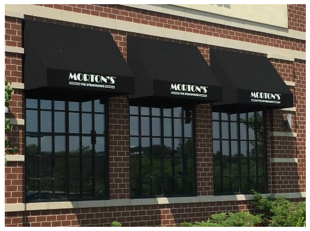</td>
</tr>
<tr class="odd">
<td>BACKLIT ILLUMINATION:</td>
<td>A method of internal illumination by which the sign is lit from within and light is projected back onto the supporting surface to create a halo effect around the sign copy. Also commonly known as "halo illumination". </td>
</tr>
<tr class="even">
<td>BANNER:</td>
<td>A sign constructed of lightweight flexible material.</td>
</tr>
<tr class="odd">
<td>BARE BULB ILLUMINATION:</td>
<td>Exposed or uncovered lighting elements used for illumination of a sign, including but not limited to exposed light bulbs. </td>
</tr>
<tr class="even">
<td>BLADE SIGN (PROJECTING SIGN):</td>
<td>A sign which extends out from a building face or wall, often in a perpendicular manner; also called a Projecting Sign. </td>
</tr>
<tr class="odd">
<td>CABINET (BOX) SIGN:</td>
<td>A sign which includes a frame or box-like external structure which encloses the functional elements of the sign, including internal illumination, where the sign content is affixed on a face/panel. Also called a Box Sign. 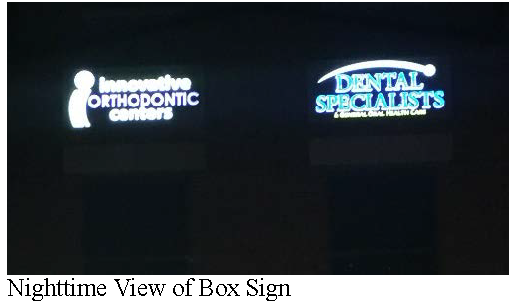</td>
</tr>
<tr class="even">
<td>CHANGEABLE COPY SIGN:</td>
<td>A component of a sign that features changeable text, characters, and/or illustrations that allows the sign's display to be amended, updated or otherwise modified. Electronic message boards are a type of changeable copy sign. 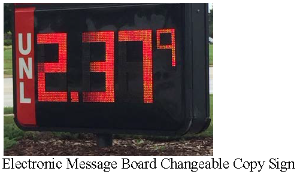</td>
</tr>
<tr class="odd">
<td></td>
<td></td>
</tr>
<tr class="even">
<td>CONSTRUCTION SIGN:</td>
<td>A sign which functions to identify or announce an upcoming construction project, which may include renderings or the purpose for which the building is intended.</td>
</tr>
<tr class="odd">
<td>DEVELOPMENT 
IDENTIFICATION 
SIGN:</td>
<td>A sign which identifies a commercial planned unit development, existing commercial center, or an overall commercial development. Development Identification Signage is used to accommodate those locations where the collection of business (either based on symmetry of use, site design, or aesthetics) is considered a destination for which an identification sign is helpful as a location navigation reference. </td>
</tr>
<tr class="even">
<td>DIRECTIONAL SIGN:</td>
<td>A sign which includes physical characteristics used to identify the location or direction of an activity, service, use, point of access or similar feature. 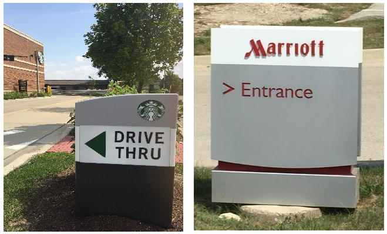</td>
</tr>
<tr class="odd">
<td>EDUCATIONAL CAMPUS</td>
<td>A collection of buildings and/or property owned or occupied by an organization within a defined geographic setting, most commonly within a residential environment.</td>
</tr>
<tr class="even">
<td>FLAG:</td>
<td>A piece of cloth or similar material typically attached by one edge to a pole or rope used as a symbol or as a signal.</td>
</tr>
<tr class="odd">
<td>FRONTAGE:</td>
<td>A strip or extension of land abutting a public or private roadway (excluding drive aisles), unless otherwise defined within this chapter.</td>
</tr>
<tr class="even">
<td>GROUND SIGN:</td>
<td>A sign which is permanently attached to the ground and may be completely or principally supported by one or more posts or other support structure, which is not attached to the principal building on the property. Ground sign types include monument, pole, etc. 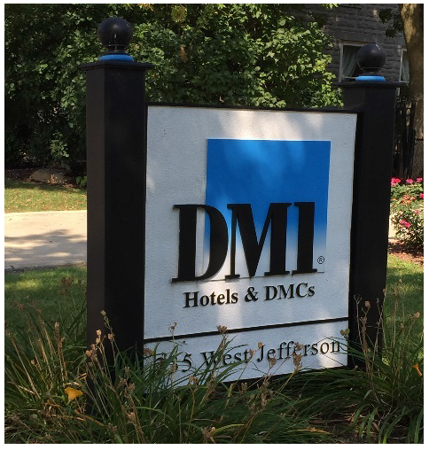</td>
</tr>
<tr class="odd">
<td>HAND HELD SIGN:</td>
<td>Signs that are not self-supporting and are carried, supported or under the immediate control of a human being.</td>
</tr>
<tr class="even">
<td>HISTORICAL MARKER:</td>
<td>A sign that displays or identifies historical interest. 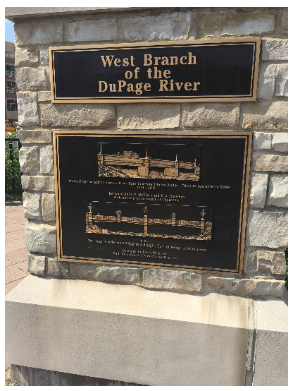</td>
</tr>
<tr class="odd">
<td></td>
<td>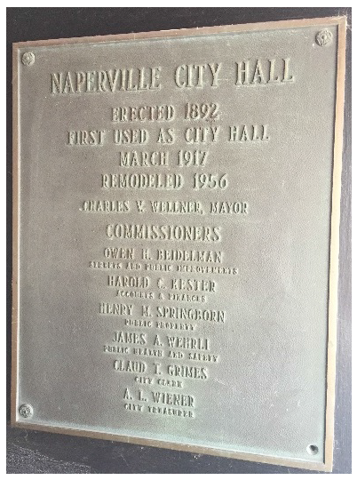</td>
</tr>
<tr class="even">
<td>INFLATABLE:</td>
<td>An object or device that can be filled with air or gas.</td>
</tr>
<tr class="odd">
<td>INFORMATIONAL SIGN:</td>
<td>A sign designed and located to be viewed exclusively by pedestrians when navigating a campus, district, or within the confines of a building. 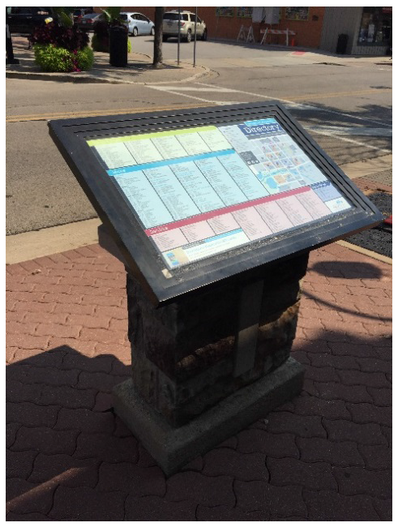</td>
</tr>
<tr class="even">
<td></td>
<td>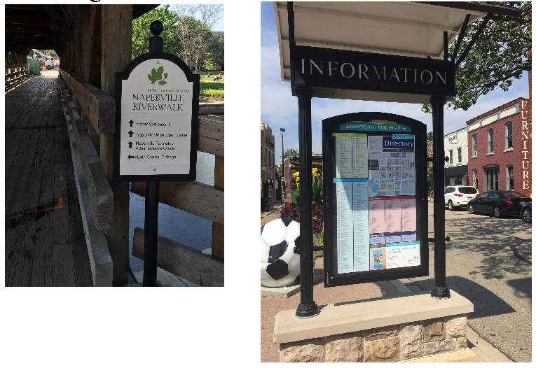</td>
</tr>
<tr class="odd">
<td>INSTITUTIONAL USES:</td>
<td>Schools, religious and not-for-profit land uses as defined within this Title.</td>
</tr>
<tr class="even">
<td>MODEL HOME AREA:</td>
<td>The subdivision or planned unit development, in which the model home site is located.</td>
</tr>
<tr class="odd">
<td>MODEL HOME SITE:</td>
<td>A qualifying building or structure authorized by permit per Section 6-2-9, which is used as an example of the type of dwelling unit which may be purchased or rented. 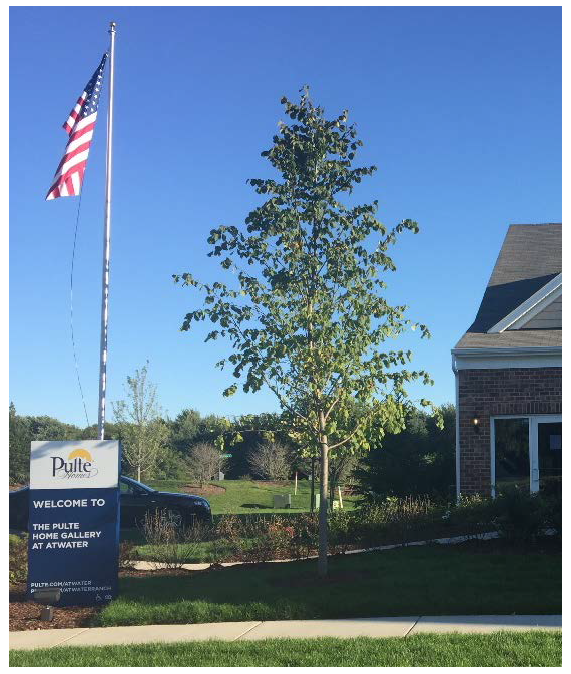</td>
</tr>
<tr class="even">
<td>MONUMENT SIGN:</td>
<td>A type of <em>Ground Sign</em> which is permanently attached to the ground and anchored by a support structure a minimum of eighty percent (80%) of the width of the sign. 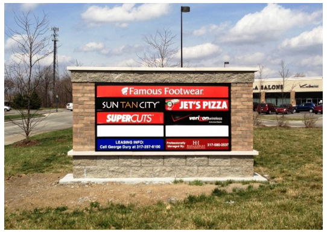</td>
</tr>
<tr class="odd">
<td>OFF PREMISES SIGN:</td>
<td>A sign which directs attention to a product and/or service sold, offered, created, furnished, or conducted at a location not directly associated with the property or site at which the sign is located. This shall not include signs on separate parcels that are associated with the same Planned Unit Development.</td>
</tr>
<tr class="even">
<td>OUTDOOR ADVERTISING SIGN:</td>
<td>A sign providing display space for general commercial advertising not related to the premises on site at which the sign is located; commonly referred to as "billboards".</td>
</tr>
<tr class="odd">
<td>OUT LOT/OUTBUILDING:</td>
<td>A secondary lot or structure not physically connected to the principal use of the development or property.</td>
</tr>
<tr class="even">
<td>PEDESTRIAN WALL SIGN:</td>
<td>A type of <em>Wall Sign</em> designed and installed specifically for pedestrian viewing, often enclosed in a glass frame, including but not limited to menus, events, services, schedules, etc. 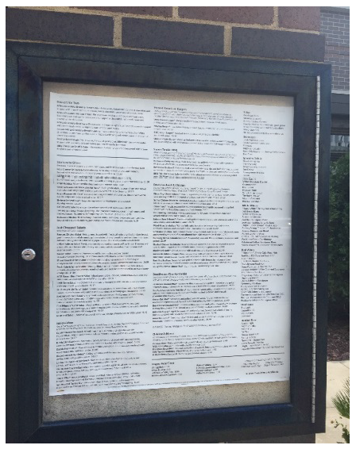</td>
</tr>
<tr class="odd">
<td></td>
<td>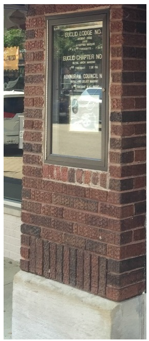</td>
</tr>
<tr class="even">
<td>POLE SIGN:</td>
<td>A type of <em>Ground Sign</em> which is supported by a pole structure extended from the ground. 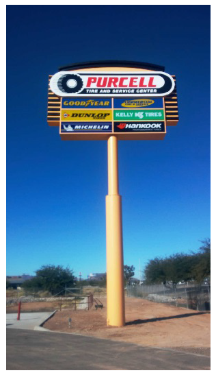</td>
</tr>
<tr class="odd">
<td>PORTABLE SIGN:</td>
<td>A category of signs designed to be easily moved from place to place and often containing a <em>Changeable Copy Sign</em> element. 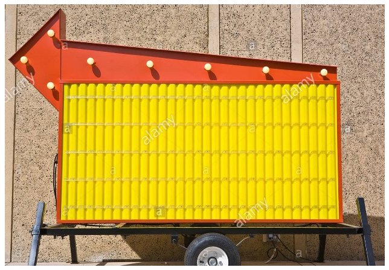</td>
</tr>
<tr class="even">
<td></td>
<td>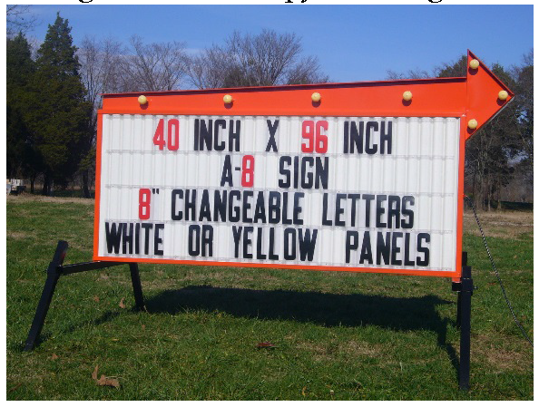</td>
</tr>
<tr class="odd">
<td>POST SIGN:</td>
<td>A type of <em>Ground Sign</em> mounted on a single or multiple support posts, as differentiated from a <em>Pole Sign</em> based on the supports serving as an essential design/decorative element of the sign. 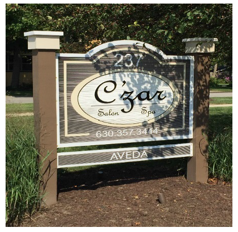</td>
</tr>
<tr class="even">
<td>RACEWAY:</td>
<td>The structural support of a <em>Wall Sign</em>.</td>
</tr>
<tr class="odd">
<td>ROOF SIGN:</td>
<td>A sign located on or attached to the roof of a structure.</td>
</tr>
<tr class="even">
<td>SHOPPING CENTER:</td>
<td>A series of retail establishments with individual entrances, sharing a common wall and common off street parking.</td>
</tr>
<tr class="odd">
<td>SIDEWALK SIGN:</td>
<td>A <em>Portable Sign</em> that is easily movable and displayed during operating hours of entity advertised; also called a Sandwich Board sign. 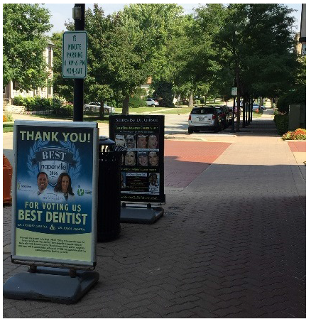</td>
</tr>
<tr class="even">
<td>SIGN:</td>
<td>Any object, device, display or structure, or part thereof, which is used to advertise, identify, display, direct or attract attention by any means including words, printed text, letters, figures, designs, symbols, pictures, fixtures, colors, motion, illumination or projected images for the purpose of delivering a message.</td>
</tr>
<tr class="odd">
<td>SIGN AREA:</td>
<td>The area in square feet of the smallest geometric figure, which encloses the sign display. For <em>Wall Signs</em>, the sign area shall include the frame or cabinet structure. See Section 6-16-7 of this Chapter for illustrations.</td>
</tr>
<tr class="even">
<td>SIGN, COMMERCIAL:</td>
<td>Display of speech on behalf of a company or individual for the intent of making a profit. Commercial Speech is economic in nature intended to identify, advertise, or direct attention to a business service or product.</td>
</tr>
<tr class="odd">
<td>SIGN, NON-COMMERCIAL:</td>
<td>Display which is devoid of any commercial signage.</td>
</tr>
<tr class="even">
<td>SUPPORT STRUCTURE:</td>
<td>Any structure or material which supports or is capable of supporting or keeping a sign in a stationary position, including foundation.</td>
</tr>
<tr class="odd">
<td>TEMPORARY SIGN:</td>
<td>A sign constructed and intended for a temporary period of display and is neither permanently installed in the ground nor permanently affixed to a building, structure, wall or perimeter fencing. </td>
</tr>
<tr class="even">
<td></td>
<td></td>
</tr>
<tr class="odd">
<td>WALL SIGN:</td>
<td>A sign attached or erected against a wall of a building or structure with the exposed face of the sign parallel to the plane of the wall designed to be visible from the property frontage.</td>
</tr>
<tr class="even">
<td>WALL SIGN, SECONDARY BUSINESS:</td>
<td>A wall sign to be used for a secondary commercial business located inside a primary business establishment.</td>
</tr>
<tr class="odd">
<td>WINDOW SIGN:</td>
<td>A sign installed inside, painted upon, or placed against a window for purposes of viewing from outside the premises, excluding merchandise located in a window display.</td>
</tr>
<tr class="even">
<td>YARD SIGN:</td>
<td>A type of <em>Temporary Sign</em> placed upon or inserted into the ground independently of any other structure, but not including any <em>Sidewalk Sign</em>. 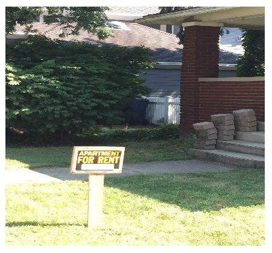</td>
</tr>
<tr class="odd">
<td></td>
<td> (Ord. No. 17-006, § 3, 1-17-2017; Ord. No. 22-121, § 2, 11-15-2022)</td>
</tr>
</tbody>
</table>

### 6-16-3: PROHIBITED SIGNS

Any sign not expressly permitted in this Chapter is prohibited. No person or entity shall display any of the following signs within the City of Naperville:

1\. Signs which by color, location, or design resemble or conflict with traffic control signs or signals.

2\. Portable signs, excluding sidewalk signs as defined within this Title.

3\. Commercial signs on a vehicle where said vehicle is parked adjacent to or near the right-of-way for the purposes of identifying or calling attention to the business, such as utilizing directional signage, and is not used for daily operations or during the regular course of business, or is not licensed, insured, or operational.

4\. Outdoor Advertising Sign.

5\. Flashing signs.

6\. Any signs or attention getting devices, that rotate, revolve, or have any visible moving parts or that gives the appearance of movement, including, but are not limited to, searchlights, spinners, streamers, balloons, and other similar devices, or ornamentation designed for purposes of attracting attention, promotion or advertising, unless otherwise provided for in this Chapter.

7\. Off-premise signs displaying commercial speech. Off-premise signs shall not include signs located on separate parcels that are part of the same Planned Unit Development.

8\. Any sign or structure which constitutes a hazard to public health or safety, including dangerous construction or sight obstructions.

9\. Any sign located in the public right-of-way, unless otherwise provided for in this Chapter.

10\. Pole signs, excluding tollway corridor signage as defined within this Title

11\. Changeable-copy signs and Electronic Message Boards, as defined in this Chapter, in the Downtown Central Business District.

12\. Ground Signs, as defined in this Chapter, in the Downtown Central Business District. Existing ground signs shall continue to be used and maintained in accordance with Section 6-16-10 of this Chapter.

(Ord. No. 17-006, § 3, 1-17-2017; Ord. No. 22-121, § 2, 11-15-2022)

### 6-16-4: SIGNS ON RESIDENTIAL PROPERTY

Signs on properties being used for residential purposes, regardless of zoning.

1\. Exempt Signs: The following signs located on private property are not required to obtain a permit, subject to compliance with the following requirements:

1.1 Address numbers, non-illuminated or directly illuminated, located on the property to which the sign is apparent, as required per Sections 5-1B-2:R319.1 (Premises Identification) and 9-2-3 (Building Numbers Required) of this Code.

1.2 Governmental signs incidental thereto for identification, information, directional, or public safety purposes erected or required by governmental bodies, or authorized for a public purpose by any law, statute or ordinance, such as traffic control signs and legal notices, including those located in the right-of-way.

1.3 Flags and handheld signs displaying only non-commercial speech, images or messages.

1.4 Historical Marker signs: Maximum of six (6) square feet in area.

1.5 Signs On Property For Sale Or Lease: One yard sign per frontage not to exceed six (6) square feet and a maximum height of five (5) feet, including any support structure, and shall not extend outside the property line. Such sign shall be removed upon closing of the sale or initiation of the lease.

1.6 Construction Signs: One yard sign is permitted for construction sites not to exceed six (6) square feet and a maximum height of five (5) feet, including any support structure, and shall not extend outside the property line. The sign shall be confined to the site of the construction, and shall be removed within three (3) days after the construction is complete.

One forty-eight (48) square foot sign with a maximum height of ten (10) feet shall be allowed for each qualifying frontage for a residential development including at least five (5) contiguous lots under the control of a single entity. Such signs shall be removed upon the completion of the development project.

1.7 In addition to the signs noted specifically in this Section, each property is allowed temporary non-commercial, non-illuminated wall and ground mounted temporary signs subject to the following requirements:

1.7.1 Sign area per individual sign shall be a maximum of six (6) square feet.

1.7.2 Sign height shall be a maximum of five (5) feet, including any support structure.

1.8 Signs on private property, including drive-through signage, not designed or installed to not be viewed from a frontage as defined in this chapter.

2\. Permanent Signs (Permit Required): Permanent signs shall be installed for an indefinite period of time, subject to all maintenance requirements as required by this Code. These provisions shall not apply to legal nonconforming uses.

2.1 Subdivisions or Planned Unit Developments ten (10) acres or larger or with ten (10) or more residential units and/or buildings:

2.1.1 Two (2) ground signs per entrance, with a maximum of four (4) total ground signs, per subdivision.

2.1.2 Sign area per individual sign shall be a maximum of thirty-two (32) square feet.

2.1.3 Sign height per individual sign shall be a maximum of six (6) feet, except that said sign height may be increased to nine (9) feet if installed along an arterial roadway.

2.1.4 Sign shall be setback a minimum of five (5) feet from any property line.

2.2 Home Occupation Sign: Properties with a permitted home occupation shall be limited to one of the following sign types, as regulated below:

2.2.1 Wall Sign: One wall sign not to exceed four (4) square feet in area.

OR

2.2.2 Ground Sign: One ground sign not to exceed four (4) square feet in area setback a minimum of five (5) feet from any property line.

2.2.3 If illuminated, only external illumination is permitted.

2.3 Office Uses permitted as Principal Uses by Conditional Use permit, in accordance with the procedures outlined in 6-3-8, shall be permitted signage in accordance with Section 6-16-6:4 (Properties Zoned Transitional Use (TU)) of this Section.

(Ord. No. 17-006, § 3, 1-17-2017; Ord. No. 22-121, § 2, 11-15-2022)

### 6-16-5: SIGNS ON COMMERCIAL AND INSTITUTIONAL PROPERTY

Commercial and institutional signs identify, advertise, or direct attention to non-residential structures or services, including but not limited to commercial, industrial, office or institutional uses. Regulations pertaining to uses located in the B4, B5 or TU districts are provided in Section 6-16-6 (Special Areas of Control) herein. Signage allowances are based on actual land use, not zoning classifications. Commercial signage may only be displayed upon the property to which the commercial sign pertains.

1\. Exempt Signs: The following signs are not required to obtain a permit, subject to compliance with the following requirements:

1.1 Governmental signs incidental thereto for identification, information, directional, or public safety purposes erected or required by governmental bodies, or authorized for a public purpose by any law, statute or ordinance, such as traffic control signs and legal notices, including those located in the right-of-way.

1.2 Directional signs up to a maximum six (6) square feet in sign area and installed on private property.

1.3 Address Numbers: Non-illuminated or directly illuminated, located on the lot to which the sign is apparent, as required per Sections 5-1B-2:R319.1 (Premises Identification) and 9-2-3 (Building Numbers Required) of this Code.

1.4 Flags displaying only non-commercial speech, images or messages. One additional flag displaying commercial speech on parcels one acre or larger in size.

1.5 Historical Marker signs up to a maximum of six (6) square feet in area.

1.6 Sidewalk Sign: One sidewalk sign not to exceed six (6) square feet in area and five (5) feet in height placed within five (5) feet of the building entrance during the hours of the operation of the building to which it corresponds. Sidewalk signs shall not be permitted in the public right-of-way, unless otherwise noted in this Code.

1.7 Window Signs: Shall occupy a maximum of seventy-five (75) percent of a single window pane and no more than fifty (50) percent of the total window surface area per storefront elevation. See illustration in Section 6-16-7 of this Chapter.

1.8 Handheld Signs Or People In Costume: Shall be located on the sidewalk immediately adjacent to the building within which the tenant to which they are advertising is located.

1.9 Signs On Property For Sale Or Lease: One yard sign, up to forty-eight (48) square feet in size with a maximum height of ten (10) feet is permitted per frontage. Signs shall be located in compliance with the provisions provided in Section 6-16-5:2.2 provided herein. Such signs shall be removed upon the closing of the sale or initiation of the lease.

1.10 Construction Sign: On non-residential property to which an active building permit has been issued, one yard sign no more than forty-eight (48) square feet with a maximum height of ten (10) feet shall be permitted. Such signs shall be removed upon the issuance of a Certificate of Occupancy by the City.

1.11 Pedestrian wall signs, up to a maximum of six (6) square feet in area.

1.12 Temporary non-commercial site signage subject to the following requirements:

1.12.1 Sign area per individual sign shall be a maximum of twelve (12) square feet.

1.12.2 Sign height shall be a maximum of five (5) feet, including any support structure (e.g., fence, sign, frame, building)

1.12.3 Sign location shall be no closer than ten (10) feet from the paved portion of any street or back of curb where no sidewalk is present and shall not be permitted within twenty (20) feet of the point formed by the intersection of the curb lines of two (2) or streets, as illustrated in Section 6-16-7 of this Chapter.

1.12.4 For properties larger than two (2) acres, one additional temporary sign per frontage up to thirty-two (32) square feet is allowed.

1.13 Signs on private property designed or installed so as not to be viewed from a frontage as defined in this chapter.

1.14 Like for like replacement of individual tenant panels on a multiple-tenant sign.

2\. Permanent Signs (Permit Required): Allowances provided are maximums. The general requirements of each sign type in this subsection shall apply:

2.1. Wall, Awning, And Canopy Signs:

2.1.1 For facades with street frontage (public or private) and facades adjacent to an off-street parking area where customer access is also available, wall, awning, and canopy signage (in any combination) shall be permitted up to a maximum sign area of one and one-half (1.5) square feet for each linear foot of facade. For facades on properties separated from the adjacent street frontage by another lot that is not designed to have a building located upon it (e.g. reserved exclusively for parking, stormwater management, etc.), permits for wall, canopy and awning signage may be authorized by the Zoning Administrator in accordance with the limits provided in this subsection.

2.1.2 For Multi-Story Multi-Tenant buildings: Excluding the first floor facade, the maximum combined area of one and one-half (1.5) square feet per each linear foot of frontage for all tenants located above and below the first floor on facades facing a public right-of-way. First floor signage shall be permitted in accordance with Section 2.1.1 above.

2.1.3 For facades adjacent to an off street parking area where customer access is not available, the total sign area shall not exceed fifty percent (50%) of the maximum sign area permitted as provided in this subsection.

2.1.4 In addition to the number of signs permitted herein, one additional sign shall be permitted for each secondary business located inside the primary business establishment. The sign area for each secondary business sign shall not exceed ten percent (10%) of the maximum allowable sign area for the primary business, plus any sign area allowed, but not being used by the principal business. A secondary business sign shall not exceed a total of one hundred (100) square feet. The secondary business sign area calculation is excluded from the maximum sign area allowed for the primary business.

2.1.5 Placement: Signs shall not extend above the roofline or parapet of a building. Wall signs may be painted on, or attached in a place substantially parallel to the building exterior wall, and must not interrupt architectural details. Awnings and canopies shall be installed so that a clearance from grade to the bottom of the awning or canopy of no less than eight (8) feet is maintained. See illustration in Section 6-16-7 of this Chapter.

2.1.6 Color And Patterns: If a raceway is visible it shall match the color of the exterior of the building. Awnings and canopies shall be limited to two (2) colors, except for logos which are exempt from this provision.

2.2 Ground Signs: All permanent ground signs must be of a monument type.

2.2.1 Number: Each property with a minimum of one hundred (100) feet of lot frontage is allowed one monument sign, oriented perpendicular to the eligible frontage as defined in Section 6-16-2. Each property with a minimum of five hundred (500) linear feet along the frontage may have two (2) monument signs placed no closer together than two hundred (200) feet and must meet the area and setback requirements as indicated in this Section. Exceptions are provided in Section 6-16-7 Special Areas of Control.

2.2.2 Sign Area: Ground signs must comply with the following area requirements, except as further regulated in Section 6-16-6 (Special Areas of Control):

| Posted Speed Limit (mph) | Maximum Sign Area |
|--------------------------|-------------------|
| 40 mph or less           | 45 square feet    |
| 45 to 50 mph             | 90 square feet    |
| 55 mph or greater        | 120 square feet   |

2.2.3 Changeable Signage: Changeable signage cannot exceed fifty percent (50%) of the permitted maximum sign area of a ground sign. The sign shall change no more than once every ten (10) seconds and shall only contain static displays. A variance is required for any display which changes more frequently.

2.2.4 Height: Ten feet (10), as measured from grade, and may be increased an additional two (2) feet for architectural features for monument signs. See illustration in Section 6-16-7 of this Chapter.

2.2.5 Setbacks:

2.2.5.1 When fronting a major arterial: Ten (10) feet from the front property line.

2.2.5.2 When fronting all other road classifications: Five (5) feet from the front property line.

2.2.5.3 From an interior property line: Forty (40) feet, except as provided for in Section 5-4-8 (Special Areas of Control), or unless otherwise approved by the Zoning Administrator if reduced setbacks are needed to limit impact on required parking, reasonably accommodate locations with limited open space, and avoid obstructions to existing signage. Signs shall not be placed in a manner that creates a danger to the public, either as a result of dangerous construction, sight obstruction or other cause.

2.2.6 Landscape Requirement: A landscaped area located around the base of the ground sign equal to one square foot for each one square foot of monument sign area is required for all monument signs. The landscaped area shall contain well maintained material including living landscape materials, architectural stones, water features or other beautification measures placed throughout the required landscape area. It is the responsibility of the property owner to ensure that landscaping is installed within six (6) months from the installation of the monument sign. See illustration in Section 6-16-7 of this Chapter.

2.2.7 Address Identification: Address number must be incorporated into a ground sign. Addresses shall be at least five and one-half (5.5) inches in height. Addresses not exceeding a height of six (6) inches are excluded from the sign area measurement.

2.2.8 Tollway Property Allowance: For properties that are directly adjacent to the I-88 tollway corridor, the following additional regulations shall apply, unless otherwise noted:

2.2.8.1 Number: One ground sign located along the I-88 tollway corridor frontage shall only be permitted for properties with a minimum of five hundred (500) feet of frontage along the tollway corridor. If multiple lots are located within a single campus or shared development, all lot frontages may be totaled to determine compliance with five hundred (500) foot minimum frontage requirement.

2.2.8.2 Sign Area: Maximum of one hundred twenty (120) square feet. Changeable Copy shall be limited to one-half (½) of the allowable sign area (or fifty percent (50%)) and shall be subject to the permit and variance requirements noted in Section 6-15-5:2.2.3 of this Chapter.

2.2.8.3 Height: Maximum height of twenty-five (25) feet, as measured from grade.

2.2.8.4 Landscaping: Shall be provided at the base of the sign unless waived by Zoning Administrator due to limited visibility or maintenance concerns. The landscape area shall be equal to one square foot for each one square foot of ground sign area. The landscaped area shall contain well maintained material including living landscape materials, architectural stones, water features or other beautification measures placed throughout the required landscape area. It is the responsibility of the property owner to ensure that landscaping is installed within six (6) months from the installation of the sign. See illustration in Section 6-16-7 of this Chapter.

2.3 Blade Signs:

2.3.1 Sign Area: Eight (8) square feet per side.

2.3.2 Number: One blade sign per each establishment per each facade with street frontage (public or private) or adjacent to an off-street parking area where customer access is also available.

2.3.3 Location: A minimum clearance of eight (8) feet measured from the bottom of the sign to the sidewalk above which the sign extends, and shall extend from the building facade a maximum of six (6) feet. See illustration in Section 6-16-7 of this Chapter.

2.4 Development Identification Signs:

2.4.1 Number: No more than one sign per street frontage for the development. Development identification signs for shopping centers with multiple tenants and a minimum of five hundred (500) linear feet along the roadway may have two (2) development identification signs placed per street frontage and must meet the area and setback requirements as indicated in this Section.

2.4.2 Area: A maximum of thirty-two (32) square feet in area.

2.4.3 Area Bonus: A fifty percent (50%) area bonus is permitted when it is the only sign for a development on which more than one (1) ground sign would otherwise be permitted.

2.4.4 Height: A maximum of ten (10) feet from finished grade.

2.4.5 Setback: A minimum of ten (10) feet from any property line.

2.4.6 Landscape Requirement: A landscaped area located around the base of the Development Identification Sign equal to one square foot for each one square foot of sign area is required. The landscaped area shall contain well maintained material including living landscape materials, architectural stones, water features or other beautification measures placed throughout the required landscape area. It is the responsibility of the property owner to ensure that landscaping is installed within six (6) months from the installation of the sign. See illustration in Section 6-16-7 of this Chapter.

3\. Temporary Signs (Permit Required): Temporary signs, as defined in Section 6-16-2 of this Chapter, are permitted, subject to the following provisions of this Section.

3.1 Time Period: No more than four (4) one-week (seven-day) periods during any calendar year. A temporary sign displayed for less than seven (7) days constitutes a one-week period. The signs must be removed immediately following the time period approved on the permit.

3.2 Sign Area: Maximum thirty-two (32) square feet per sign.

3.3 Height:

3.3.1 Inflatable: Twenty-five (25) feet as measured from grade.

3.3.2 All other ground mounted: Ten (10) feet as measured from grade.

3.4 Placement:

3.4.1 Wall Mounted: Shall not extend above the roofline or parapet of a building.

3.4.2 Ground Mounted: Must be placed on private property and shall not be placed in a manner that creates a danger to the public, either as a result of dangerous construction, sight obstruction or any other cause. Signs must be placed to comply with the visibility requirements contained in Section 6-2-13 of Title 6 of this Code. See illustration for measurement in Section 6-16-7 of this Chapter.

3.4.3 Roof mounted signs are prohibited.

3.5 For Temporary Uses receiving an occupancy permit, a sign up to thirty-two (32) square feet in size and in compliance with the height and placement restrictions noted within this section may be permitted for a period of time not to exceed that for which the Temporary Use is authorized.

(Ord. No. 17-006, § 3, 1-17-2017; Ord. No. 22-121, § 2, 11-15-2022)

### 6-16-6: SPECIAL AREAS OF CONTROL

Given their unique property environments (e.g., pedestrian areas, mixed use areas, transit corridors), special additional signage requirements are necessary to meet the purpose and intent of this Chapter. The provisions of this Section are based upon:

• Speed limits and parcel size consideration that differ from other areas of the community

• Special aesthetic considerations to protect the distinct character and identity of the Central Business District

• The potential for signage to have an adverse impact on adjacent uses due to close proximity and/or intensity of use within special areas of control if specific regulations are not provided.

1\. Educational Campus:

1.1 Wall Sign: Shall not exceed thirty-two (32) square feet in sign area per frontage and may not extend over the roofline of the building.

1.2 Ground Sign: Ground signage may be permitted subject to the following:

1.2.1 Maximum Dimensions: A ground sign may not exceed five (5) feet in width and six (6) feet in height including ornamentation.

1.2.2 Location: Any ground sign fronting a major arterial shall be a minimum of ten (10) feet from the front property line. All other monument/ground signs must be a minimum of five (5) feet from the front property line. All ground signage must be located on private property.

2\. Model Home Signs: Model Home Area and Model Home Site Signs, as described by Section 6-2-9 of this Title, in conjunction with a registered model home, are subject to the following regulations:

2.1 Model Home Area Signs:

2.1.1 Number: One sign per entrance with a maximum of three (3) per subdivision.

2.1.2 Area: Maximum of thirty-two (32) square feet.

2.1.3 Height: Maximum of ten (10) feet including ornamentation, as measured from grade.

2.1.4 Directional signs: A maximum of six (6) square feet in sign area and six (6) in height, as measured from grade, are permitted at the entrances to the subdivision of the model home area and at each corner leading to the model home site.

2.2 Model Home Site Signs:

2.2.1 Number: A maximum of three (3) signs shall be permitted.

2.2.2 Area: A maximum of forty-eight (48) square feet, per model home site.

2.2.3 Height: A maximum of six (6) feet, including ornamentation, as measured from grade.

3\. Downtown Central Business District (Properties Zoned B4 and B5): In addition to the following regulations contained herein, all signs permitted in the Downtown Central Business District shall also be subject to the design elements and guidelines contained in the Downtown Design Standards, Title 1 Chapter 11 Section 1-11-1:5.3.

3.1 Wall, Awning, And Canopy Signs:

3.1.1 Sign Area:

3.1.1.1 For properties zoned B4 and B5: The sum of the area of all wall, awning and canopy signs facing a qualifying facade shall not exceed an area equal to one and one-half (1.5) square feet for each linear foot of frontage per side. Qualifying facades include public and private streets, sidewalks, and alleys, the West Branch of the DuPage River, and parking lots.

3.1.1.2 For Multi-Story Multi-Tenant Buildings: Excluding the first floor facade, the maximum combined area of one and one-half (1.5) square feet per each linear foot of frontage for all tenants located above and below the first floor on facades facing a public right-of-way. First floor signage shall be permitted in accordance with Section 3.1.1.1 above.

3.1.2 Location:

3.1.2.1 For Single-Tenant buildings: Signs shall be located on the portion of a building that the business occupies.

3.1.2.2 For Multi-Tenant buildings: Signs for tenants located above and below the first floor shall be evenly distributed over the building facade, complement the architectural integrity of the building, be located in the general proximity of the tenants spaces, and shall not be clustered on one portion of the building facade. Locations are subject to review and approval by the Zoning Administrator.

3.1.3 Height: Wall signs shall not extend above the roofline of the structure to which it is affixed.

3.1.4 Illumination: External illumination, internally illuminated individual channel letter signage, and bare bulb signage is permitted. Internally illuminated box signs shall only be permitted when accessory to a primary sign and letters/sign copy must be dimensional, unless otherwise approved by the Zoning Administrator.

3.2 Sidewalk Signs: Sidewalk Signs are exempt from permit and subject to the following regulations:

3.2.1 Sign Area: Maximum of six (6) square feet per business.

3.2.2 Height: Maximum of five (5) feet.

3.2.3 Location: Shall be placed such that a minimum of four (4) foot clear passable walking space exists on the sidewalk to prevent obstructions to pedestrian movement. Said signs shall be placed on the sidewalk within the area defined by the building footprint limits wherein the tenant space is occupied.

3.2.4 Illumination: Prohibited.

3.2.5 Removal Requirements: Sidewalk signs must be removed at the end of the related business' hours of operation and during severe weather including high winds and heavy snowfall. Sidewalk signs must also be removed during snow removal operations.

3.3 Window Signs: Window signs are exempt from permit. The maximum sign area shall be fifty percent (50%) of the total window surface area of the facade on which the window is located. Window signs on an individual window may not exceed seventy-five percent (75%) coverage, unless otherwise approved by the Zoning Administrator.

3.4 Blade Signs:

3.4.1 Sign Area: Maximum of eight (8) square feet per side.

3.4.2 Number: One blade sign for each tenant establishment per each frontage along a qualifying facade (as defined by Section 4.1.1.1) or alternative frontage which offers customer access to tenant space within a building.

3.4.3 Location:

3.4.3.1 A minimum clearance of eight (8) feet measured from the bottom of the sign to the sidewalk above which the sign extends. Blade signs shall not extend more than three (3) feet from the vertical plane of the facade and must be six (6) inches from the facade, provided that no blade sign shall extend beyond the limits of the sidewalk below the sign.

3.4.3.2 Upper and lower level business tenant blade signs must be located over or within two (2) feet of a door access to the business.

3.4.3.3 Ground floor (first floor) business tenant blade signs may be located anywhere along the facade occupied by the business.

3.4.4 Illumination: External illumination, internally illuminated individual channel letter signage, and bare bulb signage is permitted. Internally illuminated box signs shall only be permitted when accessory to a primary sign and letters/sign copy must be dimensional, unless otherwise approved by the Zoning Administrator.

3.5 Development Identification Signage: Shall be permitted for developments containing ten (10) or more units, applies to both commercial and residential developments, and further subject to the following:

3.5.1 For properties zoned B4: One wall sign, a maximum of thirty-two (32) square feet in sign area, and shall be placed to compliment the architectural character of the building as approved by the Zoning Administrator.

3.5.2 For properties zoned B5: One development sign per development, a maximum of thirty-two (32) square feet in sign area. Such sign may be attached to the wall or mounted to a decorative feature/seating wall. Signage attached to a decorative feature/seating wall shall have a maximum sign height of three (3) feet. No setback is required.

3.6 Pedestrian Wall Sign: Are exempt from permit, and shall not exceed nine (9) square feet in area. All such signs must be enclosed in a glass frame.

3.7 Box Signs: Shall be prohibited unless accessory to a permitted principal wall sign, and must utilize dimensional letters/sign copy (e.g. raised or recessed letters). Box signs which demonstrate a unique design/aesthetic application and are found to be in accordance with the Downtown Design Standards (Title 1 Chapter 11 Section 1-11-1:5.3) may be approved by the Zoning Administrator.

4\. Properties Zoned Transitional Use (TU): TU zoned properties shall comply with all sign requirements outlined for the Downtown Central Business District, and shall also be subject to the design elements and guidelines contained in the Downtown Design Standards, Title 1 Chapter 11 Section 1-11-1:5.3, except as further regulated below:

4.1 Ground Signs: The following requirements shall apply:

4.1.1 Number: One per property, provided the subject property has at least fifty (50) feet of street frontage along a public right-of-way.

4.1.2 Height: Maximum of ten (10) feet, as measured from grade, plus up to two (2) additional feet for architectural features.

4.1.3 Sign Area: Maximum of thirty (30) square feet.

4.1.4 Location: Shall be a minimum of fifteen (15) feet from an interior lot line and five (5) feet from the front property line, and shall be exempt from the Major Arterial Sign Setback requirement contained in Section 6-2-14.

4.2 Additional Regulations, applicable to all sign types:

4.2.1 Only external sign illumination is permitted.

4.2.2 Electronic Message Boards are prohibited.

(Ord. No. 17-006, § 3, 1-17-2017; Ord. No. 22-121, § 2, 11-15-2022)

### 6-16-7: MEASUREMENTS

The following criteria shall be used in measuring a sign or building facade in order to determine compliance with this Chapter. The illustrations provided in this section are provided to offer clarifications, not replace the written requirements of this Chapter. These illustrations do not reflect every sign type.

1\. Sign Area, Ground Sign: The sign area shall be the extreme outer dimension of the freestanding structure, excluding the support structure and architectural features. For ground signs that contain multiple cabinets on one structure, the modules together are counted as one sign face in order to compute the sign area.

2\. Sign Height, Ground Sign: The overall height of a freestanding sign or sign structure is measured from the average finished grade at the base of the sign to the highest points of the sign structure.

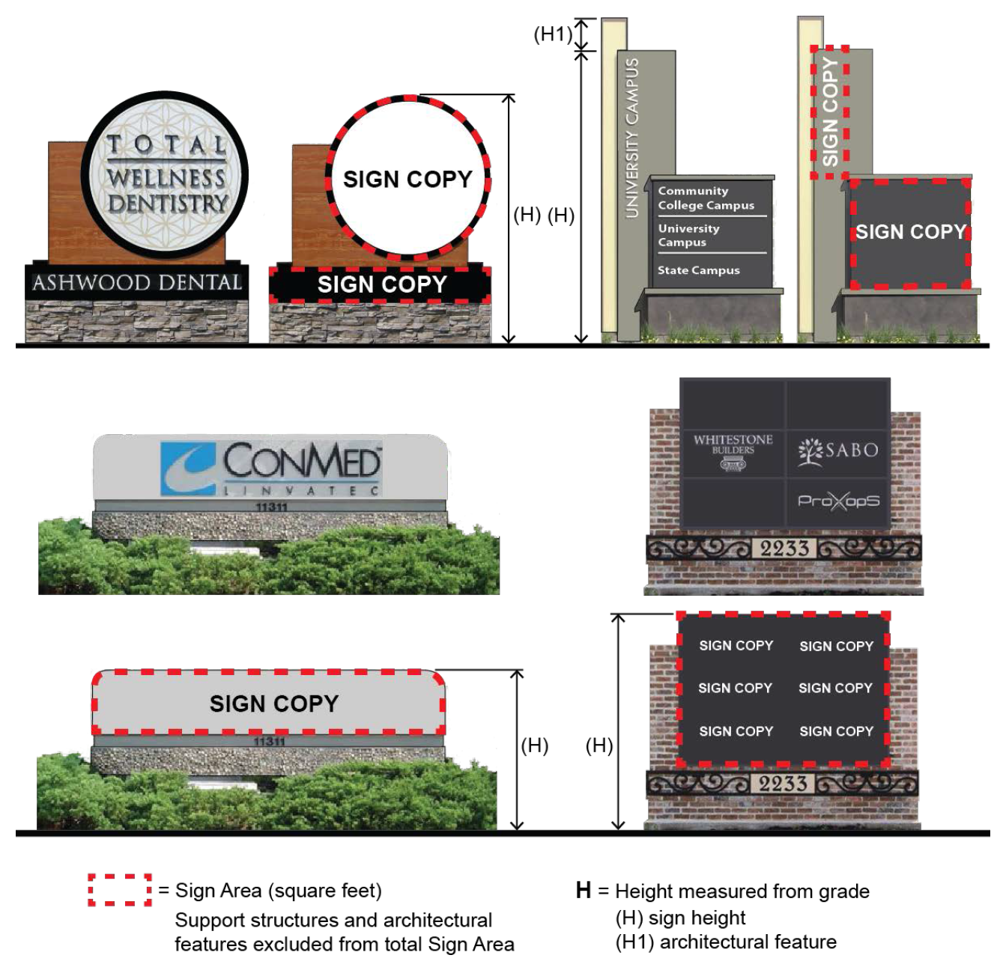

3\. Ground Sign (Landscape Requirement): The landscape requirement is determined by calculating the area of the landscaped area located around the base of the ground sign. Examples of a rectangular and circular area are provided below:

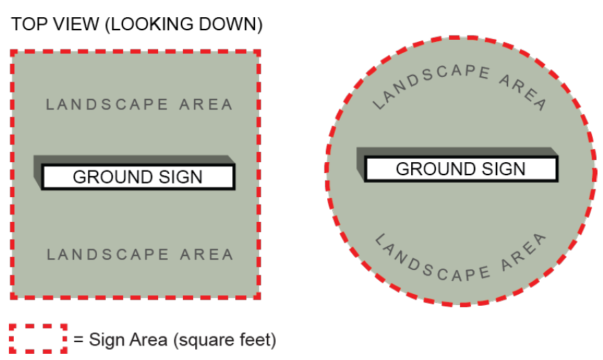

4\. Sign Area, Wall (Single Element): The sign area is determined by calculation the measurement of the outer dimensions of the frame or cabinet surrounding the sign.

5\. Sign Area, Wall Sign (Multiple Elements): When signs are constructed of individual elements, the area of all sign elements, which together convey a single, complete message, shall be considered as a single sign. The sign area is determined by calculating the area of an imaginary rectangle, circle, triangle, or parallelogram drawn around the sign elements.

6\. Sign Area, Awning And Canopy: When signs are incorporated into the awning or canopy, the sign area is determined by computing the area of an imaginary rectangle, circle, triangle, or parallelogram drawn around the sign copy.

7\. Measurement Of Building Frontage: The building frontage shall be calculated using the width of the first story exterior wall. Exterior wall dimensions shall be measured at the base of the ground floor, excluding screened walls, fences, etc. Alcoves, entryways and extruding portions shall be measured through as though along a flat wall of a building.

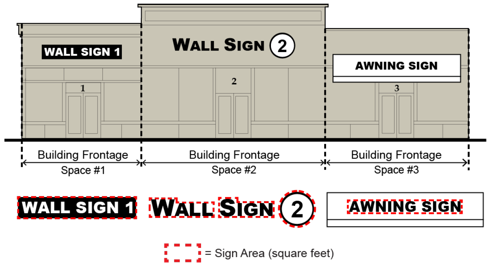

8\. Clearance, Awning/Canopy And Blade Sign: Awnings and canopies shall be installed with a minimum clearance of eight (8) feet measured from grade to the bottom of awning or canopy. Blade signs shall have a minimum clearance of eight (8) feet measured from grade to the bottom of the sign and shall extend a maximum of six (6) feet from the building facade to which its attached.

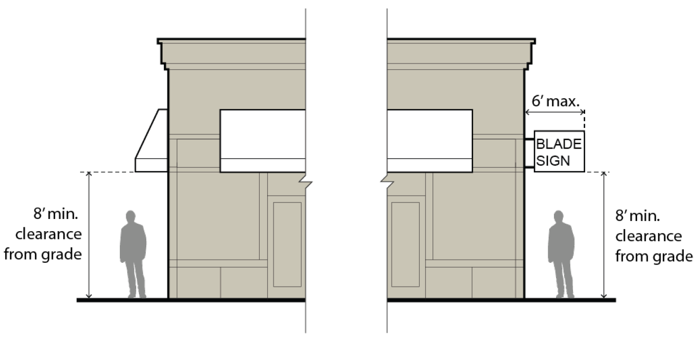

9\. Sign Area, Window Signs: Shall occupy a maximum of seventy-five percent (75%) of a single window pane and no more than fifty percent (50%) of the total window surface area per storefront elevation.

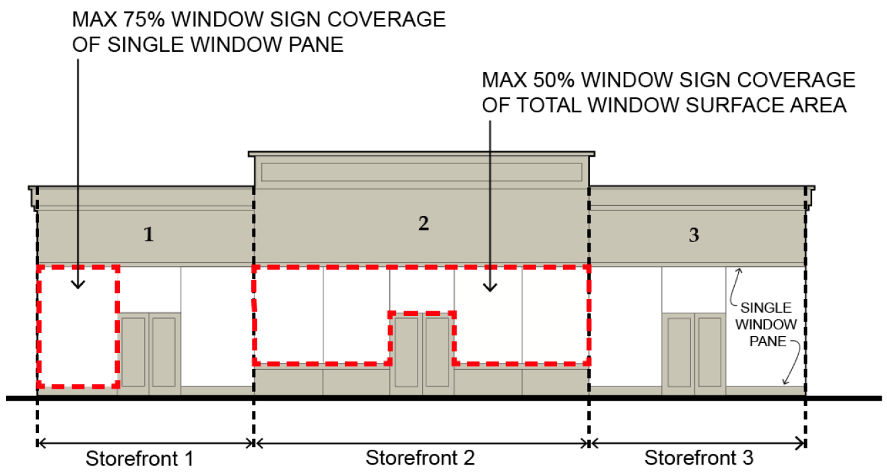

10\. Measurement Of Noncommercial Signage Setback: Noncommercial signs shall not be permitted within twenty (20) feet of the point formed by the intersection of the curb lines of two (2) or more streets, nor within ten (10) feet of the paved portion of any street or back of curb where no sidewalk is present.

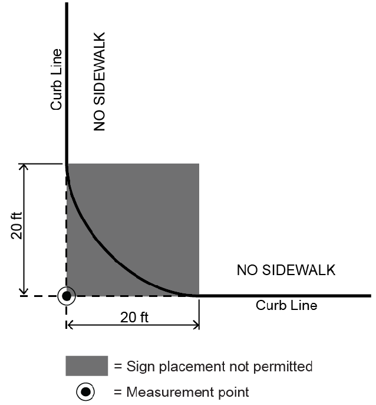

(Ord. No. 17-006, § 3, 1-17-2017)

### 6-16-8: ILLUMINATION

Internally or externally illuminated signs and bare bulb signs shall be permitted, per the regulations of this Chapter, provided they meet the following requirements:

1\. Signs shall be illuminated only by steady, stationary, shielded or shaded light sources directed solely at the sign or internal to it so that the light intensity or brightness does not create either a nuisance to adjacent property or a traffic hazard for motorists or pedestrians.

2\. Individual letters or logos may be internally illuminated. All other portions of the sign shall be opaque.

3\. No exposed reflective type bulb and no strobe light shall be used.

4\. Illuminated signs shall produce no more than thirty (30) foot-candles of illumination, four (4) feet from the sign.

5\. Whenever external illumination is used to illuminate a sign, the source of light shall be located, shielded, and directed in such a manner that the light source is not visible from a public street or private residence.

(Ord. No. 17-006, § 3, 1-17-2017)

### 6-16-9: PERMIT PROCESS

Unless exempted from the requirements of this Chapter, no person shall erect or display any sign unless issued a permit.

1\. Application: Any person or activity proposing to erect, display, or replace a sign shall file an application on a form provided by the City of Naperville. Signs listed in Sections 6-16-4:1 and 6-16-5:1 of this Chapter are exempt from a sign permit. The following supporting documents are required for review of a permit:

1.1. Scaled drawing of proposed sign (scale must be indicated on drawing).

1.2. Location drawing, clearly drawn indicating roadways, parking lots and buildings, including dimensions of setback (ground signs). If questions arise related to utilities, setbacks, or other technical details, Zoning Administrator may require a plat of survey be provided.

1.3. Detailed, scaled drawing of building elevation where sign will be placed (wall signs).

1.4. Completed electrical contractor's certification (for signs requiring electricity).

2\. Granting Of Permit: After review, a permit for the sign shall be granted if:

2.1. It complies with this Chapter.

2.2. It has been authorized by a variance granted by the City of Naperville, if required.

2.3. All applicable permit fees have been paid as required.

3\. Conformance With The National Electrical Code: All signs in which electrical wiring and connections are required shall conform to the applicable provisions of the National Electrical Code.

4\. Wind Pressure And Dead Load Requirements: Signs shall be designed and constructed to withstand a wind pressure of not less than thirty (30) pounds per square foot of net surface area and to receive dead loads as required in the building code.

5\. Payment Of Fees: All fees shall be paid in full before any permit for a sign is issued.

6\. Completion Of Authorized Work: If the work authorized under the permit has not been completed within six (6) months after the date of issuance, the permit shall become null and void.

(Ord. No. 17-006, § 3, 1-17-2017; Ord. No. 22-121, § 2, 11-15-2022)

### 6-16-10: NONCONFORMING SIGNS

Any nonconforming sign lawfully in existence at the time of the adoption of this Chapter or any subsequent amendment hereto may be continued in accordance with the provisions of this Section. Nonconforming signs may continue to exist provided the signs are in conformity with the provisions of this Section.

1\. Ordinary repairs and maintenance, including removing and replacing of the outer tenant panels shall be permitted (except in those cases when the revision of the display of commercial speech is due to a change of the business tenant). No structural alterations, or other similar work shall appreciably extend the normal life of the sign.

2\. No repair, alteration, or replacement which increases the size of the sign shall be permitted.

3\. No sign shall be moved in whole or part to any other location on the same or any other lot unless every portion of such sign is made to conform to all regulations of this Chapter and other applicable regulations of the City.

4\. A nonconforming sign which is destroyed or damaged by fire or other casualty or act of nature to the extent that the cost of restoration to the condition in which it was before the occurrence shall exceed fifty percent (50%) of the cost of the replacement of the entire sign, shall not be restored unless said sign shall conform to all of the regulations of this Chapter and other applicable regulations of the City of Naperville.

In the event such damage or destruction is less than fifty percent (50%) of the cost of restoration of the sign to the condition in which it was before the occurrence of damage or destruction, restoration must be completed within one hundred eighty (180) days from the date of such damage or destruction, and diligently pursued to completion, or the sign shall be removed.

5\. If a nonconforming sign is discontinued for a continuous period of one hundred eighty (180) days, it shall be removed, and any subsequent sign shall conform to all of the requirements of this Chapter and other applicable regulations of the City of Naperville.

6\. No substitution, through repair or alteration, of any element of a sign, which causes such sign to be classified as nonconforming, for another such element, shall be permitted.

7\. Any nonconforming sign which violates any provision of this Section shall be considered a nuisance and removed within thirty (30) days. Failure to remove within thirty (30) days shall subject the sign to abatement by the City. The owner of the nonconforming sign shall be responsible for reimbursement to the City of Naperville for all costs relating to the abatement of the nuisance.

(Ord. No. 17-006, § 3, 1-17-2017)

### 6-16-11: VARIANCES

Variance requests shall be processed in accordance with the provisions provided in Section 6-3-6 of this Title.

(Ord. No. 17-006, § 3, 1-17-2017)

### 6-16-12: NUISANCE AND ABANDONED SIGNS

1\. Nuisance: Any signage placed in the public right-of-way in violation of this Chapter shall be considered a nuisance and subject to abatement by the City. The person responsible for the illegally placed signs may be responsible for reimbursement to the City for the City's costs of the removal or abatement of the illegally placed signs in addition to being charged with violating the provisions of this Chapter and subject to any fines and costs. The City Manager may take whatever action is lawful and necessary to collect costs due under this provision including, without limitation, hiring a collection agency, refusing to issue any City permit or license to the person(s) responsible, including any service charges and costs of collection. The City may also set off against any amounts owed by the City to the person(s) responsible amounts then owed by the delinquent customer to the City. Any person(s) responsible desiring to obtain a City permit or license while contesting the amount owed the City, may obtain a City permit or license by posting financial security in a form acceptable to the City Attorney, and in an amount equal to the disputed amount.

2\. Abandoned Signs: Any sign which has been deemed abandoned shall be removed; or have the face replaced with a weatherproof, blank face by the owner, agent or person having the beneficial use of the building, structure or lot upon which such sign is located within one hundred eighty (180) days after the business has abandoned the tenant space. Any abandoned sign that does not comply with this provision is considered a nuisance and subject to abatement by the City. The owner of the abandoned sign will be responsible for reimbursement to the City of Naperville for all costs relating to the abatement of the nuisance.

(Ord. No. 17-006, § 3, 1-17-2017)

### 6-16-13: INSURANCE AND BOND REQUIREMENTS

Every applicant for a permit for a street sign which will extend over a public right-of-way as approved by the City of Naperville or which is so located that it may fall upon the same, shall file with the City before the permit is granted, a liability insurance policy covering all damage or injury that might be caused by each of said street signs, or certificate of insurance therefor, issued by an insurance company authorized to do business in the State of Illinois and satisfactory to the City, with limits of liability of not less than fifty thousand dollars (\$50,000.00) for property damage and five hundred thousand dollars (\$500,000.00) for personal injuries. The City, its officers, agents and employees shall be named as additional parties insured. Such liability insurance policy shall be maintained in force throughout the life of the permit, and if at any time it shall not be in full force, the permit shall be revoked by the City.

(Ord. No. 17-006, § 3, 1-17-2017)

### 6-16-14: SEVERABILITY AND CONSTRUCTION OF SIGN PROVISIONS

If any part, section, subsection, paragraph, subparagraph, sentence, phrase, clause, term, or word of the provisions of this chapter related to signs is declared unconstitutional by order of any court of competent jurisdiction, the declaration of such unconstitutionality shall not affect any other part, section, subsection, paragraph, subparagraph, sentence, phrase, clause, term or word of this chapter and all other portions of this chapter shall remain in full force and effect.

(Ord. No. 17-006, § 3, 1-17-2017)

### 6-16-15: SUBSTITUTION CLAUSE

Non-commercial signage may be substituted in any location where commercial signage is allowed under this Chapter.

(Ord. No. 17-006, § 3, 1-17-2017)

[^9]: Note(s)—Section 4 of Ord. No. 17-006, adopted January 17, 2017, states that field enforcement will commence on May 1, 2017.
