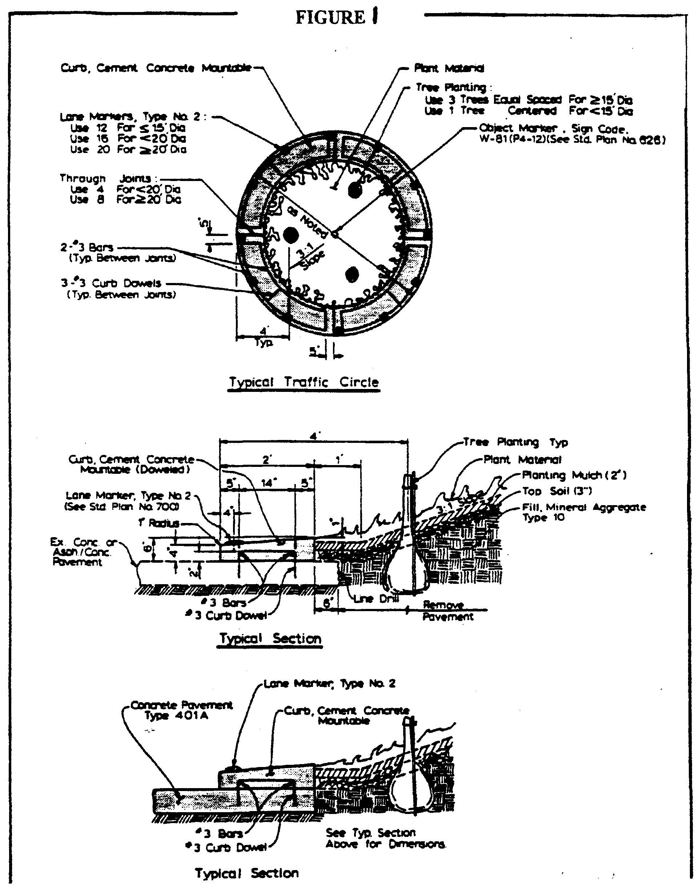
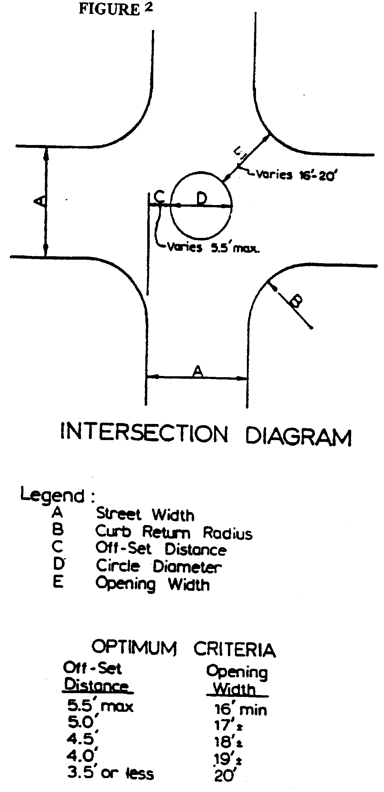
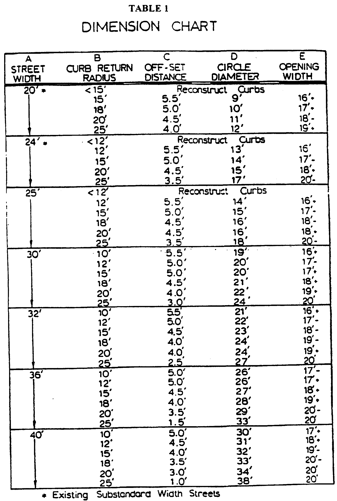
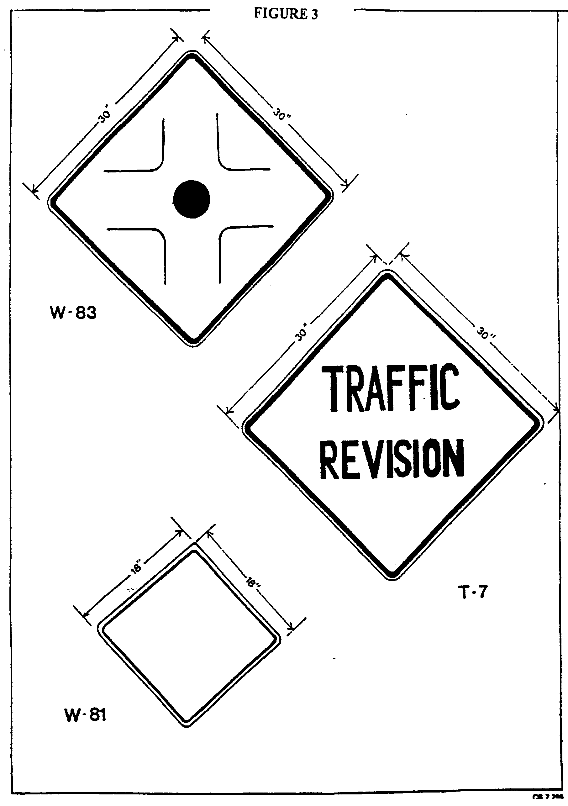

# 11-6 NEIGHBORHOOD TRAFFIC CIRCLE INTERSECTIONS

### 11-6-1: PURPOSE

Traffic circles are a neighborhood residential traffic control technique based upon changing the physical geometry control of "through" traffic so that traffic is restricted to very low speeds through intersections. Traffic circles are an alternate approach to regulatory traffic sign control, such as speed limit signs and stop signs. The construction and installation of traffic circles at residential street intersections within a neighborhood is the neighborhood residential traffic control equivalent of constructing a cul-de-sac in the middle of blocks in the neighborhood to control traffic characteristics of the individual blocks of the neighborhood.

(Ord. 96-75, 5-7-1996)

### 11-6-2: ELIGIBLE STREETS

1\. Traffic circles are appropriate for residential streets identified in the City's Master Thoroughfare Plan. Those streets identified in the City's Master Thoroughfare Plan as collector or arterial streets are "through" traffic streets and are not eligible for the construction and installation of traffic circles.

2\. Traffic circles may be used for intersections with four (4) approaches; traffic circles cannot be installed in an intersection of one street making a "T" with another.

3\. Traffic circles may not be used at cross-intersections at the primary elementary or middle school crossings as designated in the Safe School Walking Route and Traffic Plan.

4\. Traffic circles are an effective tool for residential streets which function as residential streets. Those intersections of residential streets where the sum of the approach volumes exceed three thousand (3,000) vehicles daily are not eligible for installation of a traffic circle as their volumes exceed the level beyond which traffic circles can effectively regulate speed.

(Ord. 96-75, 5-7-1996)

### 11-6-3: NEIGHBORHOOD TRAFFIC CIRCLE PLANS

Traffic circles are a neighborhood traffic control technique and are not appropriately installed at single intersections only. Consideration of a traffic circle shall be carried out only as part of an overall comprehensive traffic circle plan for a neighborhood as a whole. A neighborhood, for the purposes of this program, shall be the functional neighborhood bounded by arterial and collector streets and may consist of more than one homeowners' association (HOA).

(Ord. 96-75, 5-7-1996)

### 11-6-4: PROCESS

1\. Application:

1.1. Any group of residents, through their respective homeowners' association or designated neighborhood representative where no homeowners' association exists, may apply for installation of traffic circles as part of an overall neighborhood traffic circle plan for their neighborhood as detailed in the petition process detailed below.

1.2. A typical petition in a format acceptable for the purposes of the Neighborhood Traffic Circle Program is attached hereto and incorporated herein by reference as Exhibit A. Petitions shall be available in the City Clerk's office or from the City's Department of Public Works (DPW).

1.3. Applications by a single resident do not represent a neighborhood request and shall have no standing.

2\. Petition Procedure:

2.1. The group of residents through their HOA representative, working with the Neighborhood Traffic Circle Program Coordinator of the Traffic Engineering and Safety Division of the Department of Public Works, will cooperatively develop a preliminary traffic circle plan for the neighborhood.

2.2. If an area has no HOA, a group of residents may identify one person as their contact person for the purposes of the petition process. That person shall have the authority to speak for and make decisions for the neighborhood group as a whole.

2.3. The neighborhood representative will submit a letter indicating the neighborhood's interest in a traffic circle to DPW which will forward the letter listing the locations for proposed traffic circles to the Fire Department for review. Upon determination by the Fire Department that the proposed locations are acceptable, it shall notify DPW of that determination.

2.4. Based upon the location of the proposed traffic circles in the preliminary traffic circle plan for the neighborhood, the petition area shall consist of all residences (and local businesses) abutting any street (whether facing that street or not) within a one-block distance of each four-way street intersection for which a traffic circle is proposed as part of the plan. Where an intermediate intersecting street is a cul-de-sac, all residences on the cul-de-sac shall be included in the petition area.

2.5. The group of residents shall be responsible for circulating the petition to all affected residences (and businesses). The petition must show every address that fits the criteria of Subsection 2.4 above, whether or not a signature is secured. The group of residents applying for a neighborhood traffic circle plan will be supplied with a map of their neighborhood which indicates the petition area for the intersections identified in the preliminary traffic circle plan.

2.6. A petition for the proposed neighborhood traffic circle plan for the neighborhood shall be forwarded to the City's Transportation Advisory Board for review when at least sixty percent (60%) of all the residents (and local businesses) in the petition area have indicated their approval for each traffic circle by their signatures on the petition. Only one signature per residence (or local business for the address of the property) needs to be obtained.

2.7. When the petition is submitted to the Traffic Engineering and Safety Division for the agenda of the Transportation Advisory Board, the City shall send a letter indicating the receipt of the petition and an assessment of the minimum number of favorable signatures on the petition to the person identified as the contact person for the neighborhood group. If the number is insufficient to meet the requirement of sixty percent (60%), the petition will be returned to the contact person.

2.8. The total number of residences (and local businesses) in the petition area will be verified by using the property parcel maps of the DuPage and Will County Clerks.

3\. Review By The Transportation Advisory Board And Council:

3.1. Where at least sixty percent (60%) of the residents in the petition area have approved a petition for a neighborhood traffic circle plan, DPW staff will carry out traffic engineering investigations including traffic speed, traffic volume, and summarization of traffic accidents over the past three-year period, of intersections within the neighborhood. Based upon the traffic engineering studies, staff may request the neighborhood group to consider additional traffic circles which would expand the petition area. In this case, the petition would be returned to the neighborhood group contact person for additional circulation.

3.2. When the traffic investigations for each traffic circle petition are completed, the petition and the traffic engineering studies shall be forwarded to Police and Fire Departments for their review and comments.

3.3. For each petition for a neighborhood traffic circle plan, the Traffic Engineering and Safety Division shall develop a traffic study which shall accompany the petition at the time of its review by the Transportation Advisory Board.

3.4. Notice of public meetings and/or hearings before TAB for a neighborhood traffic circle plan will not be distributed by hand. Notice will be by mail to all residences (and local businesses) in the petition area and by posting of notice signs. Notice will also be sent to any resident requesting such notice for a specific location.

3.5. After reviewing a petition for a neighborhood traffic circle plan, the Transportation Advisory Board may remand the petition back to the neighborhood group to modify the plan with the assistance of staff, may recommend approval of the neighborhood traffic circle plan to City Council, or may deny the petition.

3.6. Upon approval of a neighborhood traffic control plan by the Council, the plan shall be placed in the schedule for pilot construction and installation within appropriate funding limits.

3.7. The priority of each neighborhood traffic control plan within the overall program shall be based upon the combination of speed, accidents, and volumes as detailed in the Intersection Priority Schedule attached hereto and incorporated herein by reference as Exhibit B.

4\. Pilot Construction And Installation:

4.1. For each temporary traffic circle, DPW shall lay out and mark the proposed geometries of the traffic circle for review and approval by the Fire Department which shall drive test the marked circle for safe travel with Fire Department vehicles.

4.2. Each neighborhood traffic circle shall be installed for a period of six (6) months in a temporary manner.

4.3. After a period of six (6) months, the neighborhood traffic circle may be removed if sixty percent (60%) or more of the residents of the neighborhood traffic circle petition the City to remove the circle.

4.4. Except in emergency situations as determined by the City Engineer, no petition to remove a traffic circle will be considered before the traffic circle is in place for at least six (6) months.

4.5. Right-of-way controls and pedestrian/school advance and crosswalk warning signs currently in place shall remain during the pilot construction and installation.

5\. Permanent Construction And Installation Of Traffic Circles:

5.1. After completion of a pilot installation of a traffic circle for a period of six (6) or more months, each temporary traffic circle shall be removed and a permanent traffic circle shall be constructed, installed, and landscaped according to a "noncontractual agreement" between the HOA and the City.

5.2. Right-of-way controls and pedestrian/school advance and crosswalk warning signs previously placed for a traffic circle cross-intersection shall be removed at the time the permanent traffic circle is completed.

(Ord. 96-75, 5-7-1996)

### 11-6-5: LANDSCAPING IN TRAFFIC CIRCLES

1\. Landscaping in traffic circles shall be maintained by a "noncontractual agreement" between the City and the homeowners' association or organized neighborhood group.

2\. Traffic circles less than fifteen (15) feet in diameter shall have only one tree centered in the circle along with the other plantings.

To prevent any safety hazards, only those plantings approved by the Forestry Section of the Department of Public Works as may be used in traffic circles.

3\. Traffic circles at least fifteen (15) feet in diameter may have up to three (3) trees equally spaced and set back four (4) feet from the back of the traffic circle curb along with the other plantings in accordance with the Traffic Circle Details illustrated on Figure 1, attached hereto and incorporated herein by reference. Permissible plantings are listed in Exhibit C, attached hereto and incorporated herein by reference.

4\. Plantings and trees will normally be installed in a permanent traffic circle following the six-month pilot period. DPW shall install temporary plantings as part of the pilot construction and installation. The homeowners' association, upon request to DPW, may install and maintain plant materials during the pilot construction and installation in accordance with a signed agreement, provided that these plantings will be removed during the construction of the permanent traffic circle.

5\. All permanent landscaping and plantings shall be the subject of a DPW permit detailing the permissible plantings by type and including the name of the HOA which will be responsible for the plantings.

6\. No basketball hoops shall be allowed in traffic circles.

7\. Any plantings which are damaged by vandalism or traffic damage will be the responsibility of the neighborhood group and homeowners' association to replace.

8\. If the plantings are not maintained for a period of two (2) months or more, DPW may remove the unmaintained plantings in the traffic circle.

9\. If no neighborhood group is willing to maintain the plantings in a traffic circle, DPW may select between two (2) options including surfacing the circle in asphalt and removing the traffic circle.

(Ord. 96-75, 5-7-1996)

### 11-6-6: TRAFFIC CIRCLE DESIGN AND LAYOUT

1\. Design Considerations:

1.1. Design criteria for a traffic circle shall reduce traffic speeds and accidents while allowing for the movement of large trucks and emergency equipment through the intersection.

1.2. Such criteria shall also provide the largest possible traffic circle with the maximum amount of landscaping for beautification, and thereby provide visual warning to drivers of the traffic circle in the middle of the residential street.

1.3. There will be cases where not all of the criteria can be met and where one or more curb returns may have to be reconstructed. Some of these cases include:

1.3.1. Where intersecting streets are of different widths; and

1.3.2. Where one or more of the intersecting streets are off-set or angled.

1.4. For each intersection, the size of the traffic circle will vary depending on the circumstances for that specific intersection. In general, the size of the circle will be determined by the geometries of the intersection, with the largest circle that meets the following design criteria.

2\. Design Criteria:

2.1. The distance between a traffic circle and the street curb projection off-set distance shall be a maximum of five and one-half (5½) feet, in accordance with the intersection diagram depicted in Figure 2, attached hereto and incorporated herein by reference.

2.2. The width between a traffic circle and a curb return (opening width) shall be a minimum of sixteen (16) feet and a maximum of twenty (20) feet, also in accordance with Figure 2.

2.3. As the off-set distance decreases from the maximum of five and one-half (5½) feet, the opening width shall increase from the minimum of sixteen (16) feet, in accordance with intersection diagram Figure 2 included in Dimension Table 1.

2.4. The outside two (2) feet of the traffic circle shall be designed with a mountable monolithic concrete curb which is surface doweled to the existing pavement in accordance with the traffic circle details on Figure 1.

2.5. The minimum diameter for a circle shall be twelve (12) feet. Circles of smaller size will not be considered.

2.6. The center of the circle shall be located as close as practical to the center of the intersection.

2.7. Where the intersecting streets differ significantly in width, a more appropriate design of an "elongated" circle will be considered. An "elongated" circle consists of two (2) half circles with tangent sections between them.

2.8. In some instances, such as a circle being on a Fire Department response route or bus route, the size and/or location of the circle may be adjusted to more appropriately meet the special circumstances.

3\. Traffic Circle Signing: Typical signs for installation in advance and in traffic circles are shown on Figure 3, attached hereto and incorporated herein by reference. The W-81 Type I Object Marker (Yellow Diamond) eighteen (18) inches by eighteen (18) inches shall be used in all traffic circle installations, with one sign facing each vehicle approach direction. The Type I Object Marker shall be installed at a minimum height of three (3) feet above the surface of the approaching street. The W-83 "Traffic Circle Ahead" warning sign, thirty (30) inches by thirty (30) inches, shall be installed in advance of each traffic circle.

4\. Parking: Parking shall be prohibited within an intersection in accordance with 11-2A-1 of the Naperville Municipal Code. This prohibition applies to parking within a traffic circle or within twenty (20) feet of any intersection or crosswalk.

(Ord. 96-75, 5-7-1996)

### 11-6-7: REMOVAL OF TRAFFIC CIRCLES

1\. Removal of a permanent traffic circle shall be with review by TAB and approval by City Council according to the same procedures detailed in Subsection 11-6-4.2 of this Chapter by petition of the affected residents of the neighborhood or request of the City Engineer.

2\. Under emergency conditions as determined by the City Engineer, the City shall have the right to remove a permanent or temporary traffic circle without public notification. Any previously posted right-of-way controls will be reinstalled at the time of the emergency removal.

(Ord. 96-75, 5-7-1996)

**EXHIBIT "A"**

**TRAFFIC CIRCLE PETITION**

By our signature, the undersigned residents, hereby indicate that we do understand the purposes and procedures of the Traffic Circle Program and hereby petition the City of Naperville for the construction of a traffic circle under the Neighborhood Traffic Circle Program for the intersection of:

and

**CONTACT PERSON**

**ADDRESS**

**PHONE**

PRINTED NAME SIGNATURE ADDRESS

**EXHIBIT B**

**<u>Intersection Prioritization Scheme</u>**

The following shall comprise the system with which the Department will prioritize intersections for which applications for traffic circle treatment have been received, but that are beyond the Department's ability to accommodate during the current funding period. The system is open ended and generates a point total based on the following methods:

Factor 1.) Speed - 1 point will be given for each measured mph (average of 85th percentile and top of pace) above the locally posted speed limit for the approach to the intersection with the highest mph thus measured. An intersection, in a residential 25 area, having four measured average approach speeds of 33, 31.5, 29, and 30.5 would receive 8 points based on the high speed of 33 being 8 points above the locally posted average of 25 mph.

Factor 2.) Accidents - An intersection will receive one point for each accident occurring at that intersection for the period extending from the current date back three full calendar years.

Factor 3.) Volume - Given a minimum qualifying volume and a maximum qualifying volume, an intersection gets one point for each 10 percent of the difference between the minimum and the maximum, that the observed entering volumes at the intersection are above the minimum qualifying volume. Below is an example for an intersection with an observed entering volume of 2100 cars per day, given an minimum qualifying level of 1200 and a maximum qualifying level of 3000.

= = 50% = 5 points

Intersections will be prioritized based on their point totals from the above factors. The intersection with the higher point total will have a higher priority rating (will come before) than the intersection with the lower point total. In the event of a tie, the intersection currently having the least restrictive traffic control will take precedence.

**EXHIBIT C**

**LANDSCAPE SPECIES AND MAINTENANCE**

Petitioners for landscaped Traffic Circles should submit a landscape plan detailing what plants are proposed to be installed, their quantities and their intended locations. The mature heights of the plants should also be noted on the submitted drawing.

Plant materials shall be accepted subject to the following conditions:

Any variety of hardy annual and perennial flower and ground cover under 2½' in mature height (which is not considered a noxious weed), will be acceptable.

Acceptable species of shrubs shall include all hardy varieties which do not exceed 2½' in mature height, (excluding barberry species which is considered a noxious plant). The following is a list of acceptable upright branching deciduous parkway tree species which would be suitable for Traffic Circle planting. (Evergreen tree species would not be considered appropriate for planting in Traffic Circles.)

<u>CALLERY PEAR:</u> (Pyrus calleryana) - There are several acceptable varieties of 'callery' pears, including 'Bradford', 'Chanticleer' and 'Aristocrat'. Flowers white in spring followed by small fruit and dark glossy green leaves. Holds leaves late into fall with brilliant deep red fall color. Pest resistant and grows to 35' in height.

<u>GINKGO (MALE):</u> (Ginkgo biloba) - Approximate mature height of 60'. Pyramidal in form, the tree is densely clothed with foliage on ascending branches. The leaves turn a deep rich gold in the fall. Slow growth. Very resistant to insects, diseases and City conditions.

<u>HACKBERRY:</u> (Celtis occidentalus) - Approximate mature height of 60'+. Fairly free of disease and insect pests. Elm-like leaves turn yellow in fall. Medium growth.

<u>HONEYLOCUST (THORNLESS):</u> (Gleditsia triacanthos inermis) - Approximate mature height of 50' with spread of 40', somewhat vase shaped. Foliage is fine textured small leaflets which turn yellow in fall.

<u>LITTLE LEAF LINDEN:</u> (Tilia cordata) - Other varieties of linden are also acceptable trees. Approximate mature height of 50'. Dense pyramidal form with compact glossy foliage. Unusual fragrant flowers in early July. Medium growth.

<u>NORWAY MAPLE:</u> (Acer plantanoides) - Many varieties available including 'Crimson King' which has maroon leaves. Tolerant of urban conditions. Grows to a height of 50' with dark green or maroon leaves.

<u>RED MAPLE:</u> (Acer rubrum) - Many varieties available. Approximate mature height of 40'-60'. Red and occasionally yellow and orange leaves in the fall. Red flowers in spring. Medium growth. <u>Requires good soil conditions for best growth.</u>

<u>WHITE ASH (SEEDLESS):</u> (Fraxinus americana) - Approximate mature height of 50'-60'. The tree is round to oval in shape and may spread to 40'. Fall color purple or maroon leaves; hence the names 'Autumn' or 'Purple' ash.

<u>ZELKOVA:</u> (Zelkova serrata) - Medium sized tree; interesting bark and fall color. Similar to elm tree in leaf and form. Resistant to Dutch Elm Disease. Mature height of 50', medium growth.

<u>AMUR MAPLE:</u> (Acer ginnala)

<u>HEDGE MAPLE:</u> (Acer campestre)

<u>TATARIAN MAPLE:</u> (Acer tataricum)

<u>IRON WOOD:</u> (Ostria virginiana)

<u>REDBUD:</u> (Cercis canadensis)

<u>SERVICEBERRY:</u> (Amelanchier species)

<u>OTHER SPECIES:</u> - Approved by the Department of Public Works

Please note that trees will need to be pruned such that the lower limbs do not obscure proper sight distances for autos and pedestrians. A minimum of 6' from pavement level to height of the first low limb will need to be maintained.

**TRAFFIC CIRCLE LANDSCAPE MAINTENANCE NOTES**

All plant material shall be maintained properly, including pruning, watering, weeding and kept disease and insect free. Shrubs and flower beds shall be kept litter and debris free at all times. Once flowers and ground cover materials have died back for the season, they shall be appropriately cleaned up and all landscape waste properly recycled.

Turf grass plants should be mowed and weeded according to all appropriate City standards in order to present a neat appearance at all times.

